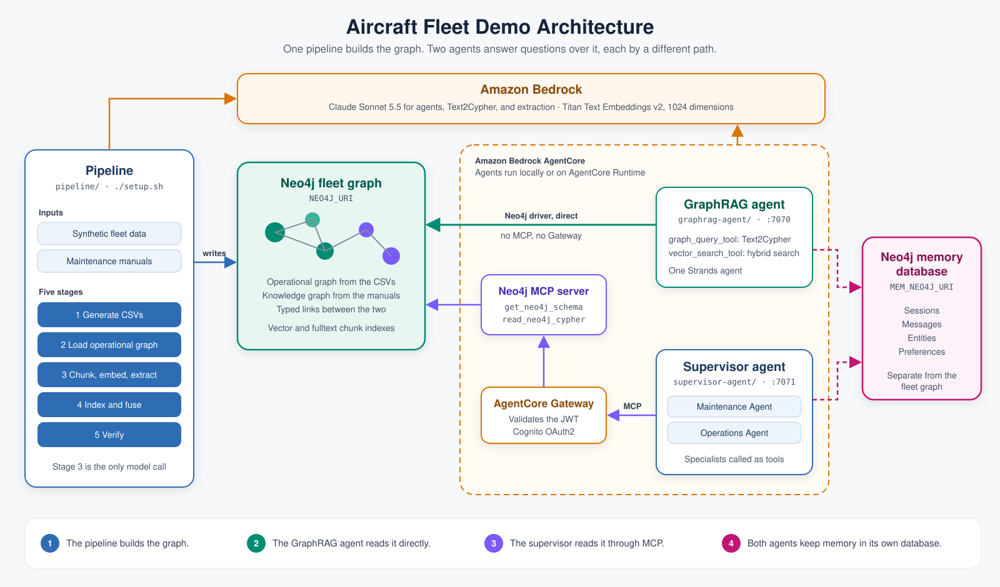
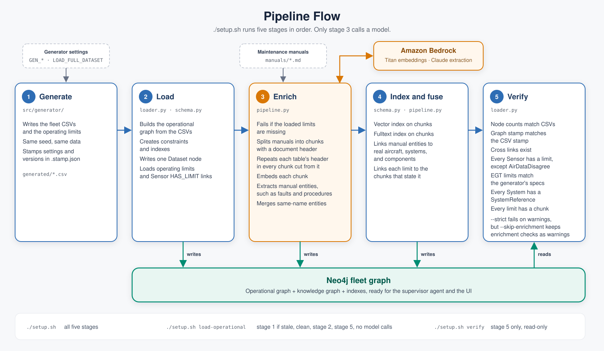
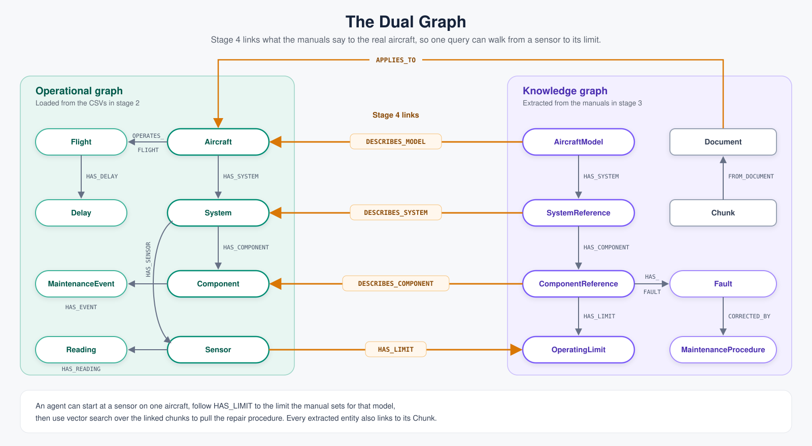

# Aircraft Fleet Demo

This demo builds an aircraft fleet graph in Neo4j and answers questions about
it with AI agents on Amazon Bedrock. One pipeline builds the graph. Two agents
read it in two different ways.



## Overview

- **One graph, two kinds of data:** The graph joins live fleet records with knowledge extracted from maintenance manuals. An agent can move from a sensor on one aircraft to the limit the manual sets for it.
- **One pipeline:** The pipeline generates the fleet data, loads it, enriches it from the manuals with Bedrock, links the two graphs, and verifies the result.
- **Two agents:** The GraphRAG agent reads Neo4j directly with a driver. The supervisor agent reads the same graph through the Neo4j MCP server and AgentCore Gateway.
- **Memory:** Both agents remember each session and what they learn about a user. Memory lives in its own Neo4j database, apart from the fleet graph.
- **AgentCore Runtime:** Both agents run locally for development and deploy to Amazon Bedrock AgentCore Runtime.

## The three projects

### Pipeline

The [`pipeline/`](./pipeline/) project builds the Aircraft Digital Twin graph.

- **Synthetic fleet:** It generates aircraft, systems, components, sensors, hourly readings, flights, delays, and maintenance events from a fixed seed.
- **Manual enrichment:** It chunks the maintenance manuals, embeds each chunk with Bedrock Titan, and extracts faults, procedures, and limits with Bedrock Claude.
- **Graph fusion:** It links the extracted knowledge to the real aircraft, systems, components, and sensors.
- **Indexes:** It creates the vector and fulltext chunk indexes that both agents search.
- **Checks:** It stamps each dataset and verifies node counts and stamps after every load.

### GraphRAG agent

The [`graphrag-agent/`](./graphrag-agent/) project is a single Strands agent.

- **Direct driver:** It connects to Neo4j with the Python driver. It uses no MCP server and no Gateway.
- **Text2Cypher:** The `graph_query` tool writes read-only Cypher from the live schema for exact and aggregate questions.
- **Hybrid search:** The `vector_search` tool combines vector and fulltext search over the manual chunks.
- **Direct modes:** One endpoint also serves the schema and each retriever on its own, which the demo uses to show each part.

### Supervisor agent

The [`supervisor-agent/`](./supervisor-agent/) project is a Strands supervisor with two specialists.

- **Routing:** The supervisor sends each question to the Maintenance Agent, the Operations Agent, or both. It then writes one answer from their results.
- **MCP over the Gateway:** The specialists query Neo4j through the AgentCore Gateway with an OAuth2 token.
- **Recovery:** Each Gateway tool rebuilds its MCP session and retries once when the session drops.
- **Safe errors:** The tools replace raw database errors before the model sees them, so no address leaks into an answer.

## Quick start

Check the [prerequisites](#prerequisites) first. `./setup.sh` needs AWS
credentials with Bedrock access, and the default dataset needs a paid Aura tier
or a local Neo4j.

Run these commands from `demos/aircraft-fleet/`:

```bash
cp .env.sample .env          # set NEO4J_URI, NEO4J_USERNAME, NEO4J_PASSWORD, MEM_NEO4J_URI, MEM_NEO4J_PASSWORD

cd pipeline
uv sync
./setup.sh                   # build the graph

cd ../graphrag-agent
uv sync
uv run fleet-server          # terminal 1: start the agent on port 7070
uv run fleet-cli "How many aircraft are in the database?"   # terminal 2
```

## Prerequisites

- **Neo4j:** You need a Neo4j 5.23 or later database for the fleet graph. Neo4j Aura works well. The default dataset is past the Aura Free limits, so use a paid tier or a local Neo4j.
- **Memory database:** You need a second Neo4j database or instance for agent memory. It can start empty.
- **Read-only user:** The cloud deploys read the fleet graph as a read-only Neo4j user. The [MCP server README](../../neo4j-mcp-server/README.md#use-a-read-only-database-user) shows how to create it, including the extra role Aura Professional needs.
- **AWS:** You need AWS credentials with Bedrock access to Claude and the Titan embedding model.
- **Tools:** You need the [`uv`](https://docs.astral.sh/uv/) package manager and Python 3.12 or later.
- **Deploy tools:** Cloud deploys need the AgentCore CLI, installed with `npm install -g @aws/agentcore`. The agents are tested with version 1.2.0.

## Configure

The pipeline and both agents read one `.env` file in `demos/aircraft-fleet/`.

```bash
cp .env.sample .env
```

- **Fleet graph:** Set `NEO4J_URI`, `NEO4J_USERNAME`, and `NEO4J_PASSWORD`. The pipeline and the GraphRAG agent use them.
- **Memory:** Set `MEM_NEO4J_URI` and `MEM_NEO4J_PASSWORD`. Set `MEM_NEO4J_USERNAME` and `MEM_NEO4J_DATABASE` too if they are not `neo4j`. An agent server stops at startup if the URI or the password is missing.
- **Supervisor graph access:** The supervisor reaches the fleet graph through MCP credentials, not the `NEO4J_*` settings. See Step 4.
- **Another file:** Set `FLEET_ENV_FILE` to load a different file. A value already set in the environment wins.

## Step 1: Build the graph



Run these commands from `demos/aircraft-fleet/pipeline/`:

```bash
uv sync
./setup.sh                   # generate, load, enrich, index and fuse, verify
```

- **Default size:** The default loads 30 aircraft over 90 days, about 800,000 nodes.
- **Full size:** Set `LOAD_FULL_DATASET=true` in `.env` to load 100 aircraft.
- **No model calls:** Run `./setup.sh load-operational` to build only the operational graph. Its final check fails, because that graph has no manual enrichment.

See the [pipeline README](./pipeline/README.md) for each stage and the dual graph.



## Step 2: Run the GraphRAG agent locally

Run these commands from `demos/aircraft-fleet/graphrag-agent/`:

```bash
uv sync
uv run fleet-server          # terminal 1: Ctrl+C stops it
uv run fleet-cli "How many aircraft are in the database?"   # terminal 2
uv run fleet-demo            # terminal 2: the full showcase
```

The agent reads the live graph schema, so it picks up a new graph with no
changes. See the [GraphRAG agent README](./graphrag-agent/README.md) for the
request flow, memory, and troubleshooting.

## Step 3: Deploy the GraphRAG agent (optional)

Run these commands from `demos/aircraft-fleet/graphrag-agent/`:

```bash
./agent.sh deploy
./agent.sh invoke-cloud "How many aircraft are in the database?"
```

- **Settings:** The deploy reads its connection settings from `.env`.
- **Passwords:** The deploy never sends a password. The runtime reads each one from the Secrets Manager secret named by `NEO4J_PASSWORD_SECRET_ARN` and `MEM_NEO4J_PASSWORD_SECRET_ARN`.
- **User names:** A secret with a `username` key also sets the Neo4j user. The shared `.env` can then keep the admin user for the pipeline while the agents read as a read-only user.

See [Deploy](graphrag-agent/README.md#deploy) for the one-time setup, which
creates the two secrets.

## Step 4: Run the supervisor agent over the MCP Gateway (optional)

The supervisor needs a Neo4j MCP server that points at the same `NEO4J_URI`.
The MCP server deploy also needs Docker with buildx, the AWS CDK CLI, and a
local clone of the server source. See the
[MCP server README](../../neo4j-mcp-server/README.md) for these and for how to
create a read-only Neo4j user. Run these commands from the repo root:

```bash
cd neo4j-mcp-server
cp .env.sample .env.fleet    # set the same NEO4J_URI, a read-only NEO4J_USERNAME and NEO4J_PASSWORD, and NEO4J_MCP_REPO
./deploy.py --env fleet
./deploy.py --env fleet credentials
../scripts/sync-credentials.sh   # copies the credentials to demos/aircraft-fleet/.mcp-credentials.json
```

Then run these commands from `demos/aircraft-fleet/supervisor-agent/`:

```bash
uv sync
./agent.sh start             # serves http://localhost:7071
./agent.sh test-maintenance
./agent.sh test-operations
```

See the [supervisor agent README](./supervisor-agent/README.md) for routing,
cloud deployment, and load testing.

## Keep the embedder the same

`vector_search` works only when the agent and the pipeline use the same
embedding model and dimensions.

- **Default:** Both sides use `amazon.titan-embed-text-v2:0` with 1024 dimensions.
- **Changes:** If you change the pipeline embedder, set `EMBED_MODEL_ID` and `EMBED_DIMENSIONS` in `.env` to match.
- **Mismatch:** A mismatch makes vector search return poor results or nothing.

## Diagrams

The diagrams live in [`docs/images/`](./docs/images/) as SVG files.

| Diagram | Shows |
|---------|-------|
| [`architecture.svg`](docs/images/architecture.svg) | The pipeline, both agents, the Gateway path, and the two databases |
| [`pipeline-flow.svg`](docs/images/pipeline-flow.svg) | The five pipeline stages and what each one writes |
| [`dual-graph.svg`](docs/images/dual-graph.svg) | The operational graph, the knowledge graph, and the links between them |
| [`graphrag-request-flow.svg`](docs/images/graphrag-request-flow.svg) | One request through the GraphRAG agent |
| [`supervisor-request-flow.svg`](docs/images/supervisor-request-flow.svg) | One request through the supervisor and the Gateway |
| [`memory-lifecycle.svg`](docs/images/memory-lifecycle.svg) | How both agents open, use, and close conversation memory |
| [`data-model.svg`](docs/images/data-model.svg) | The operational node labels and relationship types |
| [`generator-flow.svg`](docs/images/generator-flow.svg) | The six data generator stages, atomic publish, and the output checks |
| [`supervisor-routing-auth.svg`](docs/images/supervisor-routing-auth.svg) | Supervisor routing and the two Gateway token paths |
| [`end-to-end-sequence.svg`](docs/images/end-to-end-sequence.svg) | One supervisor question through a specialist and the Gateway |
| [`deployment-topology.svg`](docs/images/deployment-topology.svg) | The deploy steps, the three stacks, and the two databases |

## More detail

- **Architecture:** The [fleet architecture document](./docs/ARCHITECTURE.md) explains how the parts fit together. Each part has its own document: [pipeline](./docs/architecture/pipeline.md), [GraphRAG agent](./docs/architecture/graphrag-agent.md), [supervisor agent](./docs/architecture/supervisor-agent.md), [memory](./docs/architecture/memory.md), and [deployment](./docs/architecture/deployment.md).
- **Pipeline:** The [pipeline README](./pipeline/README.md) covers the stages, Bedrock structured output, and dataset sizes.
- **GraphRAG agent:** The [GraphRAG agent README](./graphrag-agent/README.md) covers the tools, memory, local and cloud runs, and troubleshooting.
- **Supervisor agent:** The [supervisor agent README](./supervisor-agent/README.md) covers routing, Gateway recovery, and cloud deployment.
- **Test plan:** The [end-to-end test plan](./docs/e2e-test-plan.md) holds the test steps and the last recorded run.
