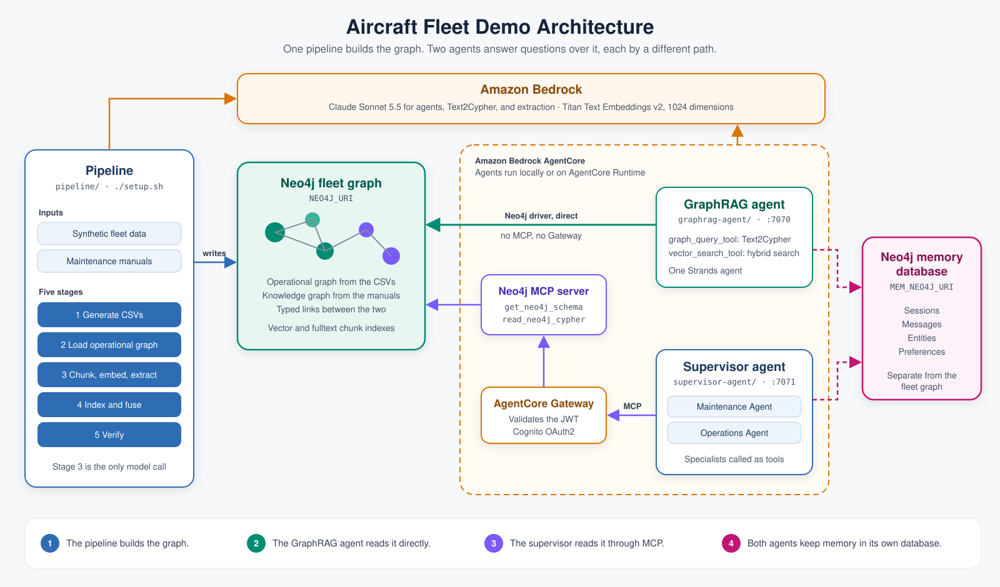

# Aircraft Fleet Architecture

A maintenance question about one aircraft needs three things at once. It needs
the sensor history of that aircraft, the faults logged against its parts, and
the limit that the maintenance manual sets for each sensor. The fleet records
live in rows and the limits live in prose. This demo puts both into one Neo4j
graph, links them, and answers questions over that graph with two agents that
reach it in two different ways.

## Components

- **Pipeline:** The [`pipeline/`](../pipeline/) project builds the fleet graph in five stages. It generates a synthetic fleet, loads it, extracts knowledge from the manuals with Bedrock, links the two graphs, and verifies the result. It is the only component that writes the fleet graph.
- **GraphRAG agent:** The `graphrag-agent/` project is one Strands agent with two retrieval tools. One tool writes Cypher from the live schema. The other runs hybrid search over the manual chunks.
- **Supervisor agent:** The [`supervisor-agent/`](../supervisor-agent/) project is a Strands supervisor with two specialist agents as its tools. The specialists query the graph through the Neo4j MCP server.
- **Neo4j MCP server:** The `fleet` deployment of [`neo4j-mcp-server/`](../../../neo4j-mcp-server/) runs `mcp-neo4j-cypher` read-only on AgentCore Runtime behind an AgentCore Gateway.
- **Memory:** Both agents keep conversation memory with Neo4j Agent Memory in a second Neo4j database.

## Two access paths to one graph

The two agents answer the same questions over the same graph. They differ in
how they reach it.

| | GraphRAG agent | Supervisor agent |
|---|---|---|
| Reaches Neo4j through | The Neo4j Python driver over Bolt | The AgentCore Gateway and the MCP server |
| Credentials | The fleet graph password | A Cognito M2M token for the Gateway |
| Query tools | Text2Cypher and hybrid vector search | `get_neo4j_schema` and `read_neo4j_cypher` |
| Read-only by | An `EXPLAIN` check on each generated query | `NEO4J_READ_ONLY=true` on the MCP server |
| Local port | 7070 | 7071 |

The direct path gives the agent the full `neo4j-graphrag` retrievers,
including hybrid search, at the cost of holding a database password. The MCP
path keeps the password inside the MCP server and gives every client one
authenticated endpoint. The supervisor then has only the two MCP tools, so it
has no vector search over the manual chunks.

## Two databases

- **Fleet graph:** The fleet graph holds the operational graph from the generated CSVs and the knowledge graph extracted from the manuals. The pipeline writes it. Both agents only read it.
- **Memory database:** The memory database holds sessions, messages, extracted entities, and user preferences for both agents. It stays apart from the fleet graph, because memory labels in the fleet graph would reach the Text2Cypher schema prompt.

## Models

| Model | Used by |
|-------|---------|
| Claude Sonnet 5.5, `global.anthropic.claude-sonnet-5-5` | Pipeline extraction, both agent loops, Text2Cypher, and memory extraction |
| Amazon Titan Text Embeddings v2, 1024 dimensions | Chunk embeddings, query embeddings, and memory embeddings |

The pipeline and the GraphRAG agent must use the same embedder. A mismatch
makes vector search return poor results or nothing.

## Detail by part

| Document | Covers |
|----------|--------|
| [Pipeline](architecture/pipeline.md) | The generator, the data model, manual enrichment, fusion, indexes, and verify |
| [GraphRAG agent](architecture/graphrag-agent.md) | The two tools, the schema cache, the read-only guard, direct modes, and streaming |
| [Supervisor agent](architecture/supervisor-agent.md) | Routing, specialists, the Gateway client, the two token paths, and error handling |
| [Memory](architecture/memory.md) | Shared clients, per-request managers, deferred extraction, the retrieval threshold, and shutdown |
| [Deployment](architecture/deployment.md) | The three stacks, secrets, the MCP server deployment, credential sync, and teardown |

## Diagrams

All diagrams are SVG files in [`images/`](images/).

| Diagram | Shows |
|---------|-------|
| [`architecture.svg`](images/architecture.svg) | The pipeline, both agents, the Gateway path, and the two databases |
| [`pipeline-flow.svg`](images/pipeline-flow.svg) | The five pipeline stages and what each one writes |
| [`generator-flow.svg`](images/generator-flow.svg) | How `generate-data` builds one dataset from one seed |
| [`data-model.svg`](images/data-model.svg) | The operational graph's labels and relationships |
| [`dual-graph.svg`](images/dual-graph.svg) | The operational graph, the knowledge graph, and the links between them |
| [`graphrag-request-flow.svg`](images/graphrag-request-flow.svg) | One request through the GraphRAG agent |
| [`supervisor-request-flow.svg`](images/supervisor-request-flow.svg) | One request through the supervisor and the Gateway |
| [`supervisor-routing-auth.svg`](images/supervisor-routing-auth.svg) | Supervisor routing and the local and cloud Gateway token paths |
| [`end-to-end-sequence.svg`](images/end-to-end-sequence.svg) | One supervisor question through a specialist, the Gateway, and the MCP server |
| [`memory-lifecycle.svg`](images/memory-lifecycle.svg) | How both agents open, use, and close conversation memory |
| [`deployment-topology.svg`](images/deployment-topology.svg) | The three stacks, the AWS services, and the two Neo4j databases |
