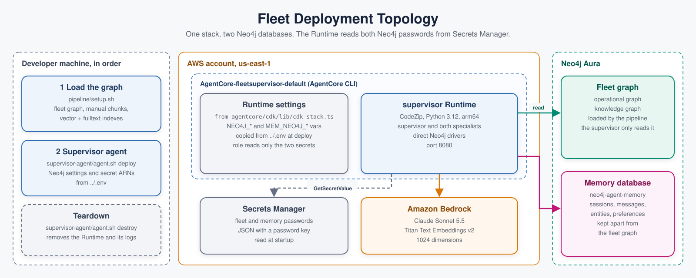

# Deployment Architecture

The fleet demo deploys one CloudFormation stack into one AWS account and
reads two Neo4j databases outside it. The supervisor needs the fleet graph
loaded before it can answer. The Runtime reads both Neo4j passwords from
Secrets Manager, so no password appears in a template, an environment
variable, or a deployment package.

| Stack | Deployed by | Holds |
|-------|-------------|-------|
| `AgentCore-fleetsupervisor-default` | `supervisor-agent/agent.sh deploy` | The `supervisor` Runtime and its role |

The deploy runs in this order.

1. **Load the graph:** `pipeline/setup.sh` builds the fleet graph and the chunk indexes. [Pipeline](pipeline.md) covers the stages.
2. **Create the read-only user:** An admin creates `fleet_reader` on the fleet database, with the `reader` role and, on Aura, the `graphql_app_read_only_<AURA_ID>` role.
3. **Create the secrets:** `uv run fleet-supervisor-secrets` creates `fleet/neo4j-reader` and `fleet/memory-neo4j` and prints their two ARN lines. Add both lines to the shared `.env`.
4. **Deploy the supervisor:** `supervisor-agent/agent.sh deploy` deploys its Runtime.

The [supervisor README](../../supervisor-agent/README.md#create-the-secrets)
covers steps 2 and 3.

## The supervisor Runtime

`supervisor-agent/agent.sh deploy` wraps the AgentCore CLI. The project in
`agentcore/agentcore.json` is `fleetsupervisor`, with one runtime,
`supervisor`.

- **Package:** The Runtime is a CodeZip on Python 3.12 for arm64, with `main.py` as the entrypoint on port 8080.
- **Settings:** The deploy reads the Neo4j URIs, user names, and database names from the shared `../.env` and passes them to the Runtime. Synth refuses a URI that does not use `neo4j+s://` or `bolt+s://`.
- **Secrets:** `NEO4J_PASSWORD_SECRET_ARN` and `MEM_NEO4J_PASSWORD_SECRET_ARN` name the fleet and memory secrets. Each secret is a JSON object with a `password` key and an optional `username` key. The Runtime reads each secret once per process. When Neo4j rejects the memory password, the same request reads the memory secret again and builds once more.
- **User names:** A secret's `username` key replaces `NEO4J_USERNAME` or `MEM_NEO4J_USERNAME`. The shared `.env` names the admin user the pipeline writes as, and the fleet secret names the read-only user the Runtime reads as.
- **IAM:** The CDK stack grants `secretsmanager:GetSecretValue` on exactly those two ARNs and checks that each is a complete secret ARN. It grants no `kms:Decrypt`, so the secrets must use the AWS managed key.
- **Secret guard:** The deploy refuses to run when a `.env*`, `.mcp-credentials*.json`, `.agentcore.json`, `credentials*.json`, or `*.pem` file or a `venv/` folder sits in the agent folder, because the CodeZip would ship it.

## Runtime start and TLS

The Runtime starts Python under `opentelemetry-instrument`, which imports
botocore and urllib3 before `main.py` runs. The agent injects `truststore`
only when urllib3, botocore, requests, httpx, and neo4j are not yet imported.
In the Runtime they are, so the agent logs "Skipping truststore". TLS then
falls back to each library's default CA store. Botocore and httpx use the
certifi bundle, and the neo4j driver loads the system CAs. To catch an
import-order failure before a deploy, run the local start check in the
[supervisor README](../../supervisor-agent/README.md#check-the-runtime-start-locally).

## Teardown

Teardown runs in reverse order.

- **Supervisor:** `supervisor-agent/agent.sh destroy` removes the Runtime, its stack, and its log groups. It checks the account first and fails while the stack still exists. `--yes` skips the prompt.
- **Secrets and user:** Destroy leaves the two secrets and the `fleet_reader` user in place. The [supervisor README](../../supervisor-agent/README.md#remove-the-secrets-and-the-reader) shows how to remove them.

The Neo4j databases live outside the account, so teardown leaves the fleet
graph and the memory graph in place.
