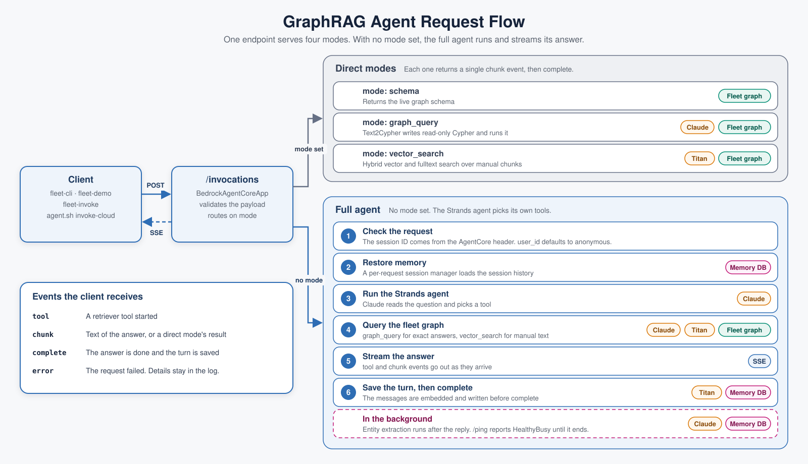

# GraphRAG Agent Architecture

Fleet questions come in two shapes. "How many CRITICAL events did the A320
fleet log last month?" is a count over typed nodes, and only Cypher answers it
exactly. "What does the manual say about high EGT on the CFM56?" is a search
over prose, where the wording in the question rarely matches the wording in
the manual. The GraphRAG agent in [`graphrag-agent/`](../../graphrag-agent/)
is one Strands agent with one tool for each shape. It reaches Neo4j with the
Neo4j Python driver over Bolt and uses neither the MCP server nor the Gateway.

## The two tools

The model picks a tool from the two tool descriptions. Each description names
the other tool for the questions it does not handle, so the choice follows the
question's shape.

- **Graph query:** `graph_query_tool(question)` answers exact lookups, counts, aggregations, and traversals. It hands the question to a Text2Cypher retriever from `neo4j-graphrag`, which asks Claude Sonnet 5.5 for Cypher against the live schema and runs it.
- **Vector search:** `vector_search_tool(query, top_k=5)` answers descriptive questions over the manual chunks. `top_k` runs from 1 to 20.

### Hybrid search

The vector search tool uses `HybridCypherRetriever` over two indexes that the
pipeline builds on `Chunk` nodes. The `maintenanceChunkEmbeddings` vector index
matches meaning. The `maintenanceChunkText` fulltext index matches exact terms
such as part numbers and sensor names, which embeddings tend to blur.

The fulltext index parses its input as Lucene syntax, and a question such as
"Is A320-200 EGT/N1 OK?" contains Lucene operators. `fulltext_query()` reduces
the text to lowercase word tokens before the search, so no question can break
the query. The vector side embeds the original question with Titan Text
Embeddings v2. That embedder must match the one the pipeline used.

Each hit then runs `CHUNK_RETRIEVAL_QUERY`. The query follows `FROM_DOCUMENT`
to the source manual and `FROM_CHUNK` back to the entities extracted from the
chunk, at most 10 per chunk. The tool result starts each chunk with its
document ID, aircraft type, and chunk number, followed by those entities. The
model can cite the source and see which faults or limits the chunk mentions.

## Schema in the prompt

The agent puts the live Neo4j schema in its system prompt, so the model knows
the labels and relationship types before it writes a question for the graph
query tool. The schema is cached for 600 seconds, and `SCHEMA_TTL_S` changes
that. The TTL lets a running server pick up a pipeline reload without a
restart. The graph query tool passes the current cached schema on every call,
so a refresh reaches the Cypher prompt without rebuilding the retriever. The
Bedrock prompt cache misses once after each refresh, because the system prompt
changes.

## The read-only guard

The model writes the Cypher, so one bad query could write to the graph, scan
the whole graph, or return millions of rows. `BoundedText2CypherRetriever` in
`text2cypher.py` closes all three.

1. **Plan first:** The retriever runs `EXPLAIN` on the generated query. `EXPLAIN` plans the query without running it. The retriever refuses any query whose `query_type` is not `READ_ONLY_QUERY_TYPE`.
2. **Time limit:** Both the `EXPLAIN` and the real query run as a `neo4j.Query` with a server-side transaction timeout of 30 seconds. `TEXT2CYPHER_TIMEOUT_S` changes it.
3. **Row cap:** The retriever fetches `max_rows + 1` records and keeps `max_rows`. The default cap is 200, and `TEXT2CYPHER_MAX_ROWS` changes it. When the extra row arrives, the tool tells the model it saw only the first rows and should aggregate or filter.

Both queries use read routing. The class copies one method from
`neo4j-graphrag` 1.24.0 and changes only the timeouts and the bounded fetch. A
test fails if the upstream signature changes.

## Errors the model sees

Strands sends a tool's exception text to the model, and a driver message can
name the server address. The tools replace that text with fixed results and
log the details.

| Failure | Result the model gets |
|---------|-----------------------|
| The generated Cypher fails | The Neo4j message, cut to 500 characters, with a request to rephrase |
| The transaction times out | The query took too long, with a hint to narrow the question |
| Neo4j is unreachable | The graph database is unavailable right now |
| Any other Neo4j error | The graph database returned an error |
| Any other failure, such as a Bedrock error | The query or search could not be run |

A failed Cypher query keeps its message because the model can use it to fix
the next attempt. The other failures carry nothing the model can act on.

## Direct modes

The runtime serves four surfaces from one `/invocations` endpoint. An optional
`mode` field in the payload picks one.

| Payload | Runs |
|---------|------|
| `{"mode": "schema"}` | Returns the cached schema string |
| `{"mode": "graph_query", "query": "..."}` | Runs Text2Cypher once, with no agent loop |
| `{"mode": "vector_search", "query": "...", "top_k": N}` | Runs the hybrid search once |
| No `mode`, or `{"prompt": "..."}` | Runs the full agent and streams its answer |

The direct modes test one retriever without the model's tool choice in the
way. They never open memory, so they keep working while the memory database is
down.

## Streaming

The server is a `BedrockAgentCoreApp`. It streams server-sent events of four
types.

- **`tool`:** The server emits one `tool` event when the agent calls a tool. Strands repeats a tool call on every input delta while the call is being assembled, so the server emits each `toolUseId` once.
- **`chunk`:** A `chunk` event carries answer text. A direct mode emits one `chunk` with its whole result.
- **`complete`:** The `complete` event ends a successful stream.
- **`error`:** An `error` event carries a generic message. The details go to the server log.

The direct modes emit one `chunk` and then `complete`, so the same client
parser handles every mode.

## Memory per request

The first agent request opens the process's shared memory. Each request then
builds its own memory manager and agent, and closes the agent stream before the
manager. A client disconnect cancels the request, but the build keeps running
in its thread until the cleanup can close it. [Memory](memory.md) covers the
lifecycle.

## Runtime

| Setting | Value |
|---------|-------|
| Model | Claude Sonnet 5.5, `MAX_TOKENS` 64000, effort medium |
| Prompt caching | `CacheConfig(strategy="auto")` on the system prompt and tool specs |
| Local server | `uv run fleet-server` on port 7070 |
| Cloud runtime | `graphrag_agent` on AgentCore Runtime, port 8080 |
| Secrets | The fleet and memory passwords, and optional user names, come from Secrets Manager on the Runtime |
| Tracing | AWS Distro for OpenTelemetry |

[Deployment](deployment.md) covers the Runtime deploy and the secret ARNs. The
[GraphRAG agent README](../../graphrag-agent/README.md) has the full command
list.
