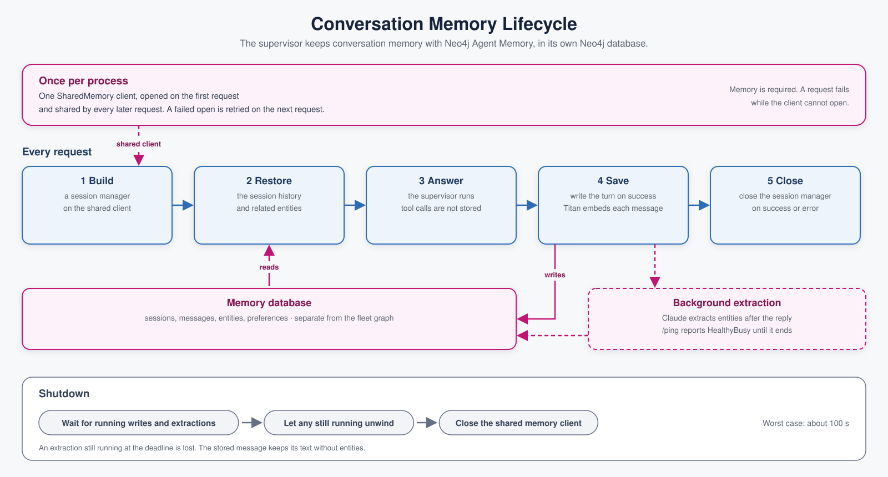

# Memory Architecture

An engineer who asks about tail N12345 and then asks "what about its
hydraulics?" expects the agent to remember the tail. An engineer who said last
week that they track the A320 fleet expects that preference to carry over.
Both fleet agents keep that memory with Neo4j Agent Memory, in a Neo4j database
of its own. The memory graph stays apart from the fleet graph, because memory
labels in the fleet graph would reach the Text2Cypher schema prompt and the
MCP server's `get_neo4j_schema` result.

## What memory holds

- **Short-term memory:** The memory database stores each session's messages. A request with a known session ID restores that history into the new agent.
- **Long-term memory:** The library extracts entities and preferences from each message and links them to the user. Later sessions for the same user can retrieve them.
- **Session and user:** The session ID comes from the AgentCore session header. A local call without the header gets a fresh ID. The user ID comes from the payload and defaults to `anonymous`.

Before each user message reaches the model, the session manager searches the
user's long-term entities and preferences. It prepends the hits above the
retrieval threshold in a `<user_context>` block. The stored message is always
the user's original text.

## One client per process, one manager per request

Opening a Neo4j driver and an extraction pipeline for every request would
cost more than most answers. Sharing one session manager across requests would
mix sessions. The agents split the two.

- **SharedMemory:** Each process opens one `SharedMemory` on the first request that needs it. It holds the memory client and the event-loop thread that every manager runs on. A failed open is not kept, so the next request tries again.
- **Per-request manager:** Each agent request builds its own `Neo4jSessionManager` on the shared client with `extract_entities=True`, `record_tool_calls=False`, and `defer_extraction=True`.
- **Close order:** The server closes the agent stream first. Strands then runs its `AfterInvocationEvent` hooks, which flush the turn, and only then does the server close the manager. A manager closed first would drop the flush.

The GraphRAG agent's direct modes never open memory. They keep working while
the memory database is down.

## Writes per turn

The session manager buffers a turn's messages from `BeforeInvocationEvent` to
`AfterInvocationEvent`. A turn that succeeds is written in order. A turn that
raises or is cancelled is discarded with an INFO log. The graph never holds a
prompt without its reply, so a later session never restores a question that
looks unanswered. A process that stops in the middle of a turn loses that
turn.

## Deferred extraction

Entity extraction calls Claude Sonnet 5.5 for every message, and the answer
should not wait for it. With `defer_extraction=True`, the drain writes each
message and starts its extraction in the background. The extractions of one
session run one at a time, in write order.

Background work needs the Runtime to keep the session alive. `SharedMemory`
calls a hook each time a deferred extraction starts, and the server turns that
into `app.add_async_task`. While a task is open, `/ping` reports
`HealthyBusy`, so AgentCore Runtime does not stop the session in the middle of
an extraction.

| Setting | Value |
|---------|-------|
| Extraction model | `bedrock/global.anthropic.claude-sonnet-5-5`, built with `send_temperature=False` and `tool_choice="auto"` |
| Embeddings | `bedrock/amazon.titan-embed-text-v2:0` at 1024 dimensions |
| Configuration | The `MEM_NEO4J_*` variables in the shared `.env` |

Sonnet 5.5 rejects a temperature and a forced `toolChoice`, so the extractor
sends neither.

## The retrieval threshold

Both agents set `RETRIEVAL_MIN_SCORE = 0.675`. The score is Neo4j's cosine
vector score, `(1 + cosine) / 2`, so 0.675 is a cosine of 0.35.

The value comes from a measurement on 2026-11-21 with Titan v2 entity
embeddings from real Sonnet 5.5 extraction.

| Threshold | Relevant hits kept, of 15 | Unrelated pairs let through, of 417 |
|-----------|---------------------------|-------------------------------------|
| 0.675 | 10 | 3 |
| 0.75 | 6 | Not recorded |

An entity embeds only its name. A short name such as an airport code scores
low against a full question, so a higher threshold drops exactly the entities
a follow-up question needs. The cost of 0.675 is a few unrelated entities in
the context block. The model can ignore those, but it cannot recover a dropped
one.

## Password failures

The two agents treat a rejected memory password differently.

- **GraphRAG agent:** The process keeps the rejection until restart. The settings are read once, so a retry would send the same wrong password and could trigger an account lockout.
- **Supervisor agent:** A rejected password retires the client and drops the settings. The next request reads the secret again and opens a new client. The retired client closes on a background thread after its last session ends, so no request waits for it.

## Shutdown

At shutdown, the server's lifespan closes the shared memory. No request opens
memory after shutdown starts. `SharedMemory.close()` waits for the deferred
extractions, so the last answers still get their entities.

- **GraphRAG agent:** The close waits up to 30 seconds for extractions, gives cancelled tasks 5 seconds to unwind, and closes the driver within its 30-second request timeout. That is about 65 seconds, or about 95 seconds when a memory open is still in flight.
- **Supervisor agent:** The close first waits up to 30 seconds for open sessions, then closes every client in parallel. It returns within about 100 seconds and logs any close still running.

## The library pin

Both agents pin `neo4j-agent-memory[strands]==0.8.0+fleet.8`. It is a wheel
from the `neo4j-partners/agent-memory` releases, and `uv.lock` records its
sha256. The agents use `SharedMemory`, deferred extraction, the background
hook, and the per-turn discard from that build. Changing the pin means
checking those four behaviors again.
