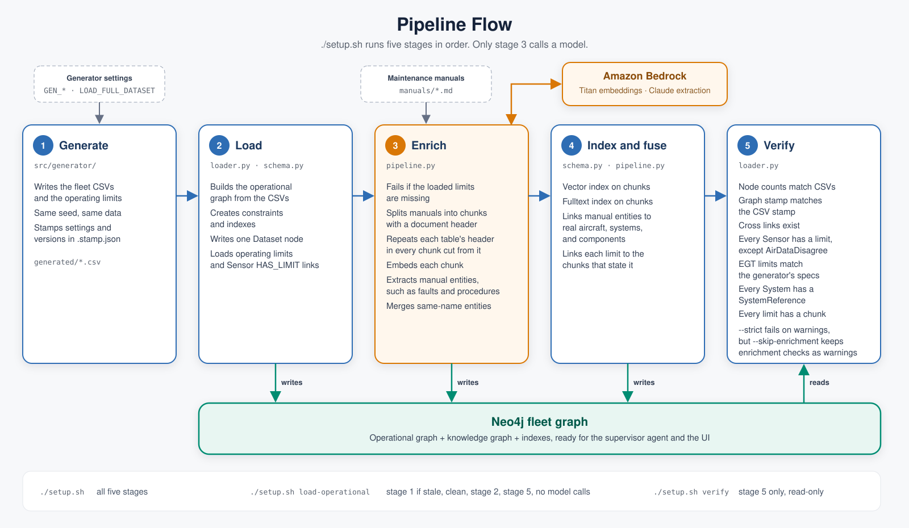
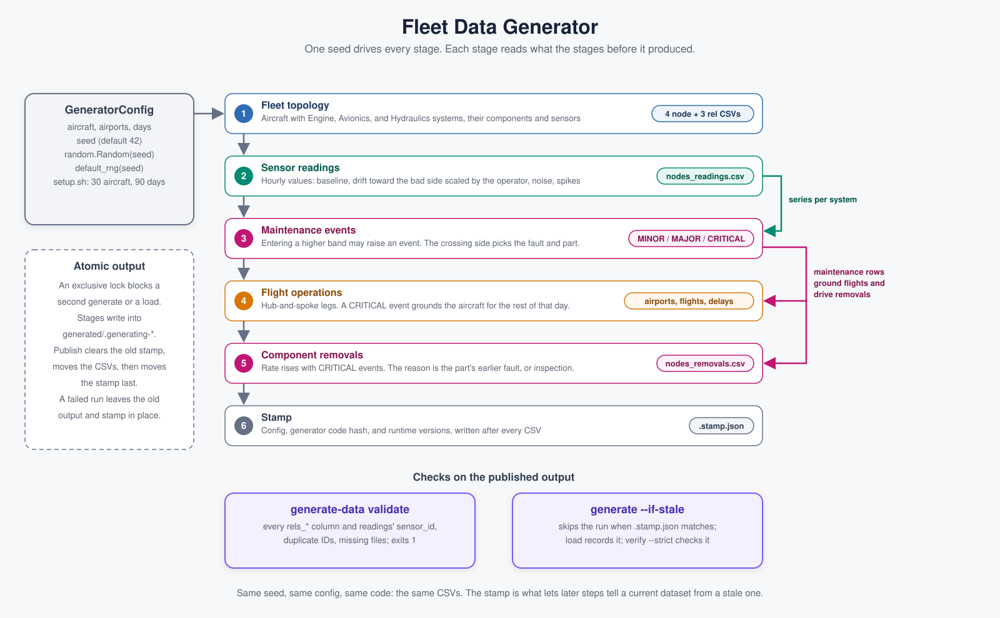
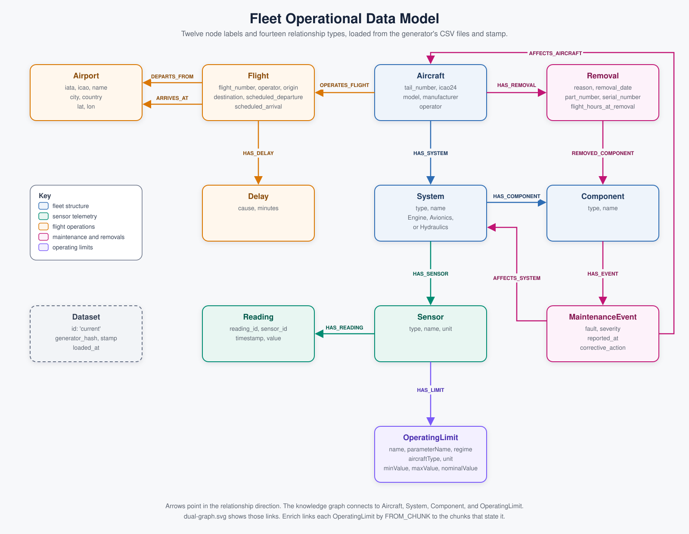
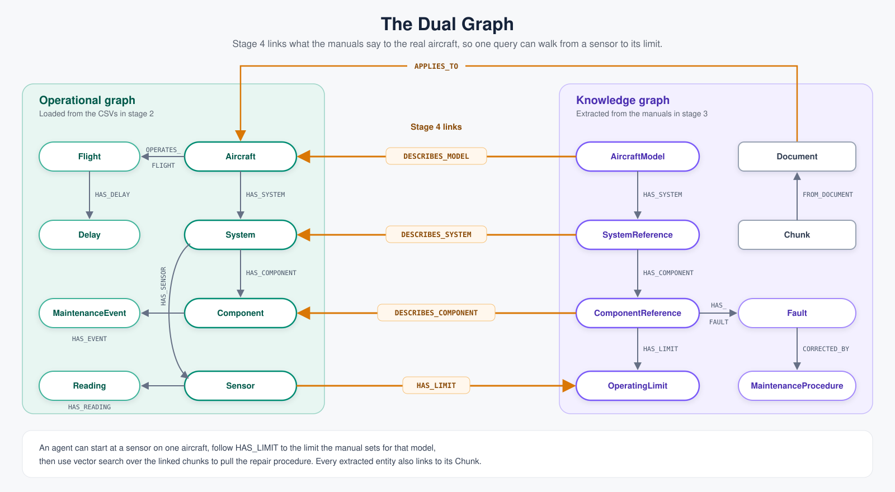

# Pipeline Architecture

The pipeline builds the fleet graph that the supervisor agent reads. It joins two kinds
of data that never share a table: generated fleet records with tail numbers,
and maintenance manuals that describe each aircraft model in prose. The graph
is useful only when an agent can move from a sensor on one aircraft to the
limits the manual sets for that sensor, so the pipeline's last real job is to
link the two.

| Stage | Code | Writes |
|-------|------|--------|
| 1. Generate | `src/generator/` | CSVs and `.stamp.json` in `generated/` |
| 2. Load | `loader.py`, `schema.py` | The operational graph, one `Dataset` node, constraints, and indexes |
| 3. Enrich | `pipeline.py` | `Document` and `Chunk` nodes with embeddings, and the extracted entities |
| 4. Index and fuse | `schema.py`, `pipeline.py` | The chunk vector and fulltext indexes, and the links between the two graphs |
| 5. Verify | `loader.py`, `pipeline.py` | A pass or fail report |

`./setup.sh` runs all five. Only stage 3 calls a model.
`./setup.sh load-operational` builds the operational graph with no Bedrock
access. It clears the database first, so there is no enrichment to relink.
Its final check is `verify --strict --skip-enrichment`. The missing documents,
chunks, and limits print as warnings, and an operational problem still fails
the run. `uv run populate-aircraft-db load-operational` skips the
clear and relinks the enrichment an earlier full run left in the database.

## Generator

`generate-data generate` builds the whole fleet from one `GeneratorConfig`.
The config holds the aircraft count, the airport count, the day count, and the
seed. The command defaults are 100 aircraft, 40 airports, 90 days, and seed
42. `setup.sh` uses 30 aircraft unless `LOAD_FULL_DATASET=true`. The seed
feeds one `random.Random` and one NumPy `default_rng`, so the same seed,
config, and code give the same CSVs.

The stages run in order, and each reads what the earlier stages produced.

1. **Fleet topology:** The generator creates aircraft with Engine, Avionics, and Hydraulics systems, then their components and sensors.
2. **Sensor readings:** Each sensor gets hourly values. A value is a baseline plus a drift toward the bad side, scaled by the operator, plus noise and occasional spikes.
3. **Maintenance events:** A reading that enters a higher band may raise an event. The side of the band it crossed picks the fault and the part. Severity is MINOR, MAJOR, or CRITICAL.
4. **Flight operations:** The generator schedules hub-and-spoke legs between airports, with delays. A CRITICAL event grounds its aircraft from the report hour to the end of that day, so those legs never appear.
5. **Component removals:** The removal rate rises with CRITICAL events. Each removal names a reason. The reason is the fault of the event that caused it, or a fault that can hit the part's type when the removal comes from an inspection.
6. **Stamp:** The stamp records the config, a hash of the generator code, and the Python, Faker, and NumPy versions.

### Atomic output and staleness

The generator writes into a `generated/.generating-*` temp directory under an
exclusive `.generate.lock`. Publish clears the old stamp, moves the CSVs, and
moves the new stamp last. A run that stops before the move keeps the previous
CSVs and stamp. A run that stops during the move leaves no stamp, so the next
load regenerates.

The stamp is how later steps tell a current dataset from a stale one.

- **Skip when current:** `generate --if-stale` skips the run when the stamp matches the config, the code hash, and the runtime versions. `./setup.sh load` uses it.
- **Recorded in the graph:** The loader copies the stamp onto `Dataset {id: 'current'}`.
- **Checked by verify:** `verify` reports a stamp that no longer matches the code, and a `Dataset` node that no longer matches the CSVs. `verify --strict` exits 1 on either.
- **Reference checks:** `generate-data validate` checks every `rels_*` reference column and each reading's `sensor_id` against the node files. It also reports duplicate IDs, missing files, and missing columns, and exits 1 on any of them.

## Operational data model

The loader reads the CSVs in batches and writes the operational graph with
batched `UNWIND` queries. Each `Aircraft` has systems through `HAS_SYSTEM`.
Each system has components through `HAS_COMPONENT` and sensors through
`HAS_SENSOR`. Each sensor has hourly `Reading` nodes.
Maintenance events hang off the component they affect, and each one also
points at its system and aircraft through `AFFECTS_SYSTEM` and
`AFFECTS_AIRCRAFT`. Those two shortcuts let a query count faults per aircraft
or per system without walking the whole structure. Flights connect aircraft to
airports and carry delays. Removals connect an aircraft to the component that
came off.

The pipeline also creates the uniqueness constraints and lookup indexes for
these labels. It also creates four fulltext indexes for sample queries:
`maintenance_search`, `delay_search`, `component_search`, and
`document_search`. One `Dataset` node holds the stamp for verify.

## Manual enrichment

Stage 3 turns each maintenance manual into a lexical graph and a set of
extracted entities with `neo4j-graphrag`'s `SimpleKGPipeline`.

- **Chunks:** `ContextPrependingSplitter` wraps `FixedSizeSplitter` with 800-character chunks and a 100-character overlap. It puts a `[DOCUMENT CONTEXT]` header with the aircraft type and title in front of every chunk. The header also names the manual section the chunk starts in, except in a manual's first chunk, which starts before any section heading. `SimpleKGPipeline` passes document metadata only to the lexical graph builder, so the header is the only place the extractor sees the airframe model. Chunks deep in an engine section often name only the engine. A chunk that starts inside a markdown table also gets the table's header row and separator, so its values keep their column names.
- **Embeddings:** Titan Text Embeddings v2 embeds each chunk at 1024 dimensions.
- **Extraction:** Claude Sonnet 5.5 extracts `AircraftModel`, `SystemReference`, `ComponentReference`, `Fault`, `MaintenanceProcedure`, and `OperatingLimit` entities. Entity names include the aircraft type, so entity resolution stays inside one model and each model keeps its own limits.
- **Operating limits:** Each `OperatingLimit` has a `regime` from a closed list of 15 in `schema.OPERATING_LIMIT_REGIMES`. Rule 8 of `EXTRACTION_PROMPT` takes the hard limits for Takeoff, Max Continuous, and Start only from the Maximum column of a manual's Operating Limits table. It gives a value from the Normal Operating Parameters table a `<regime> Normal` regime, such as `Takeoff Normal`.

### Structured output on Bedrock

The `neo4j-graphrag` extractor asks its LLM for JSON that matches a schema
through `response_format`. `StructuredBedrockLLM` in `bedrock_structured.py`
answers that request through Bedrock Converse tool use. It declares the target
schema as a tool and offers it with `toolChoice` set to `auto`. Sonnet 5.5
rejects a forced tool choice. If the reply has no tool call, or its tool
arguments fail validation against the `response_format` model, the call is
retried once. The tool input is the structured result. The class is a small `BedrockLLM` subclass that
works in any Bedrock and `neo4j-graphrag` pipeline.

## Fusion and indexes

Stage 4 creates the chunk indexes and then links the knowledge graph to the
operational graph with `link_to_existing_graph()`.

| Relationship | Meaning |
|--------------|---------|
| `Document -[:APPLIES_TO]-> Aircraft` | A manual covers every aircraft of its model. |
| `AircraftModel -[:DESCRIBES_MODEL]-> Aircraft` | A model entity links to each aircraft of that model. |
| `SystemReference -[:DESCRIBES_SYSTEM]-> System` | A system in the manual links to the real system. |
| `ComponentReference -[:DESCRIBES_COMPONENT]-> Component` | A component in the manual links to the installed component. |
| `Sensor -[:HAS_LIMIT]-> OperatingLimit` | A live sensor links to each limit the manual defines for its sensor type and model. Each limit covers one regime. |

- **Vector index:** `maintenanceChunkEmbeddings` covers `Chunk` embeddings with cosine similarity at the configured dimension.
- **Fulltext index:** `maintenanceChunkText` covers `Chunk` text. The Maintenance specialist's hybrid search uses both indexes.
- **Empty limits:** `link_to_existing_graph()` deletes each `OperatingLimit` that has no `minValue` and no `maxValue`. It does this before it writes `HAS_LIMIT`.

With the links in place, one query can start at a reading on one aircraft,
step to its sensor, follow `HAS_LIMIT` to the manual's operating limits for
each regime, and reach the chunks that describe the repair.

## Verify

Stage 5 reads the graph and prints a report of warnings and failures.

- **Counts:** Each operational label's node count must match its CSV row count.
- **Stamp:** The `Dataset` node must match the CSVs, and the stamp must match the current code.
- **Schema:** The constraints and the two chunk indexes must exist.
- **Embeddings:** Every chunk must have an embedding of the configured dimension.
- **Search:** A vector search smoke test must succeed.
- **Cross links:** The `APPLIES_TO`, `DESCRIBES_MODEL`, `DESCRIBES_SYSTEM`, `DESCRIBES_COMPONENT`, and `HAS_LIMIT` links must each exist. The `HAS_LIMIT` count includes only the links from a `Sensor` to an `OperatingLimit`.
- **Sensor limits:** Every `Sensor` must have a `HAS_LIMIT` link to an `OperatingLimit`. `AirDataDisagree` sensors are exempt, because the manuals list them only in the sensor inventory. A failure gives the unlinked count for each sensor type.
- **EGT limits:** Each aircraft type needs an EGT limit for each regime that the generator's `ENGINE_SPECS` gives a maximum. Those regimes are Takeoff, Max Continuous, and Start when the spec has a start maximum. Each `maxValue` must equal the generator's maximum. An EGT limit for a regime with no generator maximum fails, such as an A320-200 Start limit.
- **Orphans:** Readings without a sensor, flights without an aircraft, components without a system, sensors without readings, documents without chunks, and systems without a `SystemReference` must all be zero.

`./setup.sh` runs `verify --strict`. Strict mode fails on warnings and exits
nonzero, so the same check works in CI. The one exception is
`--skip-enrichment`, which keeps the enrichment checks as warnings.

`verify --strict --skip-enrichment` keeps the counts, stamp, CSV comparison,
operational constraints, and operational orphans as failures. It reports the
embeddings, chunk indexes, search test, extracted-entity constraints, cross
links, sensor limits, EGT limits, documents without chunks, and systems without a
`SystemReference` as warnings. `./setup.sh load-operational`
uses it, because that graph has no enrichment.
