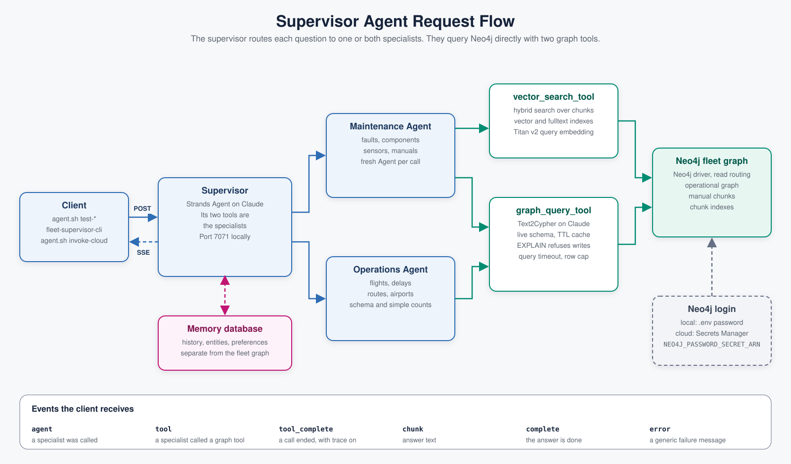
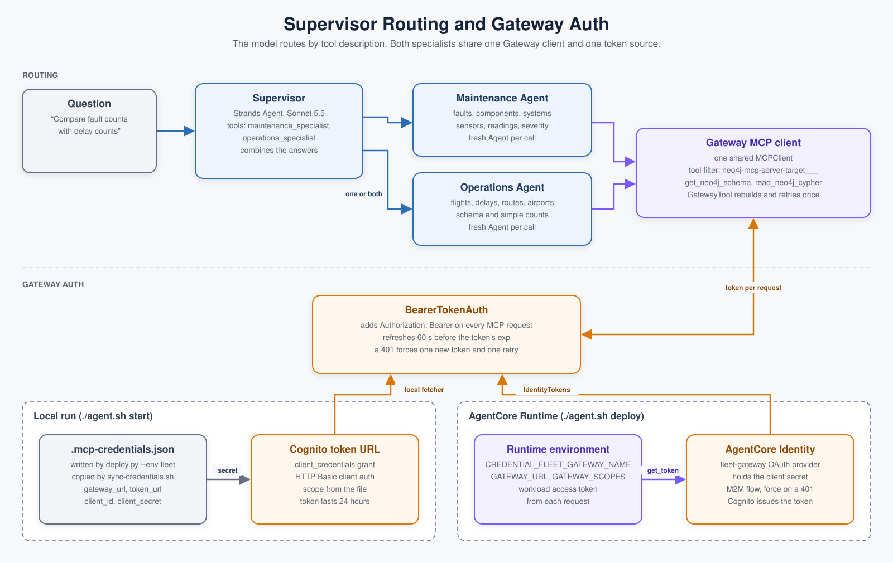
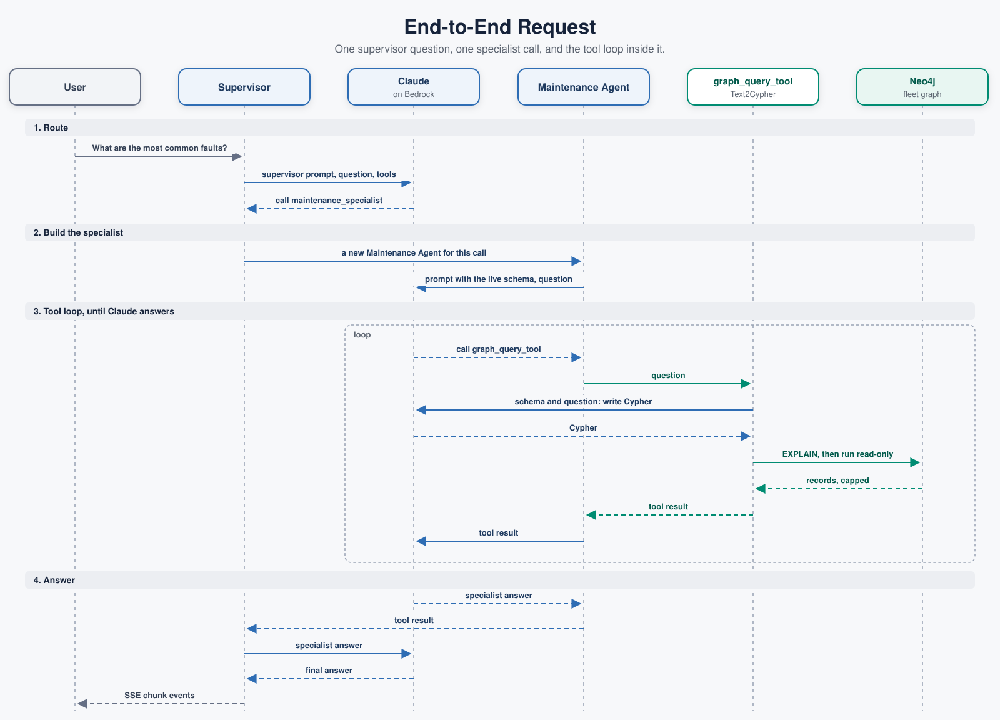

# Supervisor Agent Architecture

A question such as "Do the aircraft with the most faults also have the most
delays?" spans two domains. Maintenance knowledge covers faults, components,
and sensors. Operations knowledge covers flights, delays, and routes. One
prompt that holds both domains grows long and blurs which tables matter. The
supervisor agent in [`supervisor-agent/`](../../supervisor-agent/) gives each
domain its own specialist agent and lets a supervisor model decide which ones
to ask. The specialists reach the fleet graph only through the AgentCore
Gateway and the read-only Neo4j MCP server, so the supervisor process holds no
fleet database password.

## Routing

The supervisor is a Strands agent with two tools, `maintenance_specialist`
and `operations_specialist`. The supervisor model reads the two tool
descriptions and picks one, both, or neither. No separate classifier runs.

| Specialist | Description covers | Example questions |
|------------|--------------------|-------------------|
| Maintenance | Maintenance events, faults, components, systems, sensors, and severity | "Most common maintenance faults", "Hydraulic system issues" |
| Operations | Flights, delays, routes, airports, operators, and schedules, plus the graph schema and simple counts | "Common delay causes", "Busiest routes" |

When the supervisor calls both tools in one turn, Strands runs the calls
concurrently. The supervisor then writes the final answer from both results.
The supervisor runs Claude Sonnet 5.5 with `MAX_TOKENS` 16000 and effort high.

### A fresh specialist per call

`SpecialistTool` in `core/agents.py` builds a new specialist `Agent` on each
call and runs it through `Agent.as_tool`. A Strands agent serves one call at a
time and keeps its conversation as state. Two concurrent calls on one shared
specialist would interleave their messages. A fresh agent per call keeps
parallel calls and concurrent requests apart, at the cost of a short build on
each call.

## Gateway MCP client

The sequence above follows one question from the user to Neo4j and back.

1. **Route:** Claude on Bedrock reads the supervisor prompt and the two specialist tool specs, then calls `maintenance_specialist`.
2. **Build the specialist:** The supervisor builds a new Maintenance Agent for this call. The specialist sends its own prompt and the question to Claude.
3. **Tool loop:** Claude calls `read_neo4j_cypher`. The specialist sends the MCP call to the Gateway with its bearer token. The Gateway forwards it to the MCP server Runtime with a Runtime token, and the MCP server runs read-only Cypher on Neo4j. The loop repeats until Claude has an answer.
4. **Answer:** The specialist's answer returns to the supervisor as a tool result. Claude writes the final answer, and the server streams it to the user as server-sent events.

The server starts one Strands `MCPClient` against the Gateway URL on the first
request. Both specialists share it. A tool filter keeps only the two Gateway
tools whose names end in `___get_neo4j_schema` and `___read_neo4j_cypher`. The
Gateway prefixes each name with the target, so the model sees
`neo4j-mcp-server-target___read_neo4j_cypher`.

### Reconnects

The Gateway can end an MCP session, for example when it restarts. Each
specialist tool is a `GatewayTool` that holds the current
`GatewayConnection` while it runs. When a call finds the session ended,
`GatewayTool` asks for a new connection and retries the call once.

- **One rebuild for many callers:** A rebuild happens only when the failed connection is still the current one. Concurrent calls that hit the same dead session share one rebuild.
- **No stop under a running call:** A rebuild retires the old connection. The old client stops when the last call holding it finishes.
- **Stable tool specs:** The tool specs come from the first client, so the model's tool list stays the same across rebuilds.

## Two token paths

The Gateway accepts only a Cognito JWT issued to the stack's machine client.
The supervisor gets that token one of two ways. `BearerTokenAuth` hides the
difference from the MCP client.

| | Local run | AgentCore Runtime |
|---|---|---|
| Chosen when | Neither `CREDENTIAL_FLEET_GATEWAY_NAME` nor `GATEWAY_URL` is set | Either is set, and then both are required |
| Configuration | `.mcp-credentials.json`, or the file in `MCP_CREDENTIALS_FILE` | `CREDENTIAL_FLEET_GATEWAY_NAME`, `GATEWAY_URL`, and `GATEWAY_SCOPES` |
| Token source | A `client_credentials` grant against `token_url` with HTTP Basic client auth | `IdentityTokens` calls AgentCore Identity `get_token` with the request's workload access token, as M2M |
| Client secret | In the local credentials file | In the `fleet-gateway` credential provider |

The local path reads the token URL from the credentials file and runs no OAuth
discovery. On the Runtime, AgentCore Identity holds the client secret, so the
runtime process never sees it.

- **Refresh:** `BearerTokenAuth` reads the token's `exp` claim and fetches a new token 60 seconds before it expires. A token with no readable `exp` is reused for at most 5 minutes.
- **401 retry:** A 401 from the Gateway forces one new token and one retry. On the Runtime, the retry asks AgentCore Identity to skip its cache.
- **Shared token:** The token belongs to the OAuth client, not to a user, so every request shares one cached token. A user-federated flow would need one token per user.

## Errors the model sees

The Neo4j MCP server returns the driver's message as the tool's error text,
and Strands adds its own text when a request to the Gateway fails. Either can
name a server address. The supervisor has no driver, so `core/tool_errors.py`
classifies the text. The buckets and the wording match the GraphRAG agent.

| Error text | Result the model gets |
|------------|-----------------------|
| A `Neo.ClientError.Statement.*` or `Procedure.*` code, or a refused write | The Neo4j code and message, cut to 500 characters, with addresses removed |
| `TransactionTimedOut` | The query took too long and was stopped |
| A connection, pool, or auth failure | The graph database is unavailable right now |
| Anything else | The graph database returned an error |

Only a query error carries server text, because the model can use it to fix
its Cypher. A specialist that fails outright returns a generic error to the
supervisor model, and the details go to the server log.

## Memory and serving

The server is a `BedrockAgentCoreApp` that streams server-sent events. It
keeps conversation memory in the shared memory database with a
`Neo4jSessionManager` per request. [Memory](memory.md) covers the lifecycle,
and [Deployment](deployment.md) covers the Runtime deploy and the
`fleet-gateway` provider.

| Component | Technology |
|-----------|------------|
| Supervisor | Strands `Agent` on Claude Sonnet 5.5 |
| Specialists | Strands `Agent` built per call and wrapped with `Agent.as_tool` |
| Graph tools | One Strands `MCPClient` to the AgentCore Gateway |
| Gateway auth | `BearerTokenAuth` over a local fetcher or `IdentityTokens` |
| Memory | `Neo4jSessionManager` from `neo4j_agent_memory` |
| Server | `BedrockAgentCoreApp` on port 7071 locally and 8080 on the Runtime |

The [supervisor agent README](../../supervisor-agent/README.md) has the full
command list.
