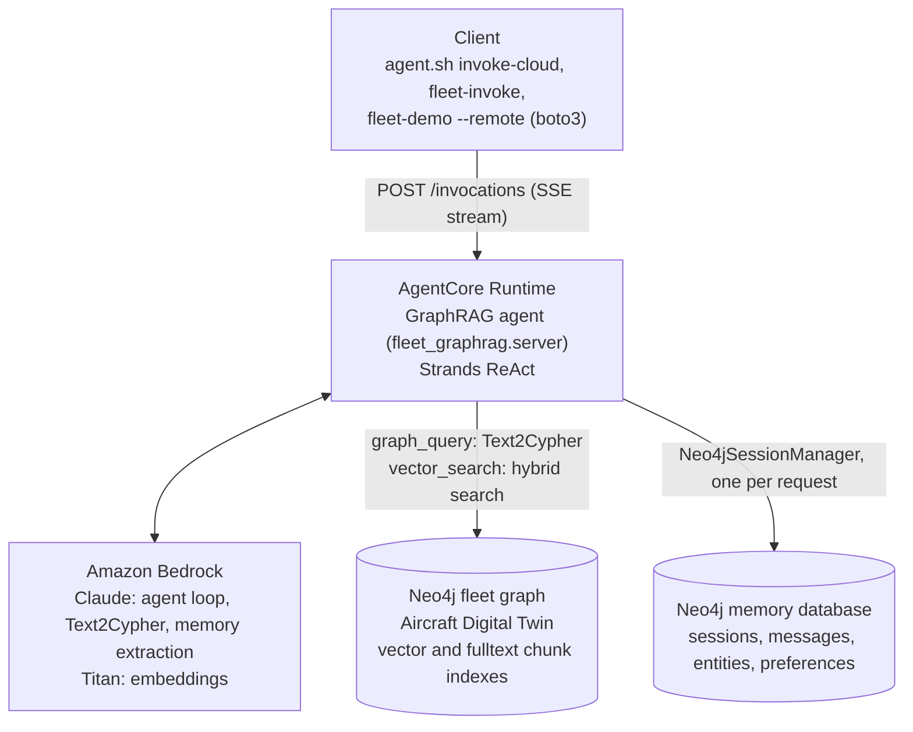

# Aircraft Fleet GraphRAG Agent

This Strands agent answers questions about an aircraft fleet. It reads both the
fleet graph and the maintenance manuals stored in Neo4j.

## Overview

- **Two kinds of questions:** Some fleet questions need exact graph answers, such as "How many aircraft are overdue for inspection?" Others need manual text, such as "What does the manual say about hydraulic leak detection?" This agent handles both.
- **Direct Neo4j driver:** The agent opens one Neo4j driver per process and connects straight to Aura. It uses no MCP server and no AgentCore Gateway.
- **`graph_query` tool:** This tool uses the `neo4j-graphrag` Text2Cypher retriever. Claude writes read-only Cypher from the live schema for exact and aggregate questions.
- **`vector_search` tool:** This tool uses the `neo4j-graphrag` `HybridCypherRetriever`. It combines the `maintenanceChunkEmbeddings` vector index with the `maintenanceChunkText` fulltext index. It answers topical questions from the manual chunks.
- **Claude on Bedrock:** The agent loop and Text2Cypher both call Claude through Amazon Bedrock. They use credentials from the standard AWS chain.
- **Titan embeddings:** Bedrock Titan embeds the questions for `vector_search`. The model matches the one the pipeline used to build the graph.
- **Conversation memory:** Neo4j Agent Memory keeps each session's history and the entities and preferences it learns about each user. It lives in its own Neo4j database, apart from the fleet graph. See [Conversation memory](#conversation-memory).
- **AgentCore Runtime:** The agent can run on Amazon Bedrock AgentCore Runtime. The deploy command passes the Neo4j connection as runtime environment variables.

## Quick start

Run these commands from `demos/aircraft-fleet/graphrag-agent/`:

```bash
cp ../.env.sample ../.env    # skip if it already exists; set the NEO4J_* and MEM_NEO4J_* values
uv sync

uv run fleet-server          # terminal 1: serves http://localhost:7070
uv run fleet-cli "How many aircraft are in the fleet?"   # terminal 2
uv run fleet-demo            # terminal 2: full showcase

./agent.sh deploy            # deploy to AgentCore Runtime
./agent.sh invoke-cloud "How many aircraft are in the database?"
```

## Architecture



- **Neo4j:** The agent reads `NEO4J_URI`, `NEO4J_USERNAME`, and `NEO4J_PASSWORD`. It opens one driver per process.
- **Neo4j password in the cloud:** When `NEO4J_PASSWORD_SECRET_ARN` is set, the agent reads the password from that Secrets Manager secret once at startup and ignores `NEO4J_PASSWORD`. The secret value is a JSON object with a `password` key, such as `{"username": "neo4j", "password": "..."}`. Other keys are ignored.
- **Bedrock:** The agent uses the standard AWS credential chain for Claude, Text2Cypher, and Titan.
- **Memory:** The agent reads `MEM_NEO4J_URI`, `MEM_NEO4J_USERNAME`, `MEM_NEO4J_DATABASE`, and `MEM_NEO4J_PASSWORD`. When `MEM_NEO4J_PASSWORD_SECRET_ARN` is set, the memory password comes from that secret in the same JSON form.

## Prerequisites

1. **Python:** You need Python 3.12 or later and the `uv` package manager.
2. **AWS:** You need the AWS CLI configured, with Bedrock access to the LLM and the Titan embedding model.
3. **Neo4j:** You need a Neo4j database built by [`demos/aircraft-fleet/pipeline/`](../pipeline/).
4. **Memory database:** You need a second Neo4j database or instance for conversation memory. It can be empty. The agent creates its schema on first connect.

## Build the graph

The agent expects the Aircraft Digital Twin graph. The graph must include the
chunk embeddings and the `maintenanceChunkEmbeddings` vector index. If your
database is empty, run these commands from `demos/aircraft-fleet/pipeline/`:

```bash
cp ../.env.sample ../.env    # set the Neo4j values and the provider
./setup.sh
```

- **Same database:** The shared `.env` points the agent at the same `NEO4J_URI`. The agent reads the schema live, so it picks up the data on its own.
- **Same embedder:** The agent's embedder must match the pipeline's embedder. The default is Bedrock Titan v2 with 1024 dimensions. Override it with `EMBED_MODEL_ID` and `EMBED_DIMENSIONS`.

## Run locally

### Set up

Run these commands from `demos/aircraft-fleet/graphrag-agent/`:

```bash
cp ../.env.sample ../.env    # skip if it already exists
uv sync
```

### Start the server

```bash
# Terminal 1: leave this running. Press Ctrl+C to stop it.
uv run fleet-server                                 # serves http://localhost:7070
./agent.sh start                                    # the same server, through the wrapper
uv run opentelemetry-instrument fleet-server        # the same server, with OTEL tracing
```

- **Config:** The server loads the shared `.env` in `demos/aircraft-fleet/`. `fleet_graphrag/server.py` loads it before it imports the `agent` package. Values already set in the environment win.
- **Startup checks:** The server builds the memory settings before it serves. A missing `MEM_NEO4J_URI` or memory password stops startup.
- **Port:** `fleet-server` runs `fleet_graphrag.server` on port 7070. The deployed runtime uses port 8080. Local runs use 7070 to avoid a clash. Set `AGENT_PORT` to use another port.
- **Stopping:** The server runs in the foreground. Press Ctrl+C or run `./agent.sh stop` to stop it.
- **Testing:** `./agent.sh test` sends one question to the server.
- **Clients:** The clients below talk to the server over HTTP from a second terminal. They hold no Neo4j credentials.

```bash
# Terminal 2
uv run fleet-cli "How many aircraft are in the fleet?"
```

### Run the demo

```bash
uv run fleet-demo
```

The demo shows each part of the agent in its own `====` section:

1. **Schema:** It prints the live Neo4j schema that the agent reasons over.
2. **Text2Cypher:** It runs the `graph_query` retriever alone.
3. **Vector search:** It runs the `vector_search` retriever alone over the manual chunks.
4. **Full agent:** It runs the Strands agent, which picks its own tools.

Each section uses a `mode` field on `/invocations`, so `uv run fleet-server`
must be running first. Sections 1 to 3 return quickly. Section 4 calls Claude
for several turns and takes a few minutes of Bedrock usage.

## Deploy to AgentCore Runtime

### Set up

Run these commands from `demos/aircraft-fleet/graphrag-agent/`:

```bash
uv sync
cp ../.env.sample ../.env    # set the deploy settings listed under Deploy
aws sso login --sso-session <your-sso-session>     # only if you use AWS SSO
```

### Deploy

Deployment uses the AgentCore CLI. Install it with
`npm install -g @aws/agentcore`. The project lives in `agentcore/`, and
`agentcore/agentcore.json` declares the `graphrag_agent` Runtime.

The CLI also needs the CDK dependencies in `agentcore/cdk/node_modules`. Git ignores that folder, so a fresh clone has none. `./agent.sh deploy` and `./agent.sh destroy` run `npm ci` there when the install is missing or incomplete. To run `agentcore deploy` directly, install them once first:

```bash
(cd agentcore/cdk && npm ci)
```

`./agent.sh deploy` reads the deploy settings from the shared `../.env`. A value exported in the shell wins. `agentcore/cdk/lib/cdk-stack.ts` copies them into the Runtime environment, and synth stops with a list of any that are missing:

- **Neo4j connection:** Set `NEO4J_URI`, `NEO4J_USERNAME`, and `NEO4J_DATABASE` for the fleet graph.
- **Memory connection:** Set `MEM_NEO4J_URI`, `MEM_NEO4J_USERNAME`, and `MEM_NEO4J_DATABASE` for the agent memory database.
- **Passwords:** Set `NEO4J_PASSWORD_SECRET_ARN` and `MEM_NEO4J_PASSWORD_SECRET_ARN` to the complete ARNs of the Secrets Manager secrets that hold the passwords. A complete ARN ends in the six-character suffix that Secrets Manager adds. Each secret holds a JSON object with a `password` key. The deploy never reads or sends the passwords themselves.
- **Secret access:** The stack grants the Runtime role `secretsmanager:GetSecretValue` on exactly those two ARNs. A secret encrypted with a customer managed KMS key also needs `kms:Decrypt` on that key, which the stack does not grant.

```bash
./agent.sh deploy            # builds the code zip and deploys the CDK stack
./agent.sh status            # shows the Runtime ARN and deployment state
./agent.sh logs --tail       # follows the Runtime logs
```

- **Deploy type:** The Runtime uses a `CodeZip` build. `agentcore deploy` zips this directory, uploads it, and runs it on a managed Python 3.12 arm64 runtime. It builds no Docker image.
- **Packaged files:** The zip holds every file here except `agentcore/`, `.venv`, `.git`, `node_modules`, `__pycache__`, and `.pytest_cache`. It includes `.ruff_cache`. `./agent.sh deploy` refuses to run while a `.env*` or `.mcp-credentials*.json` file is present, because the zip would include it. Local runs read the shared `../.env` instead.
- **Deployment target:** The first deploy creates the `default` target in `agentcore/aws-targets.json` from your current AWS account and region. That file and `agentcore/.cli/` hold account-specific values, so git ignores them.
- **Fresh clone:** The deployed state lives in those ignored files. A fresh clone, or a different machine, has no record of an earlier deploy, so `./agent.sh status` reports the Runtime as not deployed even when it is running in your account.

### Call the deployed agent

```bash
./agent.sh invoke-cloud "How many aircraft are in the database?"
uv run fleet-demo --remote                              # full showcase, deployed
uv run fleet-invoke "What does the manual say about hydraulic leak detection?"
uv run fleet-invoke load-test 5                          # a random query from queries.txt every 5s
```

The deployed agent has the same four `/invocations` modes as the local server.
A `mode` field picks one. With no `mode`, the full agent runs. Only the
connection differs:

- **`./agent.sh invoke-cloud "..."`:** This command sends one prompt through `agentcore invoke`.
- **`uv run fleet-demo --remote`:** This command runs all five demo sections against the deployed agent.
- **`uv run fleet-invoke "..."`:** This command sends one prompt and streams the answer as it arrives.
- **`uv run fleet-invoke load-test [seconds]`:** This command sends a random query from `queries.txt` on an interval. The default interval is 5 seconds.
- **`./agent.sh destroy`:** This command removes the runtime when you finish. It asks for confirmation first and cancels unless you answer `y`. Pass `--yes` to skip the question in a script. It does not read `../.env`. When it finishes, it lists anything `agentcore status` still reports as deployed. It also asks CloudFormation for the stack `AgentCore-AircraftFleet-default`. The status command reads local state that can be lost, so the CloudFormation answer is the one that counts. Destroy fails while the stack exists in any state other than `DELETE_COMPLETE`. Before it asks or changes anything, it confirms that the active AWS credentials belong to the account recorded for the target in `agentcore/aws-targets.json`. It checks the account again before the CloudFormation check. Credentials for another account would not see the stack.

## Conversation memory

The agent remembers earlier turns of a session and what it learned about a user.
It uses [Neo4j Agent Memory](https://github.com/neo4j-labs/agent-memory)
through its Strands `Neo4jSessionManager`.

- **Separate database:** Memory needs its own Neo4j database or instance. Point `MEM_NEO4J_*` at it, not at the fleet graph. Text2Cypher reads the live schema, so memory labels in the fleet graph would reach its prompt. Locally, a second database in the same Neo4j Enterprise server works, such as one made with `CREATE DATABASE memory`.
- **Session and user:** The session ID comes from the AgentCore session header. The `user_id` field in the payload scopes long-term memory. A missing or empty `user_id` becomes `anonymous`, so all anonymous callers share one profile.
- **What it stores:** Each session keeps its messages. The agent extracts entities from them and retrieves related entities and preferences on later turns. Matches below a vector score of 0.75 are left out. Tool calls are not recorded.
- **One manager per request:** Neo4j Agent Memory 0.8.0 cannot share one client across session managers. Each request builds its own manager, connects, restores the session history, and closes the manager when the answer ends. It also closes when the request fails. A failed build closes its own manager before the error is reported. If the client disconnects while the agent is still being built, the close waits for the build to end, so the build cannot reopen a closed manager.
- **Cost per request:** The first request after startup takes about 2.5 seconds longer, measured on a local Neo4j. It opens the memory driver and sets up the memory schema and indexes. Later requests add about 0.1 seconds. A remote instance adds a few network round trips to each.
- **Extraction model:** Entity extraction runs on `global.anthropic.claude-sonnet-4-6` with Titan v2 embeddings at 1024 dimensions. Sonnet 5.5 rejects the forced tool choice and the temperature that the extractor sends. The agent itself still uses `MODEL_ID`.

## Layout

| Path | Use |
|------|-----|
| `main.py` | The AgentCore Runtime entrypoint. It calls `fleet_graphrag.server.main` on port 8080. AgentCore runs a file, not a module, and CodeZip installs the dependencies but not the project. The package imports because its folder sits next to `main.py`. |
| `fleet_graphrag/` | The one package, installed into the venv in editable mode. It holds `server.py`, `agent/`, and `client/`. |
| `fleet_graphrag/server.py` | The `BedrockAgentCoreApp` and its entrypoint. It handles the `mode` field. `main()` is the only way to start the server. `fleet-server` calls it on port 7070. |
| `fleet_graphrag/agent/` | The agent core. `config.py` holds the model ID, region, embedder, index, and system prompt. `retrieval.py` holds the Neo4j driver and the `graph_query`, `vector_search`, and `get_graph_schema` functions. `tools.py` holds the Strands tool wrappers. `memory.py` builds the memory settings and the per-request session manager. `secrets.py` reads the passwords. |
| `fleet_graphrag/client/` | The clients behind `fleet-cli`, `fleet-demo`, and `fleet-invoke`. `transport.py` is the only network layer. It covers local HTTP on port 7070 and the deployed agent through boto3. `cli.py` is the terminal client, `demo.py` is the showcase, and `invoke.py` is the deployed single call and load test. |
| `agent.sh` | The wrapper for local `start`, `stop`, and `test`, and for `deploy`, `status`, `invoke-cloud`, `logs`, and `destroy` |
| `agentcore/` | The AgentCore CLI project. `agentcore.json` declares the Runtime. `cdk/` is the CDK app the CLI deploys. Its `lib/cdk-stack.ts` adds the Neo4j env vars and the secret grant. |
| `queries.txt` | Sample queries for discovery, fleet, maintenance, and delays |

## Commands

The server and clients are `uv` console scripts. Run the server in its own
terminal. Press Ctrl+C to stop it.

| Command | Description |
|---------|-------------|
| `uv run fleet-server` | Run the agent server locally on port 7070. Add the `opentelemetry-instrument` prefix for tracing. |
| `uv run fleet-cli "prompt"` | Ask the local server. Add `--remote` to ask the deployed agent. |
| `uv run fleet-demo` | Run the showcase against the local server. Add `--remote` to use the deployed agent. |
| `uv run fleet-invoke "prompt"` | Send one prompt to the deployed agent. `load-test [N]` sends a random query from `queries.txt` every N seconds. |

`./agent.sh` wraps the local server and the AgentCore CLI.

| Command | Description |
|---------|-------------|
| `start` / `stop` | Start or stop the local server on port 7070 |
| `test` | Ask the local server one question |
| `deploy` / `destroy [--yes]` | Deploy to or remove from AgentCore Runtime. `destroy` asks first unless you pass `--yes`. |
| `status` | Show the deployment status |
| `invoke-cloud "prompt"` | Call the deployed agent through `agentcore invoke` |
| `logs [args]` | Search the Runtime logs. Add `--tail` to follow them. |

## Environment variables

| Variable | Default |
|----------|---------|
| `NEO4J_URI` | Required |
| `NEO4J_USERNAME` | `neo4j` |
| `NEO4J_PASSWORD` | Local runs only. Required when `NEO4J_PASSWORD_SECRET_ARN` is unset. |
| `NEO4J_PASSWORD_SECRET_ARN` | Unset locally. Set by the deploy. The password comes from this secret. |
| `NEO4J_DATABASE` | `neo4j` |
| `MEM_NEO4J_URI` | Required. The memory database, separate from the fleet graph. |
| `MEM_NEO4J_USERNAME` | `neo4j` |
| `MEM_NEO4J_DATABASE` | `neo4j` |
| `MEM_NEO4J_PASSWORD` | Local runs only. Required when `MEM_NEO4J_PASSWORD_SECRET_ARN` is unset. |
| `MEM_NEO4J_PASSWORD_SECRET_ARN` | Unset locally. Set by the deploy. The memory password comes from this secret. |
| `MODEL_ID` | `global.anthropic.claude-sonnet-5-5` |
| `MAX_TOKENS` | `64000`. The output cap for each agent model call. |
| `MODEL_EFFORT` | `medium`. One of `low`, `medium`, `high`, `xhigh`, or `max`. |
| `AWS_REGION` | `us-east-1` |
| `VECTOR_INDEX_NAME` | `maintenanceChunkEmbeddings` |
| `FULLTEXT_INDEX_NAME` | `maintenanceChunkText` |
| `EMBED_MODEL_ID` | `amazon.titan-embed-text-v2:0` |
| `EMBED_DIMENSIONS` | `1024` |
| `SCHEMA_TTL_S` | `600`. Seconds before the cached graph schema is fetched again. |
| `TEXT2CYPHER_TIMEOUT_S` | `30`. The server-side timeout for a generated query. |
| `TEXT2CYPHER_MAX_ROWS` | `200`. The most rows a generated query returns. |
| `TEXT2CYPHER_MAX_TOKENS` | `2048`. The output cap for the Cypher-writing call. |
| `AGENT_PORT` | `7070` for `fleet-server`, `8080` on AgentCore Runtime |

## Observability

The agent uses AWS Distro for OpenTelemetry auto-instrumentation. It does not use `StrandsTelemetry`.

ADOT traces the Neo4j driver, the boto3 calls to Bedrock, and incoming requests. Strands writes its agent, model, and tool spans through the global OpenTelemetry tracer, so ADOT exports those spans too. `StrandsTelemetry` would install a second tracer provider that only covers the Strands spans. The AgentCore CLI also turns on OpenTelemetry for each runtime by default through `instrumentation.enableOtel`.

- **Local tracing:** Run `uv run opentelemetry-instrument fleet-server`. This traces the Neo4j driver, the boto3 calls to Bedrock, and incoming requests.
- **Deployed tracing:** Enable Tracing on the runtime in the CloudWatch console under Bedrock AgentCore. Traces then appear in the Bedrock AgentCore Observability dashboard. Without this step, AgentCore records no traces.

## Troubleshooting

| Symptom | Cause and fix |
|---------|---------------|
| `MEM_NEO4J_URI is not set` at startup | Set `MEM_NEO4J_URI` and `MEM_NEO4J_PASSWORD` in the shared `.env` for local runs. They point at the memory database, not the fleet graph. |
| `NEO4J_URI is not set` | Set `NEO4J_URI` and `NEO4J_PASSWORD` in the shared `.env` in `demos/aircraft-fleet/` for local runs. A deployed Runtime gets `NEO4J_URI` and `NEO4J_PASSWORD_SECRET_ARN` from the deploy. Set them in the shared `.env` and run `./agent.sh deploy` again. |
| `Missing or invalid deploy settings for runtime "graphrag_agent"` | Synth found a deploy setting that is unset, a Neo4j URI without TLS, or a secret ARN that is not complete. Fix the listed names in the shared `.env`. |
| `Could not read the secret in NEO4J_PASSWORD_SECRET_ARN` in the Runtime logs | The secret does not exist in that region, or the Runtime role cannot read it. Check the ARN and that the secret is not encrypted with a KMS key the role cannot use. |
| `vector_search` returns poor results or nothing | The agent's embedder must match the pipeline's embedder. Align `EMBED_MODEL_ID` and `EMBED_DIMENSIONS`, and confirm that the `maintenanceChunkEmbeddings` index exists. |
| `ServiceUnavailable` or an auth error from Neo4j | The `NEO4J_URI` scheme or the credentials are wrong, or the database is unreachable. |
| `NoCredentialsError` | AWS credentials are missing. Run `aws configure` or set credentials in the environment. |
| `AccessDeniedException` on the model | Enable Bedrock model access for the LLM and the Titan embedding model in the AWS console. |
| A 404 JSON response with `timestamp` on port 7070 | Another service is using port 7070. Run `lsof -ti :7070 \| xargs kill`, then restart. |
