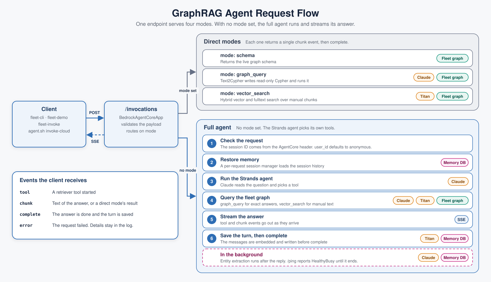
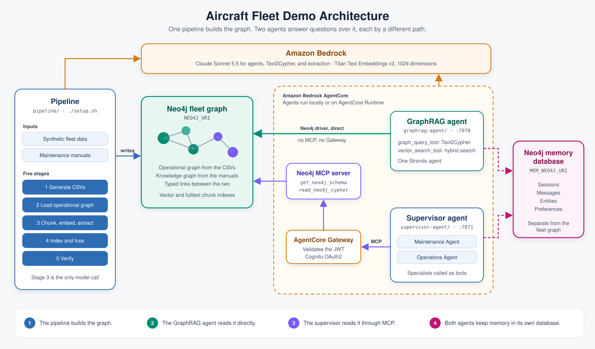
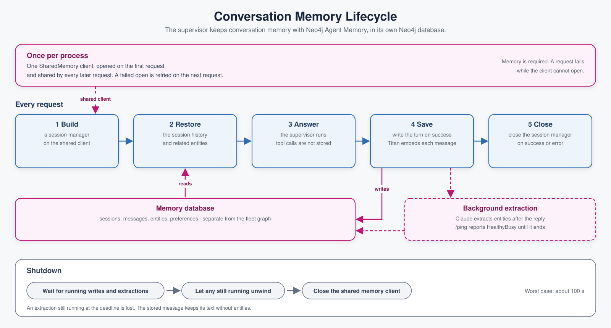

# Aircraft Fleet GraphRAG Agent

This Strands agent answers questions about an aircraft fleet. It reads both the
fleet graph and the maintenance manuals stored in Neo4j.



## Overview

- **Two kinds of questions:** Some questions need exact graph answers, such as "How many aircraft are overdue for inspection?" Others need manual text, such as "What does the manual say about hydraulic leak detection?" This agent handles both.
- **Direct Neo4j driver:** The agent opens one Neo4j driver per process. It uses no MCP server and no AgentCore Gateway.
- **Claude on Bedrock:** The agent loop and Text2Cypher both call Claude through Amazon Bedrock.
- **Conversation memory:** The agent remembers each session and what it learns about each user. Memory lives in its own Neo4j database.
- **AgentCore Runtime:** The agent runs locally on port 7070 and deploys to AgentCore Runtime as a code zip.

## Features

- **`graph_query`:** This tool uses the `neo4j-graphrag` Text2Cypher retriever. Claude writes read-only Cypher from the live schema for exact and aggregate questions.
- **`vector_search`:** This tool uses the `neo4j-graphrag` `HybridCypherRetriever`. It combines the `maintenanceChunkEmbeddings` vector index with the `maintenanceChunkText` fulltext index.
- **Read-only guard:** The agent runs `EXPLAIN` on each generated query first. It refuses any query that is not read-only.
- **Query limits:** Each generated query runs with a server-side timeout and a row cap.
- **Live schema:** The agent reads the graph schema at runtime and caches it for 10 minutes. A new graph needs no code change.
- **Direct modes:** A `mode` field on `/invocations` runs `schema`, `graph_query`, or `vector_search` alone. With no mode, the full agent runs.
- **Streaming:** The server streams `tool`, `chunk`, `complete`, and `error` events over SSE.
- **Safe errors:** A failed request sends a generic message. The details stay in the log.
- **Secrets Manager passwords:** The deployed agent reads both Neo4j passwords from Secrets Manager. The deploy never sends a password.
- **Tracing:** ADOT traces the Neo4j driver, Bedrock calls, incoming requests, and the Strands spans.

## Architecture



- **Neo4j:** The agent reads `NEO4J_URI`, `NEO4J_USERNAME`, and `NEO4J_PASSWORD`.
- **Cloud password:** When `NEO4J_PASSWORD_SECRET_ARN` is set, the agent reads the password from that secret once at startup. The secret holds a JSON object with a `password` key. Other keys are ignored.
- **Bedrock:** The agent uses the standard AWS credential chain for Claude and Titan.
- **Memory:** The agent reads `MEM_NEO4J_URI`, `MEM_NEO4J_USERNAME`, `MEM_NEO4J_DATABASE`, and `MEM_NEO4J_PASSWORD`. `MEM_NEO4J_PASSWORD_SECRET_ARN` works the same way as the fleet secret.

## Quick start

Run these commands from `demos/aircraft-fleet/graphrag-agent/`:

```bash
cp ../.env.sample ../.env    # skip if it already exists; set the NEO4J_* and MEM_NEO4J_* values
uv sync

uv run fleet-server          # terminal 1: serves http://localhost:7070
uv run fleet-cli "How many aircraft are in the fleet?"   # terminal 2
uv run fleet-demo            # terminal 2: full showcase
```

## Prerequisites

- **Python:** You need Python 3.12 or later and the `uv` package manager.
- **AWS:** You need AWS credentials with Bedrock access to Claude and the Titan embedding model.
- **Fleet graph:** You need a Neo4j database built by the [pipeline](../pipeline/). It must include the chunk embeddings and the vector index.
- **Memory database:** You need a second Neo4j database or instance. It can be empty. The agent creates its schema on first connect.
- **Same embedder:** The agent's embedder must match the pipeline's. The default is Titan v2 with 1024 dimensions. Override it with `EMBED_MODEL_ID` and `EMBED_DIMENSIONS`.

## Run locally

```bash
uv run fleet-server                                 # serves http://localhost:7070
./agent.sh start                                    # the same server, through the wrapper
uv run opentelemetry-instrument fleet-server        # the same server, with tracing
```

- **Config:** The server loads the shared `.env` in `demos/aircraft-fleet/` before it imports the agent. Values already set in the environment win.
- **Startup checks:** A missing `MEM_NEO4J_URI` or memory password stops startup.
- **Port:** Local runs use 7070. The deployed runtime uses 8080. Set `AGENT_PORT` to use another port.
- **Stopping:** Press Ctrl+C or run `./agent.sh stop`.
- **Clients:** The clients talk to the server over HTTP. They hold no Neo4j credentials.

### Run the demo

`uv run fleet-demo` shows each part of the agent in its own section:

1. **Schema:** The demo prints the live schema that the agent reasons over.
2. **Text2Cypher:** The demo runs the `graph_query` retriever alone.
3. **Vector search:** The demo runs the `vector_search` retriever alone.
4. **Full agent:** The demo runs the Strands agent, which picks its own tools.

Sections 1 to 3 return quickly. Section 4 calls Claude for several turns and
takes a few minutes of Bedrock usage.

## Deploy

Deployment uses the AgentCore CLI. Install it with `npm install -g @aws/agentcore`.
The project lives in `agentcore/`, and `agentcore/agentcore.json` declares the
`graphrag_agent` Runtime.

```bash
aws sso login --sso-session <your-sso-session>     # only if you use AWS SSO
./agent.sh deploy            # builds the code zip and deploys the CDK stack
./agent.sh status            # shows the Runtime ARN and deployment state
./agent.sh logs --tail       # follows the Runtime logs
```

### Deploy settings

`./agent.sh deploy` reads these from the shared `../.env`. A value exported in
the shell wins. Synth stops with a list of any that are missing.

- **Fleet connection:** Set `NEO4J_URI`, `NEO4J_USERNAME`, and `NEO4J_DATABASE`.
- **Memory connection:** Set `MEM_NEO4J_URI`, `MEM_NEO4J_USERNAME`, and `MEM_NEO4J_DATABASE`.
- **Passwords:** Set `NEO4J_PASSWORD_SECRET_ARN` and `MEM_NEO4J_PASSWORD_SECRET_ARN` to complete secret ARNs. A complete ARN ends in the six-character suffix that Secrets Manager adds.
- **Secret access:** The stack grants `secretsmanager:GetSecretValue` on exactly those two ARNs. A secret under a customer managed KMS key also needs `kms:Decrypt`, which the stack does not grant.

### How the deploy works

- **Code zip:** `agentcore deploy` zips this directory and runs it on a managed Python 3.12 arm64 runtime. It builds no Docker image.
- **Excluded files:** The zip leaves out `agentcore/`, `.venv`, `.git`, `node_modules`, `__pycache__`, and `.pytest_cache`.
- **Secret guard:** `./agent.sh deploy` refuses to run while a `.env*` or `.mcp-credentials*.json` file sits in this directory, because the zip would include it.
- **CDK dependencies:** `deploy` and `destroy` install `agentcore/cdk/node_modules` when it is missing, incomplete, or older than `package-lock.json`. To run `agentcore deploy` yourself, run `(cd agentcore/cdk && npm ci)` once first.
- **Local state:** The first deploy writes `agentcore/aws-targets.json` and `agentcore/.cli/` with account-specific values. Git ignores both. A fresh clone has no record of an earlier deploy, so `status` reports the Runtime as not deployed.

### Call the deployed agent

```bash
./agent.sh invoke-cloud "How many aircraft are in the database?"
uv run fleet-demo --remote                              # full showcase, deployed
uv run fleet-invoke "What does the manual say about hydraulic leak detection?"
uv run fleet-invoke load-test 5                         # a random query from queries.txt every 5s
```

The deployed agent has the same `/invocations` modes as the local server.

### Remove the deployment

`./agent.sh destroy` removes the Runtime.

- **Confirmation:** It asks first and cancels unless you answer `y`. Pass `--yes` to skip the question.
- **Account check:** It confirms that the active AWS credentials belong to the account recorded in `agentcore/aws-targets.json`.
- **Final check:** It asks CloudFormation whether the stack `AgentCore-AircraftFleet-default` is gone. It fails while the stack exists in any state other than `DELETE_COMPLETE`.

## Conversation memory



The agent uses [Neo4j Agent Memory](https://github.com/neo4j-labs/agent-memory)
through its Strands `SharedMemory` and `Neo4jSessionManager`.

### What it does

- **Session history:** Each session keeps its messages and restores them on the next turn. Tool calls are not recorded.
- **Long-term memory:** The agent extracts entities from each message. It retrieves related entities and preferences on later turns. Matches below a vector score of 0.675 are left out.
- **Session and user:** The session ID comes from the AgentCore session header. The `user_id` field scopes long-term memory. A missing `user_id` becomes `anonymous`, so all anonymous callers share one profile.
- **Separate database:** Point `MEM_NEO4J_*` at its own database, not the fleet graph. Memory labels in the fleet graph would reach the Text2Cypher prompt. A second database on the same Neo4j Enterprise server works.

### How it runs

- **One client per process:** The agent opens one memory client on the first request that needs it. A failed open is retried on the next request.
- **Wrong password:** A rejected memory password is reported on every later request until the process restarts. A retry would count toward the server's failed-login lockout.
- **One manager per request:** Each request builds a session manager on the shared client. The manager closes when the answer ends or the request fails.
- **Direct modes:** The `schema`, `graph_query`, and `vector_search` modes never open memory. They keep working while the memory database is down.
- **Background extraction:** Entity extraction runs after the turn is written, so the answer does not wait for it. `/ping` reports `HealthyBusy` until it ends. A failed extraction is logged, and the message stays stored without entities.
- **Shutdown:** The server waits up to 30 seconds for running extractions. Any still running get 5 seconds to unwind. Closing the client can take up to 30 more seconds.
- **Worst case:** A shutdown takes about 65 seconds at most. It takes about 95 seconds when a memory open is still in flight.

### Cost per request

These numbers were measured on a local Neo4j.

- **First request:** The first request against an empty memory database takes about 1.8 seconds longer. With an existing schema, the open adds 0.1 to 0.2 seconds.
- **Restore:** Building the manager and restoring history takes a few milliseconds, and 25 to 50 milliseconds once the history grows.
- **Save:** Writing the turn takes 0.7 to 1.1 seconds, mostly the Titan embedding of each message. The `complete` event goes out after the write.
- **Remote database:** A remote instance adds a few network round trips to each step.

### Extraction model

- **Model:** Extraction runs on `global.anthropic.claude-sonnet-5-5` with Titan v2 embeddings at 1024 dimensions.
- **Fork options:** Sonnet 5.5 rejects a temperature and a forced tool choice. The extractor uses `send_temperature=False` and `tool_choice="auto"`, which the fleet fork of Neo4j Agent Memory adds.
- **Agent model:** The agent itself still uses `MODEL_ID`.

## Commands

| Command | Description |
|---------|-------------|
| `uv run fleet-server` | Run the agent server locally on port 7070 |
| `uv run fleet-cli "prompt"` | Ask the local server. Add `--remote` to ask the deployed agent. |
| `uv run fleet-demo` | Run the showcase. Add `--remote` to use the deployed agent. |
| `uv run fleet-invoke "prompt"` | Send one prompt to the deployed agent. `load-test [N]` sends a query every N seconds. |
| `./agent.sh start` / `stop` | Start or stop the local server |
| `./agent.sh test` | Ask the local server one question |
| `./agent.sh deploy` / `destroy [--yes]` | Deploy to or remove from AgentCore Runtime |
| `./agent.sh status` | Show the deployment status |
| `./agent.sh invoke-cloud "prompt"` | Call the deployed agent through `agentcore invoke` |
| `./agent.sh logs [args]` | Search the Runtime logs. Add `--tail` to follow them. |

## Layout

| Path | Use |
|------|-----|
| `main.py` | The AgentCore Runtime entrypoint. It starts the server on port 8080. |
| `fleet_graphrag/server.py` | The `BedrockAgentCoreApp`, its entrypoint, and the `mode` routing |
| `fleet_graphrag/agent/config.py` | The model, region, embedder, indexes, and system prompt |
| `fleet_graphrag/agent/retrieval.py` | The Neo4j driver and the retriever functions |
| `fleet_graphrag/agent/text2cypher.py` | The Text2Cypher retriever with the read-only guard |
| `fleet_graphrag/agent/tools.py` | The Strands tool wrappers |
| `fleet_graphrag/agent/memory.py` | The memory settings and the per-request session manager |
| `fleet_graphrag/agent/secrets.py` | The Secrets Manager password reads |
| `fleet_graphrag/client/` | `fleet-cli`, `fleet-demo`, and `fleet-invoke`. `transport.py` is the only network layer. |
| `agent.sh` | The wrapper for local runs and the AgentCore CLI |
| `agentcore/` | The AgentCore CLI project and its CDK app |
| `queries.txt` | Sample queries for discovery, fleet, maintenance, and delays |

## Environment variables

| Variable | Default |
|----------|---------|
| `NEO4J_URI` | Required |
| `NEO4J_USERNAME` | `neo4j` |
| `NEO4J_PASSWORD` | Local runs only. Required when `NEO4J_PASSWORD_SECRET_ARN` is unset. |
| `NEO4J_PASSWORD_SECRET_ARN` | Unset locally. Set by the deploy. |
| `NEO4J_DATABASE` | `neo4j` |
| `MEM_NEO4J_URI` | Required. The memory database. |
| `MEM_NEO4J_USERNAME` | `neo4j` |
| `MEM_NEO4J_DATABASE` | `neo4j` |
| `MEM_NEO4J_PASSWORD` | Local runs only. Required when `MEM_NEO4J_PASSWORD_SECRET_ARN` is unset. |
| `MEM_NEO4J_PASSWORD_SECRET_ARN` | Unset locally. Set by the deploy. |
| `MODEL_ID` | `global.anthropic.claude-sonnet-5-5` |
| `MAX_TOKENS` | `64000`. The output cap for each agent model call. |
| `MODEL_EFFORT` | `medium`. One of `low`, `medium`, `high`, `xhigh`, or `max`. |
| `AWS_REGION` | `us-east-1` |
| `VECTOR_INDEX_NAME` | `maintenanceChunkEmbeddings` |
| `FULLTEXT_INDEX_NAME` | `maintenanceChunkText` |
| `EMBED_MODEL_ID` | `amazon.titan-embed-text-v2:0` |
| `EMBED_DIMENSIONS` | `1024` |
| `SCHEMA_TTL_S` | `600`. Seconds before the cached schema is fetched again. |
| `TEXT2CYPHER_TIMEOUT_S` | `30`. The server-side timeout for a generated query. |
| `TEXT2CYPHER_MAX_ROWS` | `200`. The most rows a generated query returns. |
| `TEXT2CYPHER_MAX_TOKENS` | `2048`. The output cap for the Cypher-writing call. |
| `AGENT_PORT` | `7070` for `fleet-server`, `8080` on AgentCore Runtime |

## Observability

The agent uses AWS Distro for OpenTelemetry auto-instrumentation instead of
`StrandsTelemetry`. Strands writes its spans through the global tracer, so ADOT
exports them with the rest.

- **Local tracing:** Run `uv run opentelemetry-instrument fleet-server`.
- **Deployed tracing:** Enable Tracing on the runtime in the CloudWatch console under Bedrock AgentCore. Without this step, AgentCore records no traces.

## Troubleshooting

| Symptom | Cause and fix |
|---------|---------------|
| `MEM_NEO4J_URI is not set` at startup | Set `MEM_NEO4J_URI` and `MEM_NEO4J_PASSWORD` in the shared `.env`. They point at the memory database. |
| `NEO4J_URI is not set` | Set `NEO4J_URI` and `NEO4J_PASSWORD` in the shared `.env`. For a deployed Runtime, set them and run `./agent.sh deploy` again. |
| `Missing or invalid deploy settings for runtime "graphrag_agent"` | A deploy setting is unset, a Neo4j URI lacks TLS, or a secret ARN is incomplete. Fix the listed names. |
| `Could not read the secret in NEO4J_PASSWORD_SECRET_ARN` | The secret is missing in that region, or the Runtime role cannot read it. Check the ARN and the KMS key. |
| `vector_search` returns poor results or nothing | Align `EMBED_MODEL_ID` and `EMBED_DIMENSIONS` with the pipeline, and confirm the vector index exists. |
| `ServiceUnavailable` or an auth error from Neo4j | The URI scheme or the credentials are wrong, or the database is unreachable. |
| `NoCredentialsError` | AWS credentials are missing. Run `aws configure` or set them in the environment. |
| `AccessDeniedException` on the model | Enable Bedrock model access for Claude and the Titan embedding model. |
| A 404 JSON response with `timestamp` on port 7070 | Another service holds port 7070. Run `lsof -ti :7070 \| xargs kill`, then restart. |

## See also

- **Architecture:** The [GraphRAG agent architecture document](../docs/architecture/graphrag-agent.md) explains the design. The [fleet architecture document](../docs/ARCHITECTURE.md) shows how it fits with the rest of the demo.
