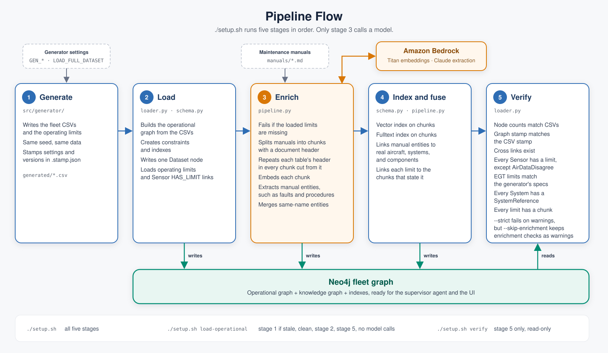
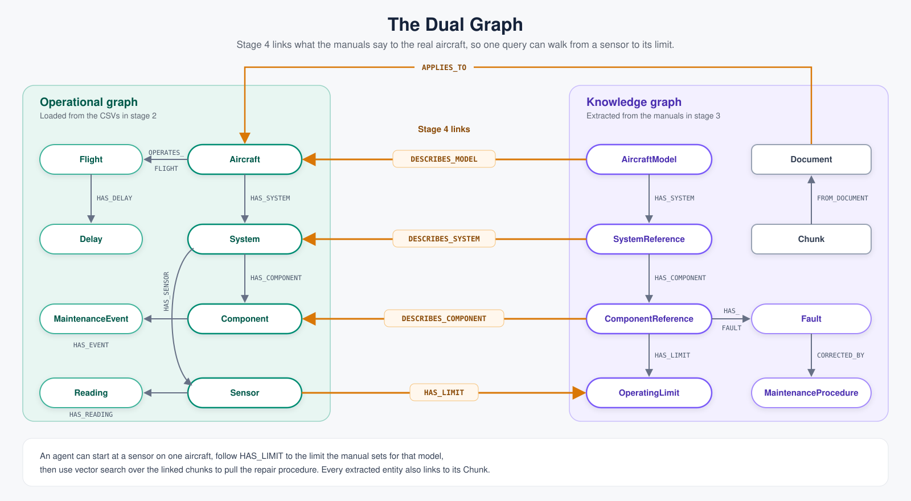

# Aircraft Fleet Pipeline

This pipeline builds a GraphRAG knowledge graph in Neo4j with Amazon Bedrock.
It loads structured fleet data, adds knowledge extracted from maintenance
manuals, and links the two into one graph.



## Overview

- **Dataset:** The pipeline uses the Aircraft Digital Twin fleet. It holds aircraft, systems, sensors, readings, flights, maintenance events, and maintenance manuals.
- **Five stages:** The pipeline generates data, loads it, enriches it from the manuals, builds indexes and cross-links, and verifies the result.
- **Bedrock:** Stage 3 uses Bedrock Titan for embeddings and Bedrock Claude for entity extraction. No other stage calls a model.
- **Consumers:** The supervisor agent and the browser UI read the graph this pipeline writes. They need no code changes.
- **Reuse:** You can swap in your own data and documents. The same five stages apply to any domain.

## Features

- **Repeatable data:** A fixed seed gives the same fleet on every run with the same settings and library versions.
- **Stamped datasets:** Each run records its settings and code hash. The load copies the stamp into the graph, and `verify` checks it.
- **Safe regeneration:** A failed or stopped generate run keeps the previous CSVs. A lock stops two runs from writing the same folder.
- **Structured output on Bedrock:** `StructuredBedrockLLM` gets schema-valid JSON from Claude through Converse tool use.
- **Document context in every chunk:** `ContextPrependingSplitter` puts the aircraft model in front of every chunk, so extraction labels each entity correctly. It also names the manual section each chunk starts in. It repeats a markdown table's header row in every chunk cut from that table.
- **Graph fusion:** Typed relationships link the extracted knowledge to the real aircraft, systems, components, and sensors.
- **Hybrid search indexes:** The pipeline creates a vector index and a fulltext index over the manual chunks.
- **Strict verification:** `verify --strict` turns warnings into failures and exits with a nonzero code. That makes it usable in CI. With `--skip-enrichment`, the enrichment checks stay warnings.

## Quick start

Run these commands from `demos/aircraft-fleet/pipeline/`:

```bash
cp ../.env.sample ../.env   # set NEO4J_URI, NEO4J_USERNAME, NEO4J_PASSWORD
./setup.sh                  # install dependencies and run all five stages
```

- **Shared `.env`:** The file lives in `demos/aircraft-fleet/`. The pipeline, the supervisor agent, and the UI read it.
- **Neo4j version:** The pipeline needs Neo4j 5.23 or later for its scoped `CALL (x) { ... }` subqueries. Aura runs a newer version.
- **AWS credentials:** `LLM_PROVIDER=bedrock` is the default. Enrichment uses your AWS credentials from the environment or `~/.aws`.
- **Dataset size:** Leave `LOAD_FULL_DATASET=false` for a small, fast run.

## Pipeline stages

| Stage | Code | Output |
|-------|------|--------|
| 1. Generate | `src/generator/` | CSVs and a `.stamp.json` in `generated/`. The folder is git-ignored. |
| 2. Load | `loader.py`, `schema.py` | The operational graph, one `Dataset` node with the stamp, and the constraints and indexes |
| 3. Enrich | `pipeline.py` | `Document` and `Chunk` nodes with embeddings, and the extracted entities |
| 4. Index and fuse | `schema.py`, `pipeline.py` | The `maintenanceChunkEmbeddings` vector index, the `maintenanceChunkText` fulltext index, and the links between the two graphs |
| 5. Verify | `loader.py`, `pipeline.py` | A pass or fail report |

- **Sample fulltext indexes:** Stage 2 also creates four fulltext indexes for sample queries: `maintenance_search`, `delay_search`, `component_search`, and `document_search`.
- **Operational labels:** Stage 2 writes `Aircraft`, `System`, `Component`, `Sensor`, `Reading`, `Flight`, `Airport`, `Delay`, `MaintenanceEvent`, and `Removal`.
- **Extracted labels:** Stage 3 writes `AircraftModel`, `SystemReference`, `ComponentReference`, `Fault`, `MaintenanceProcedure`, and `OperatingLimit`.
- **Operating limits:** Each `OperatingLimit` has a `regime` from a closed list of 15 in `schema.OPERATING_LIMIT_REGIMES`. `EXTRACTION_PROMPT` takes the hard limits for Takeoff, Max Continuous, and Start only from the Maximum column of a manual's Operating Limits table. It gives a value from the Normal Operating Parameters table a `<regime> Normal` regime, such as `Takeoff Normal`.
- **Model:** Extraction uses `global.anthropic.claude-sonnet-5-5` by default. Embeddings use `amazon.titan-embed-text-v2:0` with 1024 dimensions.

## The dual graph



After stage 4, one database holds two subgraphs:

- **Operational graph:** This graph comes from the CSVs. It holds each aircraft by tail number, with its systems, components, sensors, readings, flights, and maintenance events.
- **Knowledge graph:** The LLM extracts this graph from the manuals. It holds model-level systems, components, faults, procedures, and operating limits.

`link_to_existing_graph()` writes these relationships between them:

| Relationship | Meaning |
|--------------|---------|
| `Document -[:APPLIES_TO]-> Aircraft` | A manual covers every aircraft of its model. |
| `AircraftModel -[:DESCRIBES_MODEL]-> Aircraft` | A model entity from the manual links to each aircraft of that model. |
| `SystemReference -[:DESCRIBES_SYSTEM]-> System` | A system in the manual links to the real system. |
| `ComponentReference -[:DESCRIBES_COMPONENT]-> Component` | A component in the manual links to the installed component. |
| `Sensor -[:HAS_LIMIT]-> OperatingLimit` | A live sensor links to each limit that the manual defines for its sensor type and model. Each limit covers one regime. |

An agent can start from a sensor reading on one aircraft. It can move to the
operating limits for that sensor and model. It can then pull the repair
procedure text with vector search over the linked chunks.

- **Empty limits:** `link_to_existing_graph()` deletes each `OperatingLimit` that has no `minValue` and no `maxValue`. It does this before it writes `HAS_LIMIT`.
- **Model scope:** Entity names include the aircraft type. Entity resolution stays inside one model, so each model keeps its own limits.

## Commands

### setup.sh

Run these from `demos/aircraft-fleet/pipeline/`:

| Command | What it runs |
|---------|--------------|
| `./setup.sh` | Install dependencies, generate, clean, load, enrich, fuse, and `verify --strict` |
| `./setup.sh generate` | Stage 1 only |
| `./setup.sh load` | Regenerate if stale, clean, then stages 2 to 5. This needs Bedrock or LLM access. |
| `./setup.sh load-operational` | Regenerate if stale, clean, then stage 2 only. This makes no model calls. It ends with `verify --strict --skip-enrichment`. Missing enrichment prints as warnings, and an operational problem fails the run. |
| `./setup.sh verify` | Stage 5 only, with `--strict`. It is read-only. It needs the CSVs in `generated/`, so run `./setup.sh generate` first in a fresh clone. |
| `./setup.sh clean` | Delete all nodes and relationships |
| `./setup.sh samples` | Run showcase queries against the loaded graph |

### populate-aircraft-db

`uv run populate-aircraft-db` has more commands:

- **`enrich`:** This command runs stages 3 and 4 on a graph that is already loaded.
- **`clean-enrichment`:** This command drops only the knowledge graph. It keeps the operational data.
- **`debug-extract`:** This command runs the extractor on selected chunks. It does not write to Neo4j.
- **`agent-samples`:** This command simulates an agent that sends Cypher and vector searches.
- **`load-operational`:** This command loads without running `clean` first. It merges each node on its ID and keeps the enrichment already in the graph. It then relinks that enrichment. Run `clean` first only when the graph holds a different generated dataset. Nodes and relationships that the new CSVs lack would otherwise stay, and the leftover nodes fail `verify`'s count check. `clean` also deletes the enrichment. `./setup.sh load-operational` runs `clean` for you.

### generate-data

`uv run generate-data` drives the generator:

- **`generate`:** This command writes the CSVs and the stamp into `generated/`.
- **`validate`:** This command checks referential integrity across the generated CSVs.
- **`stats`:** This command recounts the default dataset's maintenance events into `manuals/fleet-stats.json`. Run it after a generator change.
- **`render-manuals`:** This command re-renders the generated blocks in the manuals from their specs. Add `--check` to test without writing.

## Dataset stamps

- **The stamp:** `generate` writes `generated/.stamp.json`. It holds the generator settings, a hash of the generator code, and the Python, Faker, and NumPy versions.
- **Staleness:** `generated/` is stale when its stamp does not match the `GEN_*` values, the code, or the installed versions. `load` and `load-operational` regenerate it then and print the reason.
- **Atomic writes:** Each run writes into a `generated/.generating-*` temp directory first. The new stamp goes in last, after every CSV has moved.
- **Interrupted runs:** A run stopped before the move keeps the previous CSVs and stamp. A run stopped during the move leaves no stamp, so the next `load` regenerates.
- **Lock:** A `generate` stops at once while another generate or a load holds the folder's lock. It prints `another generate or a load is running in` and the folder path.
- **Your files:** Files you add to `generated/` are kept.
- **Graph check:** `verify` compares the graph's `Dataset` node with the stamp, and the stamp with the current code. It also compares each operational label's node count with its CSV row count.
- **Strict mode:** `verify --strict` fails on any mismatch, or when the stamp is missing.
- **Operational-only graphs:** `verify --strict --skip-enrichment` reports the enrichment checks as warnings. Those cover documents, chunks, embeddings, the chunk indexes, the extracted-entity constraints, the cross links, the sensor limit check, the EGT limit check, and the check for systems without a `SystemReference`. The sensor limit check requires every `Sensor` to link to an `OperatingLimit`, except the `AirDataDisagree` sensors that the manuals give no limit. The operational and stamp checks still fail. `./setup.sh load-operational` uses it.

## Structured output on Bedrock

`src/populate_aircraft_db/bedrock_structured.py` is the most reusable part of
this pipeline.

- **The need:** The `neo4j-graphrag` entity extractor asks its LLM for JSON that matches a schema through `response_format`.
- **The class:** `StructuredBedrockLLM` is a small subclass of `BedrockLLM`. It answers that request through Bedrock Converse tool use.
- **How it works:** It declares the target schema as a tool and offers it with `toolChoice` set to `auto`. Claude Sonnet 5.5 rejects a forced tool choice. If the reply has no tool call, or its tool arguments fail validation against the `response_format` model, the call is retried once. The tool input is the structured result.
- **Reuse:** You can copy this subclass into any Bedrock and `neo4j-graphrag` pipeline.

## Keep document context in every chunk

- **The class:** `ContextPrependingSplitter` in `pipeline.py` wraps `FixedSizeSplitter`.
- **What it adds:** It adds a `[DOCUMENT CONTEXT]` header with the aircraft type and title to every chunk. The header also names the manual section the chunk starts in. A manual's first chunk starts before any section heading, so its header has no section.
- **Why it is needed:** `SimpleKGPipeline` passes document metadata only to the lexical graph builder. The header is the only place where the extractor sees the airframe model.
- **Where it matters:** Chunks deep in engine sections often name only the engine.
- **Table headers:** A chunk that starts inside a markdown table also gets the table's header row and separator after the context header. Without them, a chunk cut below a table's header holds values with no column names, such as an EGT row with no operating regimes.
- **The prompt:** `EXTRACTION_PROMPT` tells the model to read the header and keep the airframe model apart from the engine model.

## Configuration

The pipeline reads the shared `.env` in `demos/aircraft-fleet/`.

### Provider

`LLM_PROVIDER` picks the backend for embeddings and extraction:

- **`bedrock`:** This default uses Bedrock Titan and Bedrock Claude with the standard AWS credential chain.
- **`openai`:** This option uses OpenAI for embeddings and extraction.
- **`anthropic`:** This option uses OpenAI embeddings and Anthropic extraction. `./setup.sh` installs the `anthropic` extra. If you run `uv` yourself, run `uv sync --extra anthropic` first.

### Bedrock settings

- **Models:** You can override the extraction and embedding models in `.env`.
- **Embedding dimensions:** Each `clean` and `setup` creates the vector index at the configured dimension. If you change the embedding model, set a matching `BEDROCK_EMBEDDING_DIMENSIONS` and run the pipeline again.
- **Region:** The pipeline and the agents share one `AWS_REGION`, which defaults to `us-east-1`. Enable the models in that region.
- **Chunking:** `CHUNK_SIZE` defaults to 800 and `CHUNK_OVERLAP` to 100. `ENRICH_SAMPLE_SIZE` limits chunks per document for fast test runs.

### Dataset size

| Setting | Fleet | Size |
|---------|-------|------|
| `LOAD_FULL_DATASET=false` | 30 aircraft over 90 days | About 800,000 nodes, 830,000 relationships, a 54 MB readings file, and 227 maintenance events |
| `LOAD_FULL_DATASET=true` | 100 aircraft over 90 days | About 2.7 million nodes and 180 MB of readings |

- **Aura Free:** Both sizes are past the Aura Free limits. Use a paid Aura tier or a local Neo4j.
- **Window length:** Each sensor's wear reaches the same share of its limit by the end of any window. A shorter window has fewer events.
- **Overrides:** Set `GEN_AIRCRAFT`, `GEN_DAYS`, `GEN_AIRPORTS`, and `GEN_SEED` to change single values.

## Adapt this pipeline to your domain

1. **Replace stage 1:** Use your own structured data source. Update the constraints and indexes in `schema.py`.
2. **Replace `manuals/`:** Add your own documents. Update the `DOCUMENTS` list and the `[DOCUMENT CONTEXT]` header in `pipeline.py`.
3. **Redefine the extraction schema:** Edit `build_extraction_schema` and `OPERATING_LIMIT_REGIMES` in `schema.py`, and the rules in `EXTRACTION_PROMPT`. The `verify` EGT limit check in `loader.py` compares extracted limits with the generator's `ENGINE_SPECS`, so replace it too.
4. **Rewrite the fusion Cypher:** Edit `link_to_existing_graph()` so it joins your two graphs on their shared keys.

`StructuredBedrockLLM` and `ContextPrependingSplitter` work unchanged.

## Code map

| Path | Purpose |
|------|---------|
| `src/generator/` | Stage 1: the synthetic dataset generator and the `generate-data` CLI |
| `src/populate_aircraft_db/loader.py` | Stages 2 and 5: CSV bulk load and verification |
| `src/populate_aircraft_db/schema.py` | Constraints, indexes, and the extraction `GraphSchema` |
| `src/populate_aircraft_db/pipeline.py` | Stages 3 and 4: `SimpleKGPipeline`, the splitter, and the fusion Cypher |
| `src/populate_aircraft_db/bedrock_structured.py` | `StructuredBedrockLLM` |
| `src/populate_aircraft_db/config.py` | Settings, including the provider and Bedrock models |
| `src/populate_aircraft_db/main.py` | The `populate-aircraft-db` CLI |
| `src/populate_aircraft_db/agent_samples.py` | Chat and embedding calls for `agent-samples` |
| `manuals/` | The maintenance manuals used for enrichment |
| `generated/` | The CSV output and its stamp. It is git-ignored. |
| `setup.sh` | One command that drives all five stages |

## Connect the supervisor

- **Local runs:** The supervisor reads the same `NEO4J_*` settings from the shared `.env`, so it needs no extra setup. Run `./agent.sh start` in `../supervisor-agent/`.
- **Deploys:** The deployed supervisor reads the graph as a read-only user. The [supervisor README](../supervisor-agent/README.md#create-the-secrets) shows how to create that user and its secret.

## See also

- **Architecture:** The [pipeline architecture document](../docs/architecture/pipeline.md) explains the design. The [fleet architecture document](../docs/ARCHITECTURE.md) shows how it fits with the rest of the demo.
