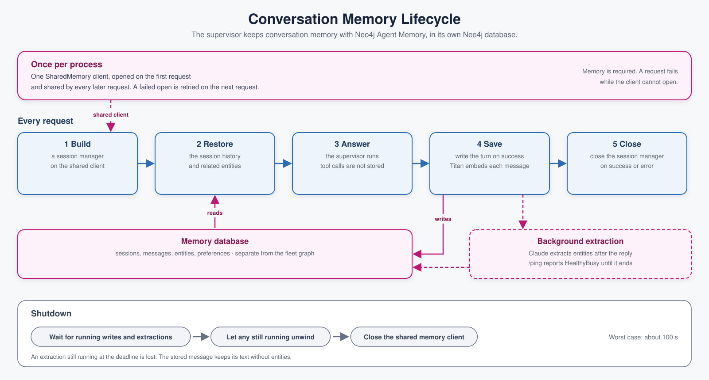

# Aircraft Fleet Supervisor Agent

This Strands supervisor agent answers questions about the aircraft fleet graph.
It hands each question to one or both specialist agents. The specialists read
Neo4j directly with the Neo4j Python driver.


## Overview

- **Supervisor:** The supervisor is a Strands `Agent`. Its two tools are the specialists, and the model picks one or both from the tool descriptions.
- **Maintenance Agent:** This specialist handles faults, components, sensors, reliability, and the maintenance manuals. Its tools are `graph_query_tool` and `vector_search_tool`.
- **Operations Agent:** This specialist handles flights, delays, routes, and airports. It also takes general questions, such as the schema or simple counts. Its one tool is `graph_query_tool`.
- **Memory:** The supervisor remembers each session and what it learns about each user. Memory lives in its own Neo4j database.

## Features

- **Parallel specialists:** The supervisor can call both specialists, or one specialist twice, in the same turn. Each call gets a fresh specialist `Agent`, so calls never wait on each other.
- **Read-only queries:** Each generated Cypher query runs `EXPLAIN` first, and the tool refuses any query that is not read-only. Each query also gets a 30-second timeout and a 200-row cap.
- **Read-only user:** With the secrets set, the agent logs in to the fleet graph as `fleet_reader`, which holds only read roles.
- **Error scrubbing:** The tools replace raw database errors before the model sees them. No database address reaches an answer.
- **No passwords in the deploy:** The deployed Runtime reads both Neo4j passwords from Secrets Manager.
- **Streaming:** The server streams `agent`, `tool`, `chunk`, `complete`, and `error` events over SSE.

## Quick start

Run these commands from `demos/aircraft-fleet/supervisor-agent/`. The server
reads the shared `../.env`, the same file the pipeline uses.

```bash
uv sync

./agent.sh start                       # terminal 1: serves http://localhost:7071
./agent.sh test-maintenance            # terminal 2: a question for Maintenance
./agent.sh test-operations             # a question for Operations
uv run fleet-supervisor-cli "Compare fault counts with delay counts"
```

## Prerequisites

- **Python:** You need Python 3.12 or later and the `uv` package manager.
- **AWS:** You need AWS credentials with Bedrock access to Claude Sonnet 5.5 and Titan Text Embeddings v2.
- **Graph:** You need the fleet graph loaded by the [pipeline](../pipeline/). The `NEO4J_*` settings in `../.env` name it.
- **Memory database:** You need a second Neo4j database or instance for memory. It can be empty. Keep it apart from the fleet graph.

## Routing

The supervisor model reads the two tool descriptions in
`fleet_supervisor/core/agents.py` and the prompt in
`fleet_supervisor/core/prompts.py`. A question that spans both domains calls
both specialists, and the supervisor combines their answers.

| Question mentions | Goes to |
|-------------------|---------|
| maintenance, faults, failures, components, systems, sensors, readings, severity, manuals | Maintenance Agent |
| flights, delays, delay causes, routes, airports, operators, schedules, on-time performance | Operations Agent |
| the schema, simple counts, or other general topics | Operations Agent |

## Graph tools

The tools live in `fleet_supervisor/core/graph/`. They share one Neo4j driver
per process.

- **Graph query:** `graph_query_tool(question)` asks Claude for Cypher against the live schema, checks it, and runs it. It answers lookups, counts, aggregations, and traversals.
- **Vector search:** `vector_search_tool(query, top_k=5)` runs hybrid vector and fulltext search over the manual chunks. `top_k` runs from 1 to 20.
- **Schema:** Both specialist prompts hold the live schema. It is cached for 600 seconds, so a running server picks up a pipeline reload.
- **Login:** The driver reads `NEO4J_PASSWORD_SECRET_ARN` when it is set. Otherwise it uses `NEO4J_USERNAME` and `NEO4J_PASSWORD`.

The [supervisor architecture](../docs/architecture/supervisor-agent.md)
covers the read-only guard, hybrid search, and the errors the model sees.

## Conversation memory



- **Package:** Memory uses `neo4j-agent-memory` 0.8.0+fleet.9, a build of the `neo4j-partners/agent-memory` fork. `pyproject.toml` pins the wheel URL, and `uv.lock` records its sha256.
- **Extraction model:** The extractor runs on Claude Sonnet 5.5. It sends no temperature and lets the model choose the tool, because Sonnet 5.5 rejects both.
- **What it stores:** Memory keeps the user and assistant text of each turn. It does not store specialist calls.
- **One client per process:** The client opens on the first request and closes at shutdown. Each request gets its own session manager on it.
- **Background extraction:** Entity extraction runs after the reply. The health check reports busy until it ends, so AgentCore Runtime keeps the session alive.
- **Shutdown:** Shutdown waits up to 30 seconds for open requests to write their memory, then closes the client. The whole close takes at most about 100 seconds.
- **Lost work:** An extraction still running at the deadline is lost. The stored message keeps its text without entities.
- **Password rotation:** If Neo4j rejects the memory password, the server reads the secret again and reopens the client with it.

## Run locally

- **Shared .env:** The server loads `demos/aircraft-fleet/.env` at startup. Set `FLEET_ENV_FILE` to use another file. A value already set in the environment wins.
- **Fleet graph:** Set `NEO4J_URI` and either `NEO4J_PASSWORD_SECRET_ARN` or `NEO4J_PASSWORD`.
- **Memory settings:** Set `MEM_NEO4J_URI` and either `MEM_NEO4J_PASSWORD_SECRET_ARN` or `MEM_NEO4J_PASSWORD`. Set `MEM_NEO4J_USERNAME` and `MEM_NEO4J_DATABASE` too if they are not `neo4j`.
- **Startup check:** The server reads both logins before it serves. A missing setting, a bad secret ARN, or a missing IAM grant stops startup.
- **Server:** `./agent.sh start` runs `uv run fleet-supervisor-server` on port 7071. Set `AGENT_PORT` to change it.
- **Runtime entrypoint:** `uv run python main.py` starts the same server on port 8080, the port AgentCore Runtime uses.
- **Browser UI:** The [UI](../ui/) shows the answer, the specialist and tool calls, and the graph evidence for each call.

### Events

| Event | Meaning |
|-------|---------|
| `{"type": "agent", "name": ...}` | A specialist was called |
| `{"type": "tool", "name": ...}` | A specialist called a graph tool |
| `{"type": "chunk", "data": ...}` | Text of the supervisor's answer |
| `{"type": "complete"}` | The answer is finished |
| `{"type": "error", "error": ...}` | The request failed. The message is generic, and the details are in the server log. |

A payload with `"trace": true` adds a `call_id` and a `parent_id` to the
`agent` and `tool` events. It also adds a `tool_complete` event when a
specialist or graph tool call finishes. The UI uses the trace.

## Create the secrets

The deployed Runtime logs in to the fleet graph as a read-only user and reads
both passwords from Secrets Manager. Create the user, then the secrets, then
deploy. Local runs read the same secrets once their ARNs are in `../.env`.

### Create the read-only user

Run this Cypher as the admin user against the `system` database of the fleet
graph.

```cypher
CREATE USER fleet_reader SET PASSWORD '<new-password>' CHANGE NOT REQUIRED;
GRANT ROLE reader TO fleet_reader;
GRANT ROLE graphql_app_read_only_<AURA_ID> TO fleet_reader;
```

- **Why the second role:** On Aura, the built-in `reader` role cannot run the schema procedures that Text2Cypher calls. Aura's `graphql_app_read_only_<AURA_ID>` role adds them. Without it, the schema read fails.
- **Find the role name:** Run `SHOW ROLES YIELD role WHERE role STARTS WITH 'graphql_app_read_only_' RETURN role;` and use the name it returns.
- **Self-managed Neo4j:** Grant `reader` and check that the user can run the schema read. The Aura role does not exist there.

Check the roles:

```cypher
SHOW USERS YIELD user, roles WHERE user = 'fleet_reader' RETURN user, roles;
```

The roles are `PUBLIC`, `reader`, and `graphql_app_read_only_<AURA_ID>`. To
check that writes fail, log in as `fleet_reader` against the fleet database and
run `CREATE (:ReaderProbe) RETURN 1;`. Neo4j refuses it with `42NFF`. If the
write succeeds, the user has a write role. Remove the probe node with
`MATCH (n:ReaderProbe) DELETE n` as the admin user, and fix the roles.

Tested on 2026-11-23 against an Aura instance: the user creation, both grants,
the role check, the refused write, and a read of the 30 aircraft as
`fleet_reader`.

### Create the two secrets

Add the reader login to `../.env`, then run the script:

```bash
# in ../.env
NEO4J_READER_USERNAME=fleet_reader
NEO4J_READER_PASSWORD=<new-password>

uv run fleet-supervisor-secrets --dry-run   # reports what a run would do
uv run fleet-supervisor-secrets
```

- **What it creates:** `fleet/neo4j-reader` holds the `fleet_reader` login. `fleet/memory-neo4j` holds the memory login from `MEM_NEO4J_USERNAME`, default `neo4j`, and `MEM_NEO4J_PASSWORD`. Each secret is a JSON object with `username` and `password` keys.
- **Admin refused:** The script refuses a reader user name that matches `NEO4J_USERNAME`, the admin user the pipeline writes as.
- **Output:** The script prints the two ARN lines, `NEO4J_PASSWORD_SECRET_ARN=...` and `MEM_NEO4J_PASSWORD_SECRET_ARN=...`. Add both lines to `../.env`. The script never writes `.env` and never prints a user name or a password.
- **Rerun:** The run is idempotent. A missing secret is created, a changed one gets a new version, and a matching one is left alone. If the second secret fails, rerun the script to get both ARNs.
- **Region and key:** The secrets go to `AWS_REGION`, default `us-east-1`. They use the AWS managed key, because the Runtime role has no `kms:Decrypt` grant.
- **Env file:** The script reads `../.env`, or the file `FLEET_ENV_FILE` or `--env-file` names.

Once the ARN lines are in `../.env`, local runs log in as `fleet_reader` too.
The memory login comes from its secret as well.

Tested on 2026-11-23: both secrets created in `us-east-1`, and a local server
that read both from Secrets Manager, logged in as `fleet_reader`, and counted
30 aircraft.

## Deploy

Create the [secrets](#create-the-secrets) and run the
[local start check](#check-the-runtime-start-locally) before each deploy.

```bash
./agent.sh deploy                  # takes several minutes
./agent.sh invoke-cloud "What are the most common maintenance faults?"
./agent.sh invoke-cloud "Which routes have the most delays?"
```

### Check the Runtime start locally

AgentCore Runtime starts the agent under `opentelemetry-instrument`. That
wrapper imports botocore and urllib3 before the agent code runs. Code that
starts cleanly under plain `uv run` can still crash in the Runtime because of
that import order. The deploy then reports only "The runtime process exited
unexpectedly" and rolls back after several minutes.

Run this from `supervisor-agent/` before you deploy. It takes a few seconds and makes
no AWS API calls:

```bash
OTEL_TRACES_EXPORTER=none OTEL_METRICS_EXPORTER=none OTEL_LOGS_EXPORTER=none \
  uv run opentelemetry-instrument python -c "import fleet_supervisor.server; import boto3; boto3.client('sts', region_name='us-east-1')"
```

- **Exporters:** The three `OTEL_*_EXPORTER=none` settings stop the wrapper from exporting to `localhost:4317`. Without them, it prints connection errors.
- **Tests:** `uv run pytest tests/test_truststore.py` runs the same check automatically.
- **Full server:** `uv run opentelemetry-instrument fleet-supervisor-server` starts the whole server the same way the Runtime does.
- **Failed deploy:** If a deploy fails with "The runtime process exited unexpectedly", run this check first. Then read the traceback in the Runtime log group.

### Deploy settings

- **Source:** The deploy reads `NEO4J_URI`, `NEO4J_USERNAME`, `NEO4J_DATABASE`, `MEM_NEO4J_URI`, `MEM_NEO4J_USERNAME`, `MEM_NEO4J_DATABASE`, and the two secret ARNs from `demos/aircraft-fleet/.env`, and passes them to the Runtime.
- **TLS:** Both URIs must use `neo4j+s://` or `bolt+s://`.
- **Secret ARNs:** `NEO4J_PASSWORD_SECRET_ARN` and `MEM_NEO4J_PASSWORD_SECRET_ARN` must be complete secret ARNs. The Runtime role can read only those two secrets.
- **User names:** A secret's `username` key wins over the user name setting. `NEO4J_USERNAME` can stay the admin user, because the fleet secret names `fleet_reader`.
- **Parsing:** The file is parsed, not sourced. A value exported in the shell wins.
- **Validation:** Synth stops with one error that lists every missing or malformed setting.

### How the deploy works

- **Code zip:** The zip holds this folder except `.venv`, `agentcore/`, `__pycache__`, and `.pytest_cache`. The runtime runs `main.py`.
- **Secret guard:** `./agent.sh deploy` refuses to run if any `.env*`, `.mcp-credentials*.json`, `.agentcore.json`, `credentials*.json`, or `*.pem` file, or a `venv/` folder, is inside this folder.
- **CDK dependencies:** `deploy` and `destroy` run `npm ci` in `agentcore/cdk` when the install is missing, incomplete, or older than `package-lock.json`. `configure` always runs it.
- **Invoke permission:** Deployed calls name no Runtime user, because the agent needs no workload access token. Its `agentcore.json` declares no credentials, memories, or gateways. That covers `fleet-supervisor-cli --remote`, `fleet-supervisor-invoke`, `load-test`, and the UI with `AGENT_ARN` set. The caller's IAM identity needs only `bedrock-agentcore:InvokeAgentRuntime`.

### Remove the deployment

`./agent.sh destroy` removes the runtime, its stack, and the runtime's
CloudWatch log groups.

- **Confirmation:** It asks first. Pass `--yes` to skip the question.
- **Account check:** It confirms that the active credentials belong to the account in `agentcore/aws-targets.json`, before it asks and again before its final lookups.
- **How it works:** The CLI has no destroy command. The script removes the runtime from the spec and deploys, which deletes the stack.
- **No stack:** When CloudFormation shows no stack, there is nothing to remove. It skips the question and the deploy and goes straight to the final check.
- **Final check:** It reads `agentcore status` and looks up the stack in AWS by name. If anything remains, it prints the command that deletes it and exits with an error.
- **Log groups:** The stack delete keeps the runtime's log group, `/aws/bedrock-agentcore/runtimes/<runtime-id>-DEFAULT`. Before it removes anything, destroy reads the runtime ID from the stack's `AWS::BedrockAgentCore::Runtime` resource. The AgentCore CLI does not record the ID locally. After the final check passes, it deletes each log group that starts with `<runtime-id>-` and prints `Removed` or `Not found` for each. A failed delete does not stop the others, but destroy then exits 1 and names the group. When the stack has no single matching Runtime, or the stack was already gone, destroy leaves the log groups alone.
- **Lost local state:** If `agentcore/.cli/` is lost, destroy still deletes the stack. The runtime ID comes from the stack, so the log groups are still removed.

If a log group delete fails, or destroy could not read the runtime ID, remove the group by hand after the stack is gone. Use the Region from `agentcore/aws-targets.json`. The failure lines name the group, and the AWS Console lists it under CloudWatch log groups.

```bash
REGION=us-east-1
RUNTIME_ID=<runtime-id>
aws logs describe-log-groups --region "$REGION" \
    --log-group-name-prefix "/aws/bedrock-agentcore/runtimes/$RUNTIME_ID-" \
    --query 'logGroups[].logGroupName' --output text
aws logs delete-log-group --region "$REGION" \
    --log-group-name "/aws/bedrock-agentcore/runtimes/$RUNTIME_ID-DEFAULT"
```

### Remove the secrets and the reader

Destroy leaves the two secrets and the `fleet_reader` user in place. Remove
them after the stack is gone, and remove the two ARN lines from `../.env` so
local runs fall back to the plain passwords.

```bash
REGION=us-east-1
aws secretsmanager delete-secret --region "$REGION" --secret-id fleet/neo4j-reader
aws secretsmanager delete-secret --region "$REGION" --secret-id fleet/memory-neo4j
```

```cypher
DROP USER fleet_reader;
```

- **Recovery window:** `delete-secret` schedules the delete, by default after 30 days. Until then the name stays taken.
- **Recreate:** `fleet-supervisor-secrets` refuses a secret scheduled for deletion. Restore it with `aws secretsmanager restore-secret --secret-id <name>`, then run the script again.
- **User:** Run `DROP USER` as the admin user against the `system` database.

### Upgrade a checkout that already deployed

Git used to track `agentcore/aws-targets.json`, and the first deploy edited it.
A `git pull` in that checkout can stop with "Your local changes to the
following files would be overwritten by merge", or with "cannot pull with
rebase: You have unstaged changes".

Keep the file, because destroy needs it. Run these two commands from this
folder in one shell. The first backs the file up, prints the backup name, then
discards the change and pulls. The second restores the file only if the backup
was complete:

```bash
backed_up= && backup=$(mktemp) && cp agentcore/aws-targets.json "$backup" && backed_up=1 && echo "Backup: $backup" && git checkout -- agentcore/aws-targets.json && git pull
[ "${backed_up:-}" = 1 ] && cp "$backup" agentcore/aws-targets.json && rm -f "$backup"
```

If the last `cp` fails, copy the backup back by hand from the printed name. If
the backup is lost, recreate the file with the account and region you deployed
to:

```json
[{"name": "default", "account": "<12-digit account ID>", "region": "<region>"}]
```

A checkout that deployed the earlier Gateway design had a Gateway credential
provider. The current design does not use it. The next deploy deletes it when
`agentcore/.cli/deployed-state.json` still records it. After that deploy,
check for it, and delete it if it is still there:

```bash
aws bedrock-agentcore-control get-oauth2-credential-provider --region <region> --name fleetsupervisor_default_fleet-gateway
aws bedrock-agentcore-control delete-oauth2-credential-provider --region <region> --name fleetsupervisor_default_fleet-gateway
```

Then delete the `AGENTCORE_CREDENTIAL_FLEET_GATEWAY_CLIENT_SECRET` line from
`agentcore/.env.local` if it is there.

## Commands

| Command | Description |
|---------|-------------|
| `./agent.sh start` / `stop` | Start or stop the agent locally on port 7071 |
| `./agent.sh test ["question"]` | Send a question to the local agent. The default asks for the schema. |
| `./agent.sh test-maintenance` | Send a question that goes to the Maintenance Agent |
| `./agent.sh test-operations` | Send a question that goes to the Operations Agent |
| `./agent.sh configure` | Create the AgentCore project if it is missing, and install its CDK dependencies |
| `./agent.sh deploy` | Deploy to AgentCore Runtime |
| `./agent.sh status` | Show the deployment status |
| `./agent.sh logs [30m]` | Show runtime logs from the given window |
| `./agent.sh invoke-cloud ["question"]` | Call the deployed agent through `agentcore invoke --runtime supervisor` |
| `./agent.sh load-test [N]` | Send a random test question to the deployed agent every N seconds. It reads the ARN from `AGENT_ARN` or `agentcore status`. |
| `./agent.sh destroy [--yes]` | Remove the runtime, its stack, and its log groups |
| `uv run fleet-supervisor-secrets` | Create or update the two deploy secrets |

## Layout

| Path | Purpose |
|------|---------|
| `main.py` | The AgentCore entrypoint. It starts the server on port 8080. |
| `fleet_supervisor/server.py` | The `BedrockAgentCoreApp`, its entrypoint, and `main()` |
| `fleet_supervisor/core/config.py` | The model, region, token limit, effort, local port, and graph settings |
| `fleet_supervisor/core/prompts.py` | The supervisor prompt and the two specialist prompts |
| `fleet_supervisor/core/agents.py` | The supervisor and `SpecialistTool` |
| `fleet_supervisor/core/model.py` | The Bedrock model factory |
| `fleet_supervisor/core/graph/` | The graph tools, the Neo4j driver, Text2Cypher with the read-only guard, and the error classifier |
| `fleet_supervisor/core/secrets.py` | The Neo4j logins, from a secret ARN or the plain settings |
| `fleet_supervisor/core/memory.py` | The memory client, the per-request session managers, and shutdown |
| `fleet_supervisor/core/events.py` | The mapping from Strands stream events to client events |
| `fleet_supervisor/core/tool_stream.py` | The `tool_complete` events for traced requests |
| `fleet_supervisor/setup_secrets.py` | `fleet-supervisor-secrets`, which creates the two deploy secrets |
| `fleet_supervisor/client/cli.py` | `fleet-supervisor-cli`, which asks the local server, or the deployed agent with `--remote`, one question |
| `fleet_supervisor/client/invoke.py` | `fleet-supervisor-invoke`, for cloud calls and load testing |
| `fleet_supervisor/client/transport.py` | The local HTTP and deployed Runtime calls |
| `fleet_supervisor/client/queries.txt` | 33 test questions: 1 to 18 for maintenance and 19 to 33 for operations |
| `agentcore/` | The AgentCore CLI project and its CDK app |
| `tests/` | Unit tests |
| `agent.sh` | The command wrapper for local runs and deployment |

## Environment variables

| Variable | Default | Purpose |
|----------|---------|---------|
| `MODEL_ID` | `global.anthropic.claude-sonnet-5-5` | The Bedrock model for all three agents and Text2Cypher |
| `AWS_REGION` | `us-east-1` | The Bedrock and AgentCore region, and the region the secrets script writes to. The server reads each secret in the region its ARN names. |
| `MAX_TOKENS` | `16000` | The output token limit |
| `MODEL_EFFORT` | `high` | The adaptive thinking effort |
| `AGENT_PORT` | `7071` | The local server port |
| `NEO4J_URI` | required | The fleet graph URI |
| `NEO4J_USERNAME` | `neo4j` | The fleet graph user. The secret's `username` key wins when it has one. |
| `NEO4J_DATABASE` | `neo4j` | The fleet graph database name |
| `NEO4J_PASSWORD` | unset | Local runs only. Required when `NEO4J_PASSWORD_SECRET_ARN` is unset. |
| `NEO4J_PASSWORD_SECRET_ARN` | unset | Required for `./agent.sh deploy`. When set, local runs read the fleet login from this secret too. |
| `NEO4J_READER_USERNAME` | required by the script | The read-only user that `fleet-supervisor-secrets` stores. The server does not read it. |
| `NEO4J_READER_PASSWORD` | required by the script | The read-only user's password for `fleet-supervisor-secrets`. The server does not read it. |
| `MEM_NEO4J_URI` | required | The memory database URI |
| `MEM_NEO4J_USERNAME` | `neo4j` | The memory database user. The secret's `username` key wins when it has one. |
| `MEM_NEO4J_DATABASE` | `neo4j` | The memory database name |
| `MEM_NEO4J_PASSWORD` | unset | Local runs only. Required when `MEM_NEO4J_PASSWORD_SECRET_ARN` is unset. |
| `MEM_NEO4J_PASSWORD_SECRET_ARN` | unset | Required for `./agent.sh deploy`. When set, local runs read the memory login from this secret too. |
| `VECTOR_INDEX_NAME` | `maintenanceChunkEmbeddings` | The chunk vector index |
| `FULLTEXT_INDEX_NAME` | `maintenanceChunkText` | The chunk fulltext index |
| `EMBED_MODEL_ID` | `amazon.titan-embed-text-v2:0` | The query embedder. It must match the pipeline's. |
| `EMBED_DIMENSIONS` | `1024` | The embedding size |
| `SCHEMA_TTL_S` | `600` | Seconds the graph schema stays cached |
| `TEXT2CYPHER_TIMEOUT_S` | `30` | The transaction timeout for each generated query |
| `TEXT2CYPHER_MAX_ROWS` | `200` | The row cap for each generated query |
| `TEXT2CYPHER_MAX_TOKENS` | `2048` | The output token limit for Cypher generation |
| `AGENT_ARN` | unset | The deployed agent for `--remote` and `load-test` |
| `FLEET_ENV_FILE` | `../.env` | The shared env file the server and the secrets script load |

## Tests

```bash
uv run pytest
uv run ruff check . && uv run ruff format --check .
```

The tests run offline and make no Bedrock, Secrets Manager, or Neo4j calls.
The one exception is `tests/test_memory_neo4j.py`, which runs against a real
Neo4j and is skipped unless `MEM_TEST_NEO4J_URI` and `MEM_TEST_NEO4J_PASSWORD`
are set.

## Example questions

- **Maintenance:** Try "Which components have the most failures?" or "What is the reliability history of avionics?"
- **Manuals:** Try "What is the hydraulic leak detection procedure?"
- **Operations:** Try "What are the most common delay causes?" or "Which airports have the highest traffic?"
- **Both:** The question "Compare maintenance fault counts with flight delay counts" calls both specialists.
- **General:** The question "What is the database schema?" goes to the Operations Agent.

See `fleet_supervisor/client/queries.txt` for all 33 questions.

## See also

- **Fleet demo:** The [fleet README](../README.md) shows how the pipeline, the supervisor, and the UI fit together.
- **Architecture:** The [supervisor architecture document](../docs/architecture/supervisor-agent.md) explains routing, the graph tools, and the read-only guard. The [deployment document](../docs/architecture/deployment.md) covers the stack, the secrets, and teardown.
