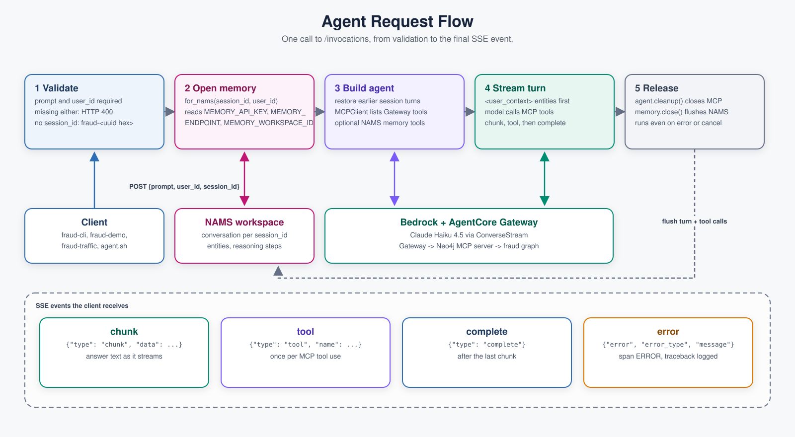
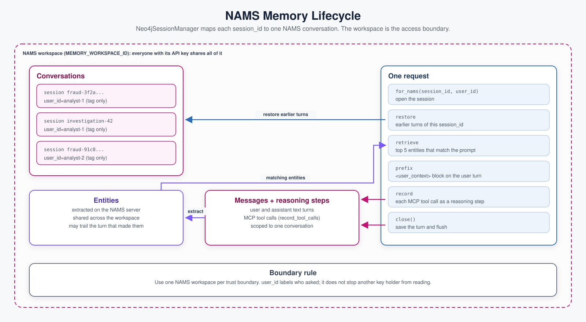
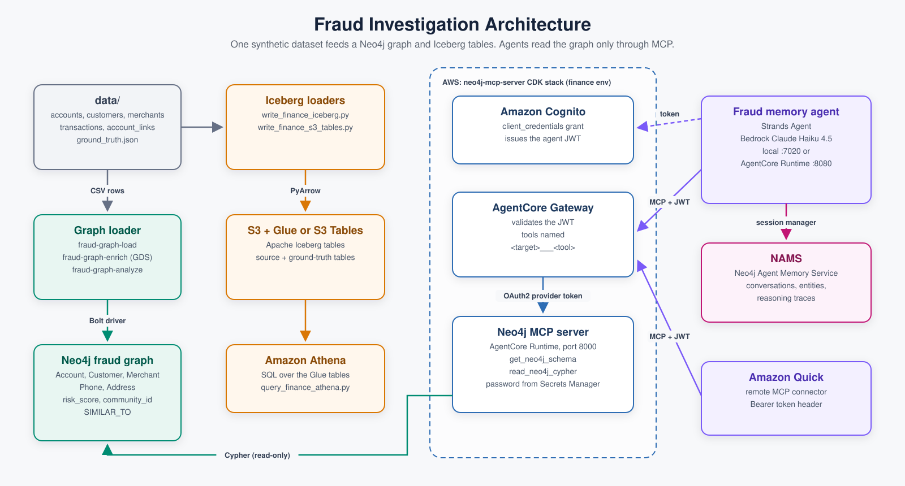

# Fraud Memory Agent

This Strands agent investigates financial-crime patterns in a Neo4j graph. It
reaches the graph through an Amazon Bedrock AgentCore Gateway and records every
turn in the hosted Neo4j Agent Memory Service.

## Overview

- **Graph access:** The agent calls Neo4j MCP tools through the AgentCore Gateway. It never connects to Neo4j directly.
- **NAMS:** The Neo4j Agent Memory Service, called **NAMS** below, holds the agent's memory. The agent reaches it through `Neo4jSessionManager` from `neo4j-agent-memory` 0.8.0.
- **Sessions:** Each `session_id` is one NAMS conversation. A call that repeats a `session_id` restores that conversation's earlier turns.
- **Separate stores:** The fraud graph and agent memory stay apart. The MCP server owns graph access. NAMS owns memory storage, embeddings, and its schema.
- **Credentials:** The agent needs no `NEO4J_*` values. It needs a NAMS API key and the Gateway credentials file `.mcp-credentials.json`. Both live in `demos/fraud-amazon-quick/`, outside the folder that `agent.sh deploy` zips.
- **Local and cloud:** You can run the agent locally on port 7020 or deploy it to AgentCore Runtime with `agent.sh`.
- **Traffic generator:** A load client sends synthetic analyst traffic so you can inspect memory in NAMS.



## Quick start

This assumes the graph is loaded and the MCP server is deployed. See
[Connect the agent to the fraud graph](#connect-the-agent-to-the-fraud-graph).
Run from `demos/fraud-amazon-quick/fraud-memory-agent/`:

```bash
cp ../.env.sample ../.env        # set MEMORY_API_KEY=nams_...
uv sync

uv run fraud-server              # Terminal 1
uv run fraud-cli --user-id analyst-1 "Find circular transfer chains"   # Terminal 2

./agent.sh deploy                # deploy to AgentCore Runtime and verify it
```

## Prerequisites

- **MCP server:** You need a deployed Neo4j MCP server and AgentCore Gateway. See [`neo4j-mcp-server/`](../../../neo4j-mcp-server/).
- **AWS credentials:** Your AWS credentials need access to the configured Bedrock model.
- **NAMS API key:** You can create a key at [NAMS](https://memory.neo4jlabs.com/).
- **AgentCore CLI:** The cloud commands in `agent.sh` need the AgentCore CLI. Install it with `npm install -g @aws/agentcore`. They also need `jq`.

## How memory works



The agent passes a `Neo4jSessionManager` to the Strands `Agent`. The session
manager reads `MEMORY_API_KEY`, `MEMORY_ENDPOINT`, and `MEMORY_WORKSPACE_ID`
from the environment.

- **Conversations:** Each `session_id` maps to one NAMS conversation. A call without a `session_id` starts a new conversation named `fraud-<uuid hex>`. A call that repeats a `session_id` continues that conversation.
- **Session restore:** When a call continues a session, the session manager loads the earlier turns into the Strands message history. The model sees them as real turns.
- **Messages:** NAMS stores the user and assistant text turns. The session manager saves the turn when the response stream closes.
- **Reasoning steps:** NAMS records each MCP tool call as a reasoning step in the conversation.
- **Entities:** NAMS extracts entities from the stored messages on the server. An entity can appear a little after the turn that produced it.
- **Entity context:** Before each user turn, the session manager finds the five workspace entities that best match the question. It adds them to the user message in a `<user_context>` block. The system prompt tells the model to treat the block as background data and to check facts against the graph.
- **Failures:** A failure to open the session or to store a message fails the request. The runtime logs the traceback at `ERROR`, marks the trace span `ERROR`, and sends an error event to the client.
- **Soft failures:** The session manager logs a warning and goes on when entity retrieval or tool-call recording fails. The turn then runs without the `<user_context>` block or without those reasoning steps.

### The workspace is the access boundary

NAMS separates data by workspace, not by user.

- **Shared reads:** Everyone who holds the workspace API key can read all of its conversations and entities.
- **User tag:** The agent tags each conversation with the request's `user_id`. The tag records who asked. It does not stop another key holder from reading the conversation.
- **Shared entities:** Entity context comes from the whole workspace. Entities from one analyst's investigation can appear in another analyst's `<user_context>` block.
- **Separate workspaces:** Use one workspace for each trust boundary, such as a team or a tenant. Give each deployment the API key and `MEMORY_WORKSPACE_ID` for its own workspace.

### Optional memory tools

Set `MEMORY_TOOLS=true` to also give the agent the NAMS Strands tools
(`search_context`, `set_entity_feedback`, `get_entity_provenance`, and a
read-only `cypher_query`). The agent decides when to call them. Like entity
context, these tools search the whole NAMS workspace. They use the same
`MEMORY_API_KEY`, `MEMORY_ENDPOINT`, and `MEMORY_WORKSPACE_ID` as the session
manager.

## Fraud graph dataset

The synthetic fraud dataset is committed in
[`demos/fraud-amazon-quick/data/`](../data/). It holds 25,000 accounts, 7,500
merchants, 250,000 merchant transactions, and 300,000 transfers.

- **Loader:** The direct Neo4j loader and the optional GDS enrichment step are documented in [`demos/fraud-amazon-quick/graph-loader/`](../graph-loader/README.md).
- **Ontology:** The file [`demos/fraud-amazon-quick/graph-loader/ontology.md`](../graph-loader/ontology.md) defines the business terms for the fraud domain. It explains what each investigation signal means and where it stops. It is an informal graph vocabulary, not an RDF or TTL ontology.

## Connect the agent to the fraud graph

The agent needs a deployed Neo4j MCP server whose `NEO4J_*` settings point to
the database with this dataset. The agent sends tool calls to the MCP server
through the AgentCore Gateway. The MCP server then connects to Neo4j.

Set up the graph and MCP server in this order. All paths and commands start
from the repo root.

1. In [`neo4j-mcp-server/`](../../../neo4j-mcp-server/), set the URI, database name, username, and password in `.env.finance`. Use a Neo4j database set aside for this demo.
2. In [`demos/fraud-amazon-quick/graph-loader/`](../graph-loader/README.md), put the same values in `.env` and load the graph. Run the GDS enrichment command if your questions need risk scores, communities, betweenness, or account similarity.
3. Deploy the MCP server, create its Gateway client credentials, and copy them to this agent:

   ```bash
   cd neo4j-mcp-server
   ./deploy.py --env finance
   ./deploy.py --env finance credentials
   ../scripts/sync-credentials.sh
   ```

   `sync-credentials.sh` copies `.mcp-credentials.finance.json` to
   `demos/fraud-amazon-quick/.mcp-credentials.json`.

4. Go to `demos/fraud-amazon-quick/fraud-memory-agent/` and start or deploy the agent. A local run reads `../.mcp-credentials.json`, refreshes the OAuth token in memory, and uses the Gateway URL in that file to find and call the Neo4j MCP tools. Set `MCP_CREDENTIALS_FILE` to read the file from another path.

- **Graph loader settings:** The graph loader keeps its `NEO4J_*` values in `demos/fraud-amazon-quick/graph-loader/.env`. They must point to the same database as the MCP server.
- **Credentials file:** The file `.mcp-credentials.json` holds the Gateway OAuth client secret. Keep it out of git and out of `fraud-memory-agent/`.

## Local run

Run from `demos/fraud-amazon-quick/fraud-memory-agent/`:

```bash
cp ../.env.sample ../.env
# Set MEMORY_API_KEY=nams_... in ../.env
uv sync

# Terminal 1
uv run fraud-server              # or ./agent.sh start; ./agent.sh stop stops it

# Terminal 2
uv run fraud-cli --user-id analyst-1 "Find circular transfer chains"
uv run fraud-demo                # runs a set of sample graph questions
uv run fraud-invoke --local memory-demo   # two turns in one session
./agent.sh test                  # one default question to the local server
```

- **`.env` location:** The file `.env` sits in `demos/fraud-amazon-quick/`, one level up. A value exported in the shell wins over the file.
- **`MEMORY_API_KEY`:** This key is required. Without it, every request returns an error.
- **`MEMORY_ENDPOINT` and `MEMORY_WORKSPACE_ID`:** These values are optional. Set `MEMORY_ENDPOINT` for a private or staging NAMS deployment. Set `MEMORY_WORKSPACE_ID` to pick the workspace.
- **`FRAUD_USER_ID`:** This value is optional. `./agent.sh invoke-cloud` sends it as the `user_id`. The default is `demo-user`, the same default as `fraud-cli`.
- **`MEMORY_TOOLS`:** This value is optional. Set it to `true` to add the NAMS memory tools. It is off by default. `agent.sh deploy` passes it to the runtime when you set it.
- **`MODEL_ID`:** This value is optional. The default is `global.anthropic.claude-sonnet-4-5-20250929-v1:0`. Set it to `global.anthropic.claude-haiku-4-5-20251001-v1:0` for a faster, cheaper model.
- **`AWS_REGION`:** This value is optional. The default is `us-west-2`.
- **`PORT`:** This value is optional. The local server uses port 7020 by default.
- **`--remote`:** This `fraud-cli` flag sends the question to the deployed runtime instead of the local server.

Open your NAMS workspace to see the conversations, extracted entities, and
reasoning traces from these runs.

## Deploy to AgentCore

Run from `demos/fraud-amazon-quick/fraud-memory-agent/`:

```bash
./agent.sh deploy
./agent.sh invoke-cloud "Find circular transfer chains"
```

The AgentCore CLI project lives in `agentcore/`. Its project is `FraudMemory`,
and its runtime is `fraud_memory_agent`. The runtime is a CodeZip build of this
folder, and `main.py` is its entrypoint.

- **Code zip:** `agentcore deploy` zips this folder. It leaves out `.git`, `.venv`, `__pycache__`, `.pytest_cache`, `.DS_Store`, `node_modules`, and `agentcore/`. The Runtime installs the dependencies from `uv.lock`. It does not install the `dev` group.
- **Secret check:** Deploy stops when a secrets file sits in this folder, such as `.env`, `.mcp-credentials.json`, `.mcp.json`, or a `*.pem` file. The zip would upload it with the code. Keep `.env` and `.mcp-credentials.json` in `demos/fraud-amazon-quick/`.
- **Credentials:** Deploy stores two credentials in AgentCore Identity. `fraud-gateway` holds the Gateway OAuth client secret from `../.mcp-credentials.json`. `nams-api-key` holds `MEMORY_API_KEY` from `../.env`. Each secret goes to the CLI on stdin. Deploy then deletes the secret lines that the CLI writes to `agentcore/.env.local`.
- **Runtime access:** The Runtime gets its Gateway token from `fraud-gateway`. It reads the NAMS key from `nams-api-key` on its first request. Its IAM role can read only these two credentials.
- **Runtime user ID:** `verify` and `invoke-cloud` send the payload's `user_id` as the runtime user ID, so the Runtime fetches the workload access token the agent needs to read both credentials. The user ID only tags that token, because both credentials are agent-wide.
- **Memory settings:** Deploy passes `MEMORY_ENDPOINT`, `MEMORY_WORKSPACE_ID`, and `MEMORY_TOOLS` from `../.env` when you set them.
- **Smoke test:** A deploy counts as verified only after the runtime is `READY` and a one-turn graph test succeeds. This test calls the real NAMS, model, and Neo4j MCP server. The check waits up to 10 minutes for a new runtime to reach `READY`.
- **`--skip-smoke`:** This flag deploys without the smoke test. Run `./agent.sh verify` before you send traffic to it.
- **Runtime ARN:** `verify`, `fraud-cli --remote`, and the traffic generator find the runtime with `agentcore status --json`. Set `AGENT_ARN` to use another runtime.
- **`invoke-cloud` errors:** `invoke-cloud` exits 1 when the response holds an error event, so scripts can check its exit code.

Recovery and diagnostics commands:

```bash
./agent.sh status                 # what the CLI has deployed in the default target
./agent.sh verify                 # READY state plus the end-to-end graph smoke test
./agent.sh logs                   # Runtime logs from the last 30 minutes
./agent.sh logs 2h                # Runtime logs from the last two hours
./agent.sh destroy                # remove the agent from AgentCore Runtime
```

### Tear down

The AgentCore CLI has no destroy command. `./agent.sh destroy` removes the
runtime from the project and deploys again. That deploy deletes the
`AgentCore-FraudMemory-default` stack and both credential providers. The
tracked `agentcore/agentcore.json` is restored afterward.

- **Confirmation:** Destroy asks before it changes anything. Pass `--yes` to skip the question.
- **Account check:** Destroy first checks that your AWS credentials belong to the account in `agentcore/aws-targets.json`. Run it from the checkout that deployed, because git ignores that file.
- **No stack:** When the stack does not exist, destroy only deletes leftover secret lines from `agentcore/.env.local`.
- **Report:** Destroy then checks `agentcore status` and looks up the stack and both providers in AWS by name. It lists anything still deployed and exits 1.
- **Log groups:** When nothing remains, destroy deletes the runtime's log groups under `/aws/bedrock-agentcore/runtimes/<runtime-id>-`. Neither the CLI nor the stack deletes them. It prints `Removed` or `Not found` for each one.

## Generate NAMS traffic

The load generator calls the real agent with synthetic analyst profiles.
Every successful request becomes NAMS memory, and its MCP tool calls become
reasoning traces.

- **Sessions:** Each synthetic conversation shares one session ID across its turns.
- **Concurrency:** The generator limits how many sessions run at once.
- **Progress:** The generator logs each session and turn as it starts and ends. Each line shows the session number, turn number, duration, and any error.
- **Exit code:** A nonzero exit code means at least one request failed.

Run from `demos/fraud-amazon-quick/fraud-memory-agent/`. Preview a plan first:

```bash
uv run python -m client.traffic --users 20 --sessions-per-user 3 \
  --turns-per-session 4 --concurrency 4 --dry-run
```

That plan has 240 agent turns. Run it locally after you start `fraud-server`:

```bash
uv run python -m client.traffic --users 20 --sessions-per-user 3 \
  --turns-per-session 4 --concurrency 4
```

Or send it to the deployed runtime:

```bash
uv run python -m client.traffic --remote --users 100 \
  --sessions-per-user 5 --turns-per-session 4 --concurrency 4 \
  --timeout 600 --retry-attempts 1 --run-id sept-demo-retry
```

The last command sends 2,000 agent turns. It runs four sessions at once and
waits up to ten minutes for each reply. Multi-step model, graph, and NAMS work
needs that time. Start at this level. Raise concurrency only after you check
your Bedrock, AgentCore, and NAMS limits.

`uv run fraud-traffic` is the same command as `uv run python -m client.traffic`.

- **`--timeout`:** This flag sets the read timeout in seconds. The default is 300. The botocore default of 60 seconds is too short for model, graph, and NAMS work.
- **`--retry-attempts`:** This flag sets the total number of attempts. The default is 1. A retry after a read timeout can store a completed turn twice in NAMS, so use `--retry-attempts 2` only when duplicates are acceptable.
- **`--continue-after-error`:** This flag keeps sending later turns in a session after one fails. By default, the generator skips them.
- **`--run-id`:** This flag adds an identifier to the synthetic user and session IDs, so you can tell runs apart.
- **Ctrl+C:** Pressing Ctrl+C stops unsent sessions and exits right away. Up to `--concurrency` requests already in flight can still finish on the server.

For a slow, steady stream in one conversation:

```bash
uv run fraud-invoke load-test --local --user-id soak-test --interval 5
```

## Request format

The local `/invocations` endpoint and the AgentCore runtime accept this
payload:

```json
{
  "prompt": "Find high-risk transfer communities",
  "user_id": "analyst-1",
  "session_id": "investigation-42"
}
```

- **`prompt`:** This field is required. The runtime also accepts `message`, `query`, or `input` in its place.
- **`user_id`:** This field is required. The runtime also accepts `actor_id` in its place. The value tags the NAMS conversation. It does not isolate memory. See [The workspace is the access boundary](#the-workspace-is-the-access-boundary).
- **`session_id`:** This field is optional. Without it, the runtime starts a new conversation named `fraud-<uuid hex>`. Send the same `session_id` on each call to continue a conversation.
- **Rejected requests:** A request without a prompt or a `user_id` gets HTTP 400 before the stream starts.

Every bundled client sends a `user_id`. `fraud-cli` and `./agent.sh test`
send `demo-user` unless you pass `--user-id`. `./agent.sh invoke-cloud`
sends `FRAUD_USER_ID`.

The response is a stream of server-sent events:

- **`chunk`:** The event `{"type": "chunk", "data": "..."}` carries answer text as it streams.
- **`tool`:** The event `{"type": "tool", "name": "..."}` arrives once for each MCP tool use.
- **`complete`:** The event `{"type": "complete"}` follows the last chunk.
- **Error:** The event `{"error": "...", "error_type": "...", "message": "..."}` reports a failure. `fraud-cli` prints it. `./agent.sh invoke-cloud` exits 1 when it sees it.

## Run the tests

Run from `demos/fraud-amazon-quick/fraud-memory-agent/`:

```bash
uv sync                           # installs pytest from the dev group
uv run pytest                     # every suite, about three minutes
uv run pytest -k "not agent_sh"   # skip the agent.sh suite, about one second
(cd agentcore/cdk && npm test)    # synth tests for the stack's IAM grants
```

pytest runs the `unittest` suites and the pytest suite for `agent.sh`. The
`agent.sh` suite runs the script against stub `agentcore`, `aws`, and `uv`
commands, so no test calls AWS.

## Architecture



The agent reaches the fraud graph only through the AgentCore Gateway and the
Neo4j MCP server. NAMS and the fraud graph share no credentials and no
database connection. See
[Deployment topology](../docs/images/deployment-topology.svg) for the AWS
resources each deploy step creates.
