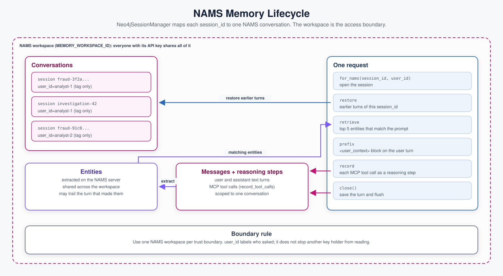

# Neo4j Agent Memory and Strands Agents

The fraud memory agent keeps its memory in the hosted Neo4j Agent Memory
Service. This page explains how the agent connects to it and why it uses
the Strands session manager from Neo4j Agent Memory `0.8.0+fleet.9`. That
version is the fleet build of 0.8.0, the same one the fleet agents run.



## The parts

- **Strands Agents:** Strands is the AWS open-source Python SDK for agents. It runs the agent loop: the model reasons, calls a tool, reads the result, and repeats. Strands also defines session managers, which load and save an agent's conversation through hooks.
- **Neo4j Agent Memory:** This Neo4j Labs Python library gives agents memory stored in a Neo4j graph. It ships a Strands integration with a session manager and optional memory tools.
- **NAMS:** The Neo4j Agent Memory Service is the hosted backend for the library. The rest of this page calls it **NAMS**. NAMS owns storage, embeddings, entity extraction, and its schema.

## How the agent uses NAMS

`server/runtime_app.py` builds one session manager for each request:

```python
Neo4jSessionManager.for_nams(
    request.session_id,
    user_id=request.user_id,
    record_tool_calls=True,
    retrieval_config=Neo4jRetrievalConfig(
        include_entities=True, include_preferences=False, top_k=5
    ),
)
```

The manager reads `MEMORY_API_KEY`, `MEMORY_ENDPOINT`, and
`MEMORY_WORKSPACE_ID` from the environment. The agent passes it to
`Agent(session_manager=...)`, and Strands calls it at each step of the turn.

1. **Open:** The manager finds the NAMS conversation for the `session_id`, or creates one. It tags a new conversation with the `user_id`.
2. **Restore:** The manager loads the conversation's earlier turns into the Strands message history. The model sees them as real turns.
3. **Retrieve:** Before the user turn reaches the model, the manager searches the workspace for the five entities that best match the question.
4. **Prefix:** The manager adds those entities to the user message in a `<user_context>` block. The system prompt tells the model to treat the block as background data and to check facts against the graph.
5. **Record:** The manager records each MCP tool call as a reasoning step. It completes the reasoning trace at the end of the turn. It stores user and assistant text turns as messages. Tool results are not stored as messages.
6. **Close:** The runtime closes the response stream, then calls `close()` on the manager. The manager saves the last buffered message at that point.

NAMS extracts entities from the stored messages on the server. Extraction
runs on assistant turns as well as user turns.

## Failures

- **Hard failures:** The manager raises when it cannot open the session or store a message. The error propagates to `BedrockAgentCoreApp`. The app logs the traceback at `ERROR` and sends the client an error event. The runtime also marks its trace span `ERROR`.
- **Soft failures:** The manager logs a warning and goes on when entity retrieval or tool-call recording fails. The turn then runs without that context or those reasoning steps.

## The workspace is the access boundary

NAMS separates data by workspace. It has no per-user isolation.

- **Shared reads:** Everyone who holds the workspace API key can read all of its conversations and entities.
- **User tag:** The `user_id` is metadata on the conversation. It records who asked. It does not stop another key holder from reading the conversation.
- **Shared entities:** Entity retrieval searches the whole workspace. An entity found in one analyst's investigation can appear in another analyst's `<user_context>` block.
- **Message search:** NAMS searches messages inside one conversation. It has no search across conversations.
- **Separate workspaces:** Use one workspace for each trust boundary, such as a team or a tenant.

## Why the agent adopted the 0.8.0 session manager

Before 0.8.0, the agent used about 150 lines of its own recall code. That
code found or created the conversation, stored each turn, and searched the
messages of up to ten earlier conversations of the same user. The session
manager replaces it for these reasons:

- **Real boundary:** The NAMS docs name the workspace as the only tenancy boundary. The old user-scoped recall filtered on a label, so it promised an isolation that NAMS does not give.
- **Shared entities anyway:** Entities are shared across the workspace whatever the agent reads. Skipping entity search protected nothing.
- **Supported path:** The session manager is the library's supported way to restore a conversation and inject context. It uses the Strands session hooks, so the agent has no custom memory code left.
- **Team work:** Fraud investigation is team work. Accounts and merchants found in one investigation help the next one. Workspace sharing is the behavior the demo wants.
- **Search cost:** NAMS message search covers one conversation. Searching earlier conversations took one call per conversation and a hand-made cap.

## Known gaps

- **No redaction after save:** NAMS has no endpoint to update or delete a message. A redaction that arrives after the manager saved the message does not reach NAMS.

## Optional memory tools

Set `MEMORY_TOOLS=true` to also give the agent the NAMS Strands tools from
`nams_context_graph_tools()`:

- **`search_context`:** This tool searches agent memory in the workspace.
- **`set_entity_feedback`:** This tool records positive or negative feedback on an entity.
- **`get_entity_provenance`:** This tool shows where an entity came from.
- **`cypher_query`:** This tool runs a read-only Cypher query against the memory graph.

The agent decides when to call them. They search agent memory, not the
fraud graph, and they cover the whole workspace. They use the same
environment values as the session manager.
