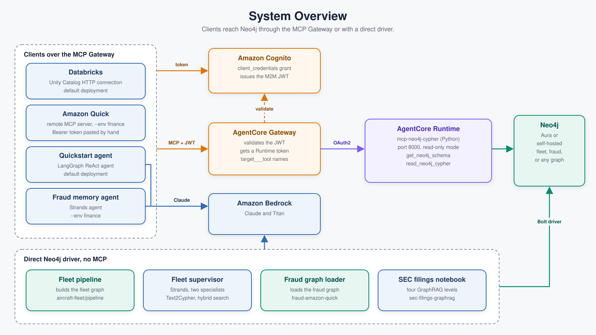
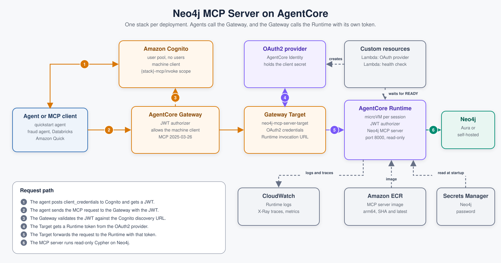
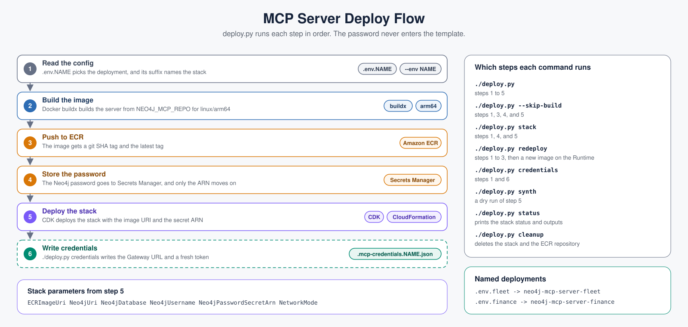
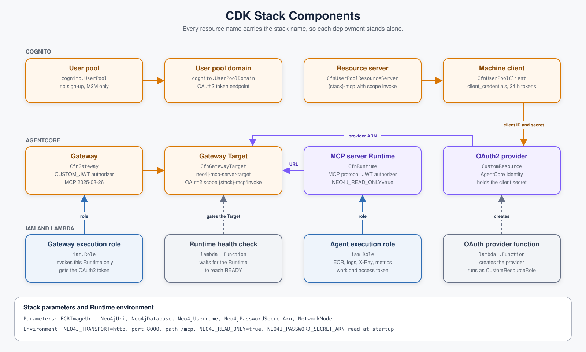
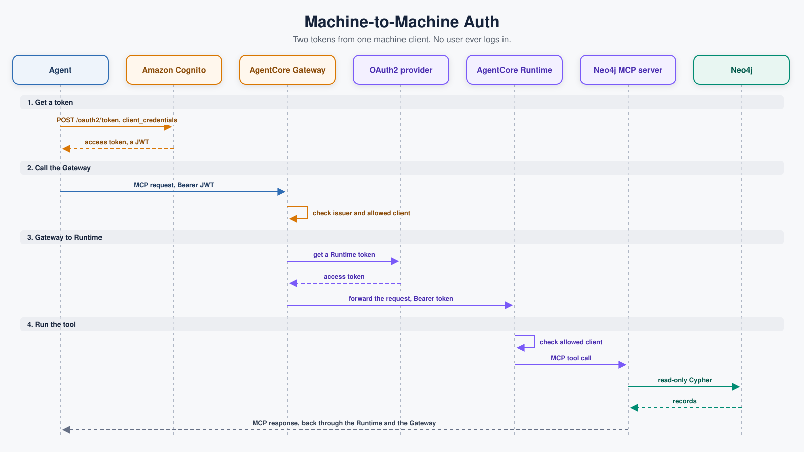

# Architecture Overview

This repository deploys the Neo4j MCP server `mcp-neo4j-cypher` to Amazon Bedrock AgentCore and builds AI agents that query Neo4j. Some agents reach Neo4j through the AgentCore Gateway and the MCP server. Others connect with a direct Neo4j driver. This document covers the MCP server deployment. The aircraft fleet demo has its own architecture documents.

## Table of Contents

1. [System Overview](#system-overview)
2. [Neo4j MCP Server Deployment](#neo4j-mcp-server-deployment)
   - [High-Level Architecture](#high-level-architecture)
   - [Component Descriptions](#component-descriptions)
   - [Deployment Flow](#deployment-flow)
   - [CDK Stack Components](#cdk-stack-components)
   - [Authentication Architecture](#authentication-architecture)
3. [Aircraft Fleet Demo](#aircraft-fleet-demo)
4. [Technology Stack Summary](#technology-stack-summary)
5. [Diagrams](#diagrams)
6. [References](#references)

---

## System Overview

The repository has three parts.

- **Neo4j MCP server:** The MCP server is `mcp-neo4j-cypher`, a Python FastMCP server from the [`neo4j-partners/mcp-neo4j`](https://github.com/neo4j-partners/mcp-neo4j) repository. The build reads the `servers/mcp-neo4j-cypher` folder of a local clone from the path in `NEO4J_MCP_REPO`.
- **MCP server deployment:** The `neo4j-mcp-server/` project uses AWS CDK to deploy the MCP server on AgentCore Runtime behind an AgentCore Gateway.
- **AI agents and demos:** The `quickstart/` and `demos/` projects query Neo4j in two ways.

The two access paths serve different needs.

| Path | Projects | How they reach Neo4j |
|------|----------|----------------------|
| MCP through the Gateway | Quickstart agent, fleet supervisor agent, fraud memory agent | Cognito token, AgentCore Gateway, AgentCore Runtime, Neo4j MCP server |
| Direct driver | Fleet pipeline, fleet GraphRAG agent, fraud graph loader, SEC filings notebook | Neo4j Python driver over Bolt |

- **Read-only MCP server:** The deployed MCP server runs with `NEO4J_READ_ONLY=true`. Agents on the MCP path get two tools, `get_neo4j_schema` and `read_neo4j_cypher`.
- **Writes:** Every write to Neo4j happens on the direct-driver path. The fleet pipeline and the fraud graph loader populate their graphs this way.

---

## Neo4j MCP Server Deployment

### High-Level Architecture

The `neo4j-mcp-server` project deploys one CloudFormation stack per deployment. Agents call the Gateway with a Cognito token. The Gateway calls the Runtime with a token of its own.

1. **Get a token:** The agent posts the `client_credentials` grant to Cognito and gets a JWT.
2. **Call the Gateway:** The agent sends the MCP request to the Gateway with the JWT as a bearer token.
3. **Validate:** The Gateway validates the JWT against the Cognito discovery URL. It accepts only tokens issued to the machine client.
4. **Get a Runtime token:** The Gateway Target gets a Runtime token from the OAuth2 credential provider.
5. **Forward:** The Gateway Target forwards the request to the Runtime with that token.
6. **Run the tool:** The Neo4j MCP server runs read-only Cypher on Neo4j and returns the result.

### Component Descriptions

#### AgentCore Runtime

AgentCore Runtime is a serverless compute environment for agents and tools. The MCP server container runs here.

- **MicroVM isolation:** Each session runs in its own microVM with isolated CPU, memory, and filesystem. The microVM is terminated and its memory is wiped when the session ends.
- **Long-running sessions:** A session can run for up to 8 hours.
- **Framework agnostic:** The Runtime hosts any agent framework or MCP server that meets its container contract.
- **Container contract:** The image must be arm64. An MCP server listens on port 8000 at `/mcp`.

**In this deployment:** The Runtime hosts the Neo4j MCP server with `protocol_configuration` set to `MCP`. It has its own custom JWT authorizer, which accepts only tokens issued to the stack's machine client. The container runs with `NEO4J_READ_ONLY=true`.

#### AgentCore Gateway

AgentCore Gateway is a managed front door that gives agents one MCP endpoint for many tool sources.

- **Protocol translation:** The Gateway turns MCP requests into calls to its targets.
- **Inbound auth:** The Gateway verifies each agent's identity before it forwards a request.
- **Outbound auth:** The Gateway attaches credentials when it calls a target.
- **Composition:** One Gateway can combine MCP servers, Lambda functions, and APIs behind one endpoint.
- **Semantic tool search:** The Gateway can index tools for semantic search. This stack does not enable it.

**In this deployment:** The Gateway is named `{stack}-gateway`. It uses a `CUSTOM_JWT` authorizer that allows only the machine client. It supports MCP protocol version `2025-03-26`.

#### Gateway Target

A Gateway Target tells the Gateway how to reach one backend and which credentials to use.

- **Endpoint:** The target holds the URL of the backend.
- **Credential provider:** The target names the OAuth2 provider the Gateway uses for outbound calls.
- **Tool indexing:** The Gateway calls the target's `tools/list` when the target is created.
- **Tool names:** Gateway tool names carry the target name as a prefix, as in `neo4j-mcp-server-target___read_neo4j_cypher`.

**In this deployment:** The target is named `neo4j-mcp-server-target`. Its endpoint is the Runtime invocation URL. It requests the `{stack}-mcp/invoke` scope from the OAuth2 provider.

#### OAuth2 Credential Provider

The OAuth2 credential provider is an AgentCore Identity resource. It stores OAuth2 client credentials and fetches tokens for the Gateway.

- **Secure storage:** AgentCore Identity stores the client secret in AWS Secrets Manager.
- **Token handling:** The provider gets new tokens when the Gateway needs them.
- **Two-legged OAuth:** The provider uses the machine-to-machine `client_credentials` flow.

**In this deployment:** The provider is named `{stack}_oauth_provider`. It holds the Cognito machine client ID and secret, so the Gateway can get Runtime tokens.

#### Custom Resource Lambdas

Two Python 3.12 Lambda functions run as CloudFormation custom resources during stack create, update, and delete.

- **OAuth provider function:** This function creates the OAuth2 credential provider. CloudFormation has no native resource for it, so the function calls the AgentCore Identity API directly.
- **Runtime health check function:** This function waits for the Runtime to reach `READY`. The Gateway Target depends on it, so the Gateway never indexes a Runtime that is still starting.

#### Amazon Cognito

Cognito issues the OAuth2 tokens. This deployment uses it only for machine-to-machine auth, so the user pool has no users.

- **User pool:** The pool has self sign-up disabled.
- **Domain:** The domain prefix is `{stack}-{account}`. It provides the `/oauth2/token` endpoint.
- **Resource server:** The resource server has the identifier `{stack}-mcp` and one scope, `invoke`.
- **Machine client:** The client has a secret and uses the `client_credentials` grant with the `{stack}-mcp/invoke` scope. Its access tokens are valid for 24 hours.

#### Amazon ECR

ECR stores the Neo4j MCP server image. `deploy.py` tags each build with the git SHA and with `latest`. The Runtime pulls the image by the URI in the `ECRImageUri` parameter.

#### AWS Secrets Manager

Secrets Manager stores the Neo4j password. `deploy.py` writes the secret and passes only its ARN to the stack. The Runtime gets only that ARN. At startup, the image entrypoint reads the password with the Runtime role and sets it inside its own process, so the password never appears in the template or the Runtime configuration.

#### Amazon CloudWatch

CloudWatch receives the Runtime logs under `/aws/bedrock-agentcore/`. The agent execution role also allows X-Ray traces and metrics in the `bedrock-agentcore` namespace.

### Deployment Flow

`deploy.py` runs every deployment step in order. It reads `.env` by default. `--env NAME` reads `.env.NAME` instead, adds the suffix to the stack name, and writes `.mcp-credentials.NAME.json`.

1. **Read the config:** `deploy.py` reads the `.env` file for the chosen deployment.
2. **Build the image:** Docker buildx builds the server from `NEO4J_MCP_REPO` for `linux/arm64`.
3. **Push to ECR:** The image gets a git SHA tag and the `latest` tag. The `IMAGE_TAG` environment variable overrides the SHA tag.
4. **Store the password:** The Neo4j password goes to Secrets Manager.
5. **Deploy the stack:** CDK deploys the stack with the image URI and the secret ARN as parameters.
6. **Write credentials:** `./deploy.py credentials` writes the Gateway URL, the client credentials, the token URL, and a fresh token.

| Command | Description |
|---------|-------------|
| `./deploy.py` | Runs a full deployment: build, push, and stack |
| `./deploy.py --skip-build` | Runs a full deployment with the image already in ECR |
| `./deploy.py redeploy` | Builds and pushes a new image, then points the existing Runtime at it |
| `./deploy.py stack` | Stores the password and deploys the CDK stack only |
| `./deploy.py synth` | Synthesizes the CloudFormation template without deploying |
| `./deploy.py status` | Shows the stack status and outputs |
| `./deploy.py credentials` | Writes the credentials file |
| `./deploy.py stack-name` | Prints the stack name for the chosen deployment |
| `./deploy.py cleanup` | Deletes the stack, the Neo4j password secret, and, after a separate prompt, the ECR repository |

- **Named deployments:** `./deploy.py --env fleet` deploys the stack `neo4j-mcp-server-fleet` for the supervisor agent. `./deploy.py --env finance` deploys `neo4j-mcp-server-finance` for the fraud memory agent.
- **Credential sync:** `scripts/sync-credentials.sh` copies each deployment's credentials file to the samples that use it.

### CDK Stack Components

The CDK stack in `cdk/neo4j_mcp_stack.py` builds every resource. Each resource name carries the stack name, so deployments do not collide.

| Resource | Type | Purpose |
|----------|------|---------|
| User pool | `cognito.UserPool` | OAuth2 identity provider with no users |
| User pool domain | `cognito.UserPoolDomain` | Hosts the `/oauth2/token` endpoint |
| Resource server | `cognito.CfnUserPoolResourceServer` | Defines the `{stack}-mcp/invoke` scope |
| Machine client | `cognito.CfnUserPoolClient` | M2M client with a secret and 24-hour tokens |
| Custom resource role | `iam.Role` | Lets the Lambdas call Cognito, AgentCore Identity, and Secrets Manager |
| Agent execution role | `iam.Role` | Gives the Runtime ECR pull, logs, X-Ray, metrics, and workload tokens |
| Gateway execution role | `iam.Role` | Lets the Gateway get OAuth2 tokens and invoke this Runtime only |
| OAuth provider function | `lambda_.Function` | Creates the OAuth2 credential provider |
| Runtime health check function | `lambda_.Function` | Waits for the Runtime to reach `READY` |
| MCP server Runtime | `bedrockagentcore.CfnRuntime` | Hosts the MCP server container with a JWT authorizer |
| Gateway | `bedrockagentcore.CfnGateway` | Entry point with a `CUSTOM_JWT` authorizer |
| Gateway Target | `bedrockagentcore.CfnGatewayTarget` | Routes tool calls to the Runtime with OAuth2 credentials |

The stack takes six parameters.

| Parameter | Description |
|-----------|-------------|
| `ECRImageUri` | The MCP server image in ECR |
| `Neo4jUri` | The Neo4j URI. It must start with `neo4j://`, `neo4j+s://`, or `neo4j+ssc://`. |
| `Neo4jDatabase` | The database name. The default is `neo4j`. |
| `Neo4jUsername` | The database user. The default is `neo4j`. |
| `Neo4jPasswordSecretArn` | The Secrets Manager ARN of the Neo4j password |
| `NetworkMode` | The Runtime network mode, `PUBLIC` or `PRIVATE`. The default is `PUBLIC`. |

- **Runtime environment:** The container gets `NEO4J_URI`, `NEO4J_DATABASE`, `NEO4J_USERNAME`, and `NEO4J_PASSWORD_SECRET_ARN`. It also gets `NEO4J_TRANSPORT=http`, port `8000`, path `/mcp`, and `NEO4J_READ_ONLY=true`.
- **Outputs:** The stack exports the Runtime ID, ARN, and invocation URL, the Gateway URL, ID, and target name, the Cognito pool ID, client ID, token URL, and scope, and the agent execution role ARN. `./deploy.py credentials` reads these outputs.

### Authentication Architecture

The system uses machine-to-machine OAuth2. One Cognito machine client backs both tokens. The agent's token gets it into the Gateway. The Gateway's token gets it into the Runtime.

1. **Get a token:** The agent posts `client_credentials` to the Cognito `/oauth2/token` endpoint and gets a JWT.
2. **Call the Gateway:** The agent sends an MCP request with the JWT. The Gateway checks the issuer and the allowed client.
3. **Gateway to Runtime:** The Gateway gets a Runtime token from the OAuth2 provider and forwards the request with it.
4. **Run the tool:** The Runtime checks the allowed client. The MCP server runs read-only Cypher with the password that the container read from Secrets Manager at startup. The response returns through the Runtime and the Gateway.

Machine-to-machine auth through the Gateway has these benefits.

- **No user management:** The user pool has no users, so there are no user passwords to rotate.
- **Simple agent auth:** Agents use client credentials instead of an interactive login.
- **One entry point:** The Gateway gives every agent one MCP endpoint.
- **Managed outbound tokens:** The Gateway gets and refreshes the Runtime token on its own.
- **Locked-down Runtime:** The Runtime accepts only tokens issued to the stack's machine client.

---

## Aircraft Fleet Demo

The aircraft fleet demo in `demos/aircraft-fleet/` uses both access paths over one graph. Its [architecture documents](../demos/aircraft-fleet/docs/ARCHITECTURE.md) cover it in full.

- **Pipeline:** The pipeline loads a generated fleet and its maintenance manuals into Neo4j with a direct driver.
- **GraphRAG agent:** The GraphRAG agent answers with Text2Cypher and hybrid search over a direct driver.
- **Supervisor agent:** The supervisor agent routes questions to two specialists that query the graph through the `fleet` deployment of this MCP server.
- **Memory:** Both agents keep conversation memory in a second Neo4j database.

---

## Technology Stack Summary

| Layer | Technology | Purpose |
|-------|------------|---------|
| **MCP server** | Python FastMCP, `mcp-neo4j-cypher` | Read-only Cypher execution |
| **Container** | Docker buildx, arm64 | AgentCore Runtime image |
| **Infrastructure** | AWS CDK in Python | Infrastructure as code |
| **Runtime** | Amazon Bedrock AgentCore Runtime | MicroVM container hosting |
| **Gateway** | Amazon Bedrock AgentCore Gateway | One MCP endpoint with inbound and outbound auth |
| **Auth** | Amazon Cognito, AgentCore Identity | OAuth2 M2M tokens |
| **Secrets** | AWS Secrets Manager | Neo4j passwords |
| **Agents** | Strands Agents, LangGraph | Tool calling and multi-agent orchestration |
| **LLM** | Claude on Amazon Bedrock | Reasoning and tool selection |
| **Embeddings** | Amazon Titan Text Embeddings v2 | Fleet chunk and query embeddings |
| **Observability** | CloudWatch, X-Ray | Logs, traces, and metrics |

The projects use different Claude models.

| Model | Used by |
|-------|---------|
| Claude Sonnet 5.5 | Both fleet agents, fleet pipeline extraction, and fleet memory extraction |
| Claude Haiku 4.5 | The quickstart agent and the fraud memory agent by default |
| Claude Sonnet 4.6 | The SEC filings notebook |

---

## Diagrams

| Diagram | Shows |
|---------|-------|
| [`system-overview.svg`](images/system-overview.svg) | The MCP path and the direct-driver path to Neo4j |
| [`mcp-server-architecture.svg`](images/mcp-server-architecture.svg) | The MCP server stack and its six-step request path |
| [`mcp-deploy-flow.svg`](images/mcp-deploy-flow.svg) | The `deploy.py` steps and which commands run them |
| [`cdk-stack-components.svg`](images/cdk-stack-components.svg) | The resources the CDK stack builds and how they connect |
| [`m2m-auth-sequence.svg`](images/m2m-auth-sequence.svg) | The machine-to-machine token flow from agent to Neo4j |

---

## References

### AWS Documentation

- [Amazon Bedrock AgentCore Overview](https://docs.aws.amazon.com/bedrock-agentcore/latest/devguide/what-is-bedrock-agentcore.html)
- [AgentCore Runtime](https://docs.aws.amazon.com/bedrock-agentcore/latest/devguide/agents-tools-runtime.html)
- [AgentCore Gateway](https://docs.aws.amazon.com/bedrock-agentcore/latest/devguide/gateway.html)
- [MCP Server Targets](https://docs.aws.amazon.com/bedrock-agentcore/latest/devguide/gateway-target-MCPservers.html)
- [Adding Gateway Targets](https://docs.aws.amazon.com/bedrock-agentcore/latest/devguide/gateway-building-adding-targets.html)
- [AWS CDK Custom Resources](https://docs.aws.amazon.com/cdk/api/v2/docs/aws-cdk-lib.custom_resources-readme.html)
- [Lambda-backed Custom Resources](https://docs.aws.amazon.com/AWSCloudFormation/latest/UserGuide/template-custom-resources-lambda.html)

### Project Resources

- [Neo4j MCP Server](https://github.com/neo4j-partners/mcp-neo4j)
- [Model Context Protocol](https://modelcontextprotocol.io/)
- [Strands Agents](https://strandsagents.com/)
- [LangGraph Multi-Agent](https://langchain-ai.github.io/langgraph/concepts/multi_agent/)
- [AWS CDK Python Reference](https://docs.aws.amazon.com/cdk/api/v2/python/)
