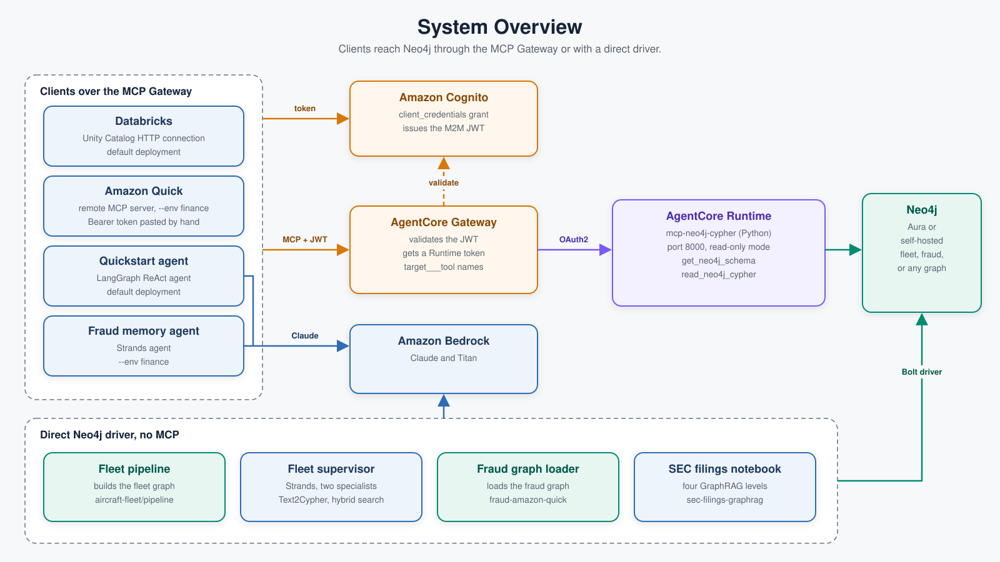

# Project Walkthrough

This repository shows how AI agents on Amazon Bedrock AgentCore answer
questions over Neo4j graphs. One project deploys the Neo4j MCP server to
AgentCore Runtime behind an AgentCore Gateway. Several agents and integrations
call that server with OAuth2. Other demos skip MCP and read Neo4j with the
Neo4j Python driver. The largest demo, aircraft fleet, builds a GraphRAG graph
with Bedrock and answers questions over it with a supervisor agent and two
specialists.

Each area below has its own README with setup steps and commands. This page
names the parts, says how they connect, and links to that detail.

## How the pieces connect

The repository reaches Neo4j in two ways.

### The MCP path through the Gateway

The `neo4j-mcp-server/` project deploys one CloudFormation stack per
deployment. Each stack holds a Cognito machine client, an AgentCore Gateway,
and an AgentCore Runtime that runs `mcp-neo4j-cypher`.

1. A client gets a JWT from Cognito with the `client_credentials` grant.
2. The client sends an MCP request with that JWT to the Gateway.
3. The Gateway validates the JWT and gets its own token for the Runtime.
4. The Runtime runs the MCP server, which runs read-only Cypher on Neo4j.

The server runs in read-only mode and exposes two tools. The Gateway adds the
target name to each tool name, as in
`neo4j-mcp-server-target___read_neo4j_cypher`.

These clients use the MCP path:

- **Quickstart agent:** The LangGraph agent in `quickstart/` calls the default deployment.
- **Fraud memory agent:** The Strands agent in `demos/fraud-amazon-quick/fraud-memory-agent/` calls the `finance` deployment.
- **Amazon Quick:** Amazon Quick connects to the `finance` Gateway as a remote MCP server. The fraud demo README covers the setup in the Quick app.
- **Databricks:** A Unity Catalog HTTP connection in `integrations/databricks/` forwards Databricks MCP calls to the Gateway.

A named deployment comes from `./deploy.py --env NAME`, which reads
`.env.NAME` and writes `.mcp-credentials.NAME.json`. The script
`scripts/sync-credentials.sh` copies each credentials file to the samples that
use it.

### The direct-driver path

The other projects connect to Neo4j over Bolt with the Neo4j Python driver.
Every write to the fleet, fraud, and SEC graphs happens on this path.

- **Fleet pipeline:** The pipeline builds the aircraft fleet graph.
- **Fleet supervisor agent:** The specialists read the fleet graph with Text2Cypher and hybrid search.
- **Fleet UI:** The UI server reads graph evidence for each tool call.
- **Fraud graph loader:** The loader builds the fraud graph that the MCP path later reads.
- **SEC filings notebook:** The notebook builds and queries a small 10-K graph.

Two projects sit outside both paths. The Gateway RBAC pattern deploys its own
Gateway and a small MCP server with no Neo4j behind it. The Aura Agents
client calls an agent that Neo4j Aura hosts.

## neo4j-mcp-server/

This project deploys the Neo4j Cypher MCP server to AgentCore Runtime behind a
Gateway with Cognito machine-to-machine OAuth2. It is the shared foundation
for every sample on the MCP path.

**Main components**

- `deploy.py` builds the ARM64 image, pushes it to ECR, stores the Neo4j password in Secrets Manager, deploys the stack, and writes the credentials file.
- `cdk/neo4j_mcp_stack.py` defines the Cognito pool and client, the Runtime, the Gateway, the Gateway Target, and the IAM roles.
- `cdk/naming.py` derives every resource name from the stack name and checks its length limits.
- `cdk/resources/oauth_provider/index.py` creates the OAuth2 credential provider that the Gateway uses to call the Runtime.
- `cdk/resources/runtime_health_check/index.py` waits for the Runtime to reach `READY` before the Gateway Target indexes its tools.
- `image/Dockerfile` wraps the `mcp-neo4j-cypher` image built from the clone in `NEO4J_MCP_REPO`.
- `image/secret_entrypoint.py` reads the Neo4j password from Secrets Manager at startup and adds the `GET /ping` health route.
- `client/gateway_client.py` and `client/mcp_local_client.py` test the server through the Gateway and in local Docker.
- `client/get_token.py` fetches a fresh Cognito token from the credentials file.

**Entry points**

- `./deploy.py` runs a full deployment, and `./deploy.py credentials` writes `.mcp-credentials.json`.
- `./deploy.py redeploy`, `status`, and `cleanup` update, inspect, and delete a deployment.
- `./cloud.sh` tests through the Gateway, and `./cloud-http.sh` tests the Runtime directly.
- `./local.sh start` runs the server in local Docker with no auth.

**Depends on:** The project needs a running Neo4j database, Docker with
buildx, the AWS CDK CLI, and a local clone of `neo4j-partners/mcp-neo4j`. It
creates AgentCore Runtime, Gateway, Cognito, ECR, Secrets Manager, and Lambda
resources.

**Detail:** See the [README](../neo4j-mcp-server/README.md) and the
[architecture document](../neo4j-mcp-server/ARCHITECTURE.md).

## quickstart/

The quickstart is a standalone LangGraph agent that answers plain-language
questions over whatever graph the default MCP deployment points at. It is the
smallest complete example of a Bedrock agent on the Gateway.

**Main components**

- `neo4j_mcp_quickstart/core.py` builds the agent, loads the Gateway tools with `langchain-mcp-adapters`, and sets the Claude model on Bedrock.
- `neo4j_mcp_quickstart/agent.py` refreshes the Cognito token before it expires.
- `neo4j_mcp_quickstart/simple_agent.py` uses the static token from the credentials file.
- `notebooks/` holds three notebooks for SageMaker Unified Studio, including a Strands version of the agent.
- `inference-profiles/setup-inference-profile.sh` creates Bedrock inference profiles with the tag that SageMaker Unified Studio requires.

**Entry points**

- `./agent.sh "question"` runs the refreshing agent, and `./agent.sh` alone runs the demo questions.
- `uv run python -m neo4j_mcp_quickstart.simple_agent "question"` runs the static-token agent.

**Depends on:** The agent needs the default MCP server deployment and its
`.mcp-credentials.json`. It also needs Bedrock access to Claude. The demo
questions assume the aircraft fleet graph.

**Detail:** See the [README](../quickstart/README.md) and the
[SageMaker model notes](../quickstart/docs/SAGEMAKER-MODELS.md).

## demos/aircraft-fleet/

This end-to-end GraphRAG demo builds an aircraft fleet graph in Neo4j and
answers questions over it. It uses no MCP and no Gateway. The pipeline, the
supervisor agent, and the UI share one `.env` file at
`demos/aircraft-fleet/`.

**Detail:** See the [demo README](../demos/aircraft-fleet/README.md) and the
[fleet architecture document](../demos/aircraft-fleet/docs/ARCHITECTURE.md).

### pipeline/

The pipeline generates a synthetic fleet, loads it into Neo4j, and enriches
it with knowledge extracted from maintenance manuals. It is the only
component that writes the fleet graph.

**Main components**

- `setup.sh` drives the five stages: generate, load, enrich, index and fuse, and verify.
- `src/generator/` generates aircraft, sensors, readings, flights, delays, and maintenance events from a fixed seed. It also writes the operating limits that the manuals state.
- `src/populate_aircraft_db/loader.py` bulk loads the CSVs, links each sensor to its operating limits, and verifies the graph.
- `src/populate_aircraft_db/pipeline.py` chunks, embeds, and extracts entities from the manuals with `neo4j-graphrag`, then links them to the fleet records. It links each operating limit to the chunks that state it.
- `src/populate_aircraft_db/schema.py` defines the constraints, the vector and fulltext chunk indexes, and the extraction schema.
- `src/populate_aircraft_db/bedrock_structured.py` gets schema-valid JSON from Claude through Converse tool use.
- `manuals/` holds the five maintenance manuals that enrichment reads.

**Entry points**

- `./setup.sh` runs every stage, and `./setup.sh load-operational` loads the fleet data with no model calls.
- `uv run generate-data` and `uv run populate-aircraft-db` run the generator and the loader on their own.

**Depends on:** The pipeline needs Neo4j 5.23 or later with an admin login.
Enrichment calls Bedrock Titan for embeddings and Bedrock Claude for
extraction.

**Detail:** See the [pipeline README](../demos/aircraft-fleet/pipeline/README.md).

### supervisor-agent/

This Strands supervisor routes each question to a Maintenance specialist, an
Operations specialist, or both, and writes one answer from their results. The
specialists read the fleet graph directly with the Neo4j driver.

**Main components**

- `fleet_supervisor/core/agents.py` builds the supervisor and wraps each specialist as a tool.
- `fleet_supervisor/core/prompts.py` holds the supervisor and specialist prompts.
- `fleet_supervisor/core/graph/tools.py` defines `graph_query_tool` for both specialists and `vector_search_tool` for Maintenance only.
- `fleet_supervisor/core/graph/text2cypher.py` writes Cypher from the live schema and refuses any query that does not plan as read-only.
- `fleet_supervisor/core/graph/retrieval.py` runs the hybrid vector and fulltext search over the manual chunks.
- `fleet_supervisor/core/memory.py` keeps conversation memory with `neo4j-agent-memory` in a second Neo4j database.
- `fleet_supervisor/core/secrets.py` reads both Neo4j logins from Secrets Manager, with plain env var fallbacks.
- `fleet_supervisor/server.py` serves the agent as a `BedrockAgentCoreApp` that streams SSE events.
- `fleet_supervisor/setup_secrets.py` creates the two Secrets Manager secrets that the deploy reads.
- `main.py` is the Runtime entrypoint on port 8080.
- `agentcore/` holds the AgentCore CLI project and its CDK stack.

**Entry points**

- `./agent.sh start` serves the agent locally on port 7071.
- `./agent.sh test-maintenance` and `./agent.sh test-operations` send one question to each specialist.
- `uv run fleet-supervisor-cli "question"` streams one answer from the local server. The `--remote` flag calls the deployed Runtime instead.
- `uv run fleet-supervisor-secrets` creates the deploy secrets.
- `./agent.sh deploy`, `invoke-cloud`, `load-test`, and `destroy` manage the Runtime deployment.

**Depends on:** The agent needs the fleet graph from the pipeline, a second
Neo4j database for memory, and Bedrock access to Claude and Titan embeddings.
A deploy also needs the AgentCore CLI, a read-only `fleet_reader` user, and
the two Secrets Manager secrets. The deployed Runtime reports to CloudWatch.

**Detail:** See the [supervisor README](../demos/aircraft-fleet/supervisor-agent/README.md)
and the [supervisor architecture document](../demos/aircraft-fleet/docs/architecture/supervisor-agent.md).

### ui/

The browser UI shows the supervisor's answer, the specialist and tool calls,
and an interactive graph of the evidence behind each call. It relays the
stream from a local or deployed supervisor.

**Main components**

- `server.py` serves the page and relays the supervisor's SSE stream from the local server or from AgentCore Runtime.
- `evidence.py` looks up the fleet graph paths named by each tool result.
- `static/app.js` renders the chat and the tool call trace.
- `static/graph.js` draws the evidence graph with the Neo4j Visualization Library.

**Entry points**

- `npm ci && npm run build` bundles the frontend.
- `uv run --project ../supervisor-agent python server.py` serves the UI on port 8081.

**Depends on:** The UI needs a running supervisor, or `AGENT_ARN` for a
deployed one. It reuses the supervisor package and reads the fleet graph with
the same login as the graph tools. The build needs Node.js 20 or later.

**Detail:** See the [UI README](../demos/aircraft-fleet/ui/README.md).

## demos/fraud-amazon-quick/

This demo finds synthetic fraud rings with Neo4j and AWS analytics. One
dataset in `data/` feeds both a Neo4j graph and Iceberg tables for Athena.
Amazon Quick and a Strands agent then query the graph through the MCP
Gateway.

**Detail:** See the [demo README](../demos/fraud-amazon-quick/README.md).

### graph-loader/

The graph loader loads the fraud CSVs into Neo4j with a direct driver. It then
adds Graph Data Science signals that the agent queries.

**Main components**

- `graph_loader/load_neo4j.py` loads the accounts, customers, merchants, and transactions from `data/`.
- `graph_loader/enrich_gds.py` adds risk scores, communities, betweenness, and account similarity.
- `graph_loader/analyze_graph.py` runs read-only investigation queries against the loaded graph.

**Entry points**

- `uv run fraud-graph-load` loads the graph, and `--reset` deletes all graph data first.
- `uv run fraud-graph-enrich` adds the GDS signals.
- `uv run fraud-graph-analyze` runs the investigation queries.

**Depends on:** The loader needs a dedicated Neo4j database. Enrichment needs
Graph Data Science or Aura Graph Analytics.

**Detail:** See the [graph loader README](../demos/fraud-amazon-quick/graph-loader/README.md).

### fraud-iceberg/

These scripts write the same fraud dataset to Apache Iceberg tables so Athena
can query it with SQL. They never reach Neo4j.

**Main components**

- `scripts/write_finance_iceberg.py` writes the tables to an S3 bucket and registers them in AWS Glue.
- `scripts/write_finance_s3_tables.py` writes the tables to Amazon S3 Tables.
- `scripts/query_finance_athena.py` runs sample SQL against the Glue tables.
- `scripts/finance_iceberg.py` holds the shared loading and writing helpers.

**Entry points:** Each script declares its own dependencies, so `uv run
scripts/<name>.py` runs it with no `uv sync`.

**Depends on:** The scripts need S3 or S3 Tables, Glue, and Athena.

**Detail:** See the [Iceberg loaders README](../demos/fraud-amazon-quick/fraud-iceberg/README.md).

### fraud-memory-agent/

This Strands agent investigates the fraud graph through the MCP Gateway. It
saves every turn in the hosted Neo4j Agent Memory Service, called NAMS.

**Main components**

- `server/runtime_app.py` builds the agent and serves it locally and on AgentCore Runtime.
- `core/factory.py` builds the Bedrock model and the Gateway MCP client.
- `core/credentials.py` resolves the Gateway credentials from AgentCore Identity in the cloud and from the credentials file locally.
- `core/config.py` holds the model ID, the region, and the system prompt.
- `client/` holds the CLI, the demo questions, the cloud invoke client, and the traffic generator.
- `main.py` is the Runtime entrypoint for the CodeZip deploy.
- `scripts/verify_agentcore_runtime.py` checks that a deployed Runtime is ready and answers a graph query.
- `agentcore/` holds the AgentCore CLI project and its CDK stack.

**Entry points**

- `uv run fraud-server` serves the agent locally on port 7020.
- `uv run fraud-cli "question"` streams one answer from the local server. The `--remote` flag calls the deployed Runtime instead.
- `./agent.sh deploy`, `verify`, `invoke-cloud`, and `destroy` manage the Runtime deployment.

**Depends on:** The agent needs the `finance` MCP server deployment over the
loaded fraud graph, a NAMS API key, and Bedrock access to Claude. The `.env`
and `.mcp-credentials.json` files sit in `demos/fraud-amazon-quick/`, outside
the folder that the deploy zips. A deploy also needs the AgentCore CLI and
stores both secrets in AgentCore Identity.

**Detail:** See the [fraud memory agent README](../demos/fraud-amazon-quick/fraud-memory-agent/README.md).

## demos/sec-filings-graphrag/

One notebook builds a small graph from NVIDIA and Amazon 10-K filings and
compares four GraphRAG retrieval levels. It is the short introduction to
GraphRAG in this repository.

**Main components**

- `4_levels_of_graphrag.ipynb` chunks and embeds the filings, writes them to Neo4j, and runs vector, vector plus graph, keyword, and combined retrieval.
- `data/` holds the two 10-K PDFs.

**Entry points:** Run `uv sync`, then run the notebook from top to bottom with
the project's `.venv` kernel.

**Depends on:** The notebook needs an empty Neo4j database and Bedrock access
to Titan Text Embeddings V2.

**Detail:** See the [README](../demos/sec-filings-graphrag/README.md).

## integrations/databricks/

This integration connects Databricks to the Neo4j MCP server through a Unity
Catalog HTTP connection. Databricks stores the Cognito client credentials and
refreshes the Gateway token itself.

**Main components**

- `setup_databricks_secrets.sh` copies the Gateway credentials into a Databricks secret scope.
- `neo4j-mcp-http-connection.ipynb` creates and tests the Unity Catalog HTTP connection.
- `neo4j-mcp-agent-deploy.ipynb` tests, evaluates, and deploys the LangGraph agent with MLflow.
- `neo4j_mcp_agent.py` defines the LangGraph agent that calls the MCP tools through the connection.
- `MANUAL-SETUP.md` and `databricks-mcp-setup.md` cover the connection setup by hand and the Unity Catalog MCP service.

**Entry points:** Run `./setup_databricks_secrets.sh`, then import and run the
notebooks in the Databricks workspace.

**Depends on:** The integration needs the MCP server deployment and its
credentials file, the Databricks CLI, and a workspace with Unity Catalog. The
agent deploys to Databricks, not to AgentCore.

**Detail:** See the [Databricks README](../integrations/databricks/README.md).

## integrations/neo4j-aura-agents/

This Python client calls a Neo4j Aura Agent over its REST API. Neo4j hosts the
agent, so this sample deploys no AWS infrastructure.

**Main components**

- `src/client.py` handles the Aura OAuth2 token and calls the agent synchronously or asynchronously.
- `src/models.py` defines Pydantic models for the response text, reasoning, tool uses, and token usage.
- `cli.py` sends one question from the command line.
- `examples/` holds sync, async, and interactive chat examples.
- `aura_agent_demo.ipynb` walks through the client in a notebook.

**Entry points:** `uv run python cli.py "question"` asks one question, and
`uv run python examples/interactive_chat.py` starts a chat.

**Depends on:** The client needs an Aura Agent with its external endpoint
turned on and an Aura API client ID and secret.

**Detail:** See the [Aura Agents README](../integrations/neo4j-aura-agents/README.md).

## patterns/gateway-rbac-interceptor/

This pattern adds role-based access control to an AgentCore Gateway with a
Lambda request interceptor. It deploys its own Gateway and a small MCP server
with no Neo4j behind it.

**Main components**

- `simple_oauth_stack.py` defines the Cognito pool with `users` and `admin` groups, the interceptor, the MCP server Runtime, and the Gateway.
- `app.py` is the CDK app that deploys that stack.
- `infra_utils/auth_interceptor_lambda.py` reads the JWT claims, blocks admin tools for callers outside `admin`, and adds identity headers.
- `mcp-server/server.py` serves public and admin tools that read those headers.
- `setup_users.py` creates an admin test user and a regular test user.
- `client/demo.py` calls the Gateway with machine and user tokens.

**Entry points:** The pattern's deploy script builds the image and deploys the
stack. Then `uv run python setup_users.py` creates the users and `./test.sh`
runs the tests. The README lists the deploy and teardown flags.

**Depends on:** The pattern needs Docker, the AWS CDK CLI, and a bootstrapped
account. It creates Cognito, Lambda, AgentCore Runtime, and Gateway resources.

**Detail:** See the [pattern README](../patterns/gateway-rbac-interceptor/README.md)
and its [architecture document](../patterns/gateway-rbac-interceptor/docs/ARCHITECTURE.md).

## scripts/

This folder holds repository-wide helper scripts.

- `sync-credentials.sh` copies the default credentials to `quickstart/` and the `finance` credentials to `demos/fraud-amazon-quick/`.
- `check-docs.sh` checks Markdown and notebook links and fails on retired folder and command names. The `check-docs.yml` GitHub workflow runs it on every pull request.
- `test-s3-access.sh` checks S3 access by creating a test bucket and uploading a file. Its `--cleanup` flag deletes the bucket.

## docs/

This folder holds the repository-level documentation and the slide gallery.

- `ARCHITECTURE.md` covers the MCP server deployment, its auth flow, and the CDK stack. It links to the fleet demo's own architecture documents.
- `images/` holds the SVG diagrams that `ARCHITECTURE.md` uses, including the system overview above.
- `proposals/` holds the design proposal for the SEC filings demo.
- `slides/` builds the Marp slide gallery from the decks in `slides/current/`. A GitHub workflow publishes it to GitHub Pages.

The `docs/slides/archive/` folder keeps older decks, drafts, and superseded
images.

**Detail:** See the [architecture document](ARCHITECTURE.md) and the
[slides README](slides/README.md).

## Summary

| Folder | Purpose | Uses MCP Gateway | Deploys to AgentCore |
|--------|---------|------------------|----------------------|
| [`neo4j-mcp-server/`](../neo4j-mcp-server/) | Deploys the Neo4j MCP server behind the Gateway | Yes | Yes |
| [`quickstart/`](../quickstart/) | Runs a LangGraph agent over the Gateway | Yes | No |
| [`demos/aircraft-fleet/pipeline/`](../demos/aircraft-fleet/pipeline/) | Builds the fleet GraphRAG graph with Bedrock | No | No |
| [`demos/aircraft-fleet/supervisor-agent/`](../demos/aircraft-fleet/supervisor-agent/) | Routes fleet questions to two specialists with direct Neo4j tools | No | Yes |
| [`demos/aircraft-fleet/ui/`](../demos/aircraft-fleet/ui/) | Shows supervisor answers with a live evidence graph | No | No |
| [`demos/fraud-amazon-quick/graph-loader/`](../demos/fraud-amazon-quick/graph-loader/) | Loads the fraud graph and adds GDS signals | No | No |
| [`demos/fraud-amazon-quick/fraud-iceberg/`](../demos/fraud-amazon-quick/fraud-iceberg/) | Writes the fraud data to Iceberg tables for Athena | No | No |
| [`demos/fraud-amazon-quick/fraud-memory-agent/`](../demos/fraud-amazon-quick/fraud-memory-agent/) | Investigates the fraud graph with NAMS memory | Yes | Yes |
| [`demos/sec-filings-graphrag/`](../demos/sec-filings-graphrag/) | Compares four GraphRAG retrieval levels in one notebook | No | No |
| [`integrations/databricks/`](../integrations/databricks/) | Connects Databricks to the Gateway through Unity Catalog | Yes | No |
| [`integrations/neo4j-aura-agents/`](../integrations/neo4j-aura-agents/) | Calls a Neo4j-hosted Aura Agent over REST | No | No |
| [`patterns/gateway-rbac-interceptor/`](../patterns/gateway-rbac-interceptor/) | Adds RBAC to a Gateway with a Lambda interceptor | Yes, its own Gateway | Yes, its own MCP server |
| [`scripts/`](../scripts/) | Syncs credentials and checks the docs | No | No |
| [`docs/`](./) | Holds the architecture docs and the slide gallery | No | No |
