<style>
section {
  --marp-auto-scaling-code: false;
}

li {
  opacity: 1 !important;
  animation: none !important;
  visibility: visible !important;
}

/* Disable all fragment animations */
.marp-fragment {
  opacity: 1 !important;
  visibility: visible !important;
}

ul > li,
ol > li {
  opacity: 1 !important;
}
</style>

# Neo4j + AWS

Grounding Generative AI in Graph Data

<!--
This talk shows how Neo4j and AWS work together for finance and fraud use cases.

- **Why graphs:** Connected data answers questions that separate tables cannot.
- **How they fit:** Neo4j adds relationship context to the AWS data and agent services.
- **Integration patterns:** Data connectors, agent tools, memory, and GraphRAG.
- **Source material:** The AWS Agentic AI Conference deck and the Neo4j hotel booking workshop, rewritten for a finance and fraud audience.
-->

---

## Neo4j Graph Intelligence Platform

What Neo4j is, and why connected data matters.

<!--
This section explains what a graph database is and why it fits fraud work.

- **First:** The basic building blocks of a graph.
- **Then:** What those blocks give a fraud investigator.
-->

---

## What Is a Graph Database

Three structures, and that is the whole model:

- **Node:** a thing, such as a person, an account, a merchant, or a document.
- **Relationship:** a named, directed connection between two nodes.
- **Property:** a named value stored on a node or on a relationship.
- **Cypher:** Neo4j's query language for these patterns. Think of it like SQL, but built to match connected paths instead of joining separate tables.

The relationship is stored, not computed. Following one is a direct hop, not a join, so the cost of a hop does not grow with the size of the data on the other side.

<!--
A graph has three building blocks. Neo4j adds a query language on top.

- **Node:** A thing, such as a person, an account, or a merchant.
- **Relationship:** A named link from one node to another.
- **Property:** A value stored on a node or a relationship.
- **Cypher:** The query language. It matches paths in the graph, where SQL joins tables.
- **Why it is fast:** Neo4j stores each relationship. Following one is a single hop, so the cost does not grow with the size of the data.
-->

---

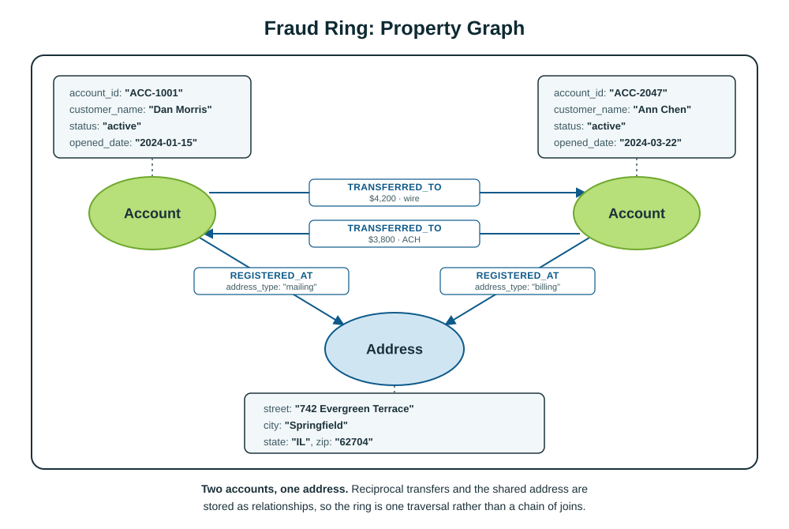

<!--
This diagram shows a small fraud ring as a property graph.

- **Accounts:** ACC-1001 and ACC-2047 each carry properties such as owner, status, and open date.
- **Transfers:** TRANSFERRED_TO relationships link the two accounts. One is a $4,200 wire. The other is a $3,800 ACH.
- **Address:** Both accounts register at the same address through REGISTERED_AT relationships.
- **Point:** The ring is one traversal. It is not a chain of joins.
-->

---

## Why a Knowledge Graph Fits Fraud Investigations

- **See the full network:** connect customers, accounts, devices, addresses, merchants, alerts, and cases in one view.
- **Find hidden relationships:** reveal shared identifiers and indirect connections that isolated transactions do not show.
- **Follow the money:** trace transfers across any number of accounts without knowing the chain length in advance.
- **Explain why a pattern matters:** link suspicious activity to known fraud typologies, policies, KYC documents, and prior cases.
- **Adapt as schemes change:** add new entities and connections without rebuilding a rigid relational model.

**Investigator value:** move from isolated transactions to an evidence-backed view of who is connected, how money moved, and why the pattern matters.

<!--
A graph shows investigators how things connect. Isolated transactions hide that.

- **Full network:** Customers, accounts, devices, addresses, merchants, alerts, and cases sit in one view.
- **Hidden links:** Shared identifiers reveal indirect connections.
- **Follow the money:** A traversal follows transfers across any number of accounts. You do not need to know the chain length first.
- **Explain why:** Suspicious activity links to fraud typologies, policies, KYC documents, and prior cases.
- **Adapt:** New entities and connections need no rebuild of a fixed schema.
-->

---

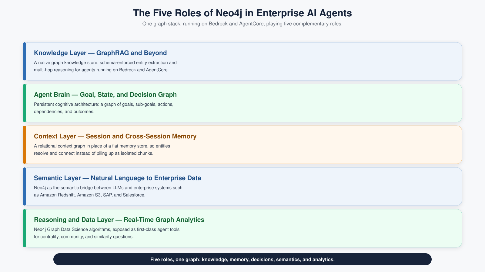

<!--
One graph stack plays five roles for enterprise AI agents on Bedrock and AgentCore.

- **Knowledge layer:** GraphRAG and multi-hop reasoning over extracted entities.
- **Agent brain:** A graph of goals, actions, dependencies, and outcomes.
- **Context layer:** Session and cross-session memory that connects entities.
- **Semantic layer:** A bridge from natural language to systems such as Redshift, S3, SAP, and Salesforce.
- **Reasoning and data layer:** Graph Data Science algorithms exposed as agent tools.
-->

---

## AWS + Neo4j: Connected Context for Grounded Enterprise AI

Neo4j graph, knowledge, and memory integrated with AWS data and agent services

<!--
This section shows where Neo4j fits in the AWS platform.

- **Customers:** Many companies already run both.
- **Layers:** AWS holds the data, models, and agents. Neo4j adds connected context.
-->

---

## Select Neo4j and AWS Customers

Companies that use Neo4j and AWS together include Adobe, Financial Times, Meredith, AstraZeneca, Novo Nordisk, Volvo, Lyft, Verizon, Novartis, LendingClub, Lockheed Martin, Comcast, Cisco, Airbus, DB, Levi Strauss & Co., Caterpillar, and TAG IMF.

<!--
Many large companies use Neo4j and AWS together.

- **Range:** The list spans media, pharma, automotive, telecom, finance, and aerospace.
- **Point:** The pairing is proven in production across industries.
-->

---

## AWS Provides the Foundation for Governed Enterprise AI

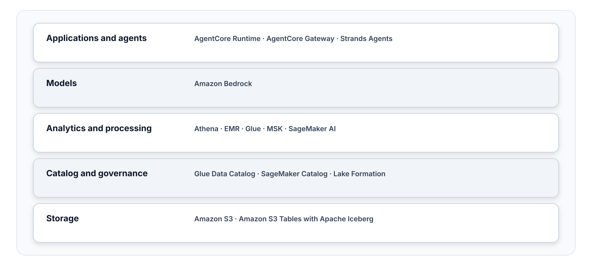

<!--
This slide shows the AWS layers first, before Neo4j.

- **Storage:** Amazon S3 and S3 Tables with Apache Iceberg.
- **Catalog and governance:** Glue Data Catalog, SageMaker Catalog, and Lake Formation.
- **Analytics and processing:** Athena, EMR, Glue, MSK, and SageMaker AI.
- **Models:** Amazon Bedrock.
- **Applications and agents:** AgentCore Runtime, AgentCore Gateway, and Strands Agents.
-->

---

## Neo4j Adds Connected Context Across the AWS Platform

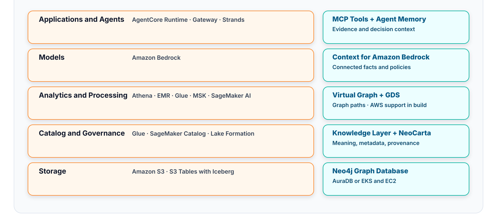

<!--
Neo4j adds a connected layer next to the AWS layers.

- **Cypher, drivers, and MCP:** Connected tools for AWS agents.
- **Context for Bedrock:** Connected facts and policies for the model.
- **Graph analytics:** Traversal, patterns, and communities.
- **Knowledge layer:** The NeoCarta semantic map.
- **Database:** Neo4j AuraDB or self-managed.
- **Authority:** Governed AWS data stays the source of truth.
-->

---

<style scoped>
table { font-size: 21px; }
small { font-size: 16px; }
</style>

## Neo4j Connection Patterns for AWS

| Integration path | AWS home | Description |
| --- | --- | --- |
| **Neo4j Spark Connector** | Amazon EMR | Exchange data between Spark DataFrames and Neo4j graphs. |
| **Neo4j Connector for AWS Glue** | AWS Glue | Load data from AWS sources into Neo4j with managed ETL jobs. |
| **Neo4j Connector for Kafka** | Amazon MSK | Stream events into Neo4j and publish graph changes to Kafka. |
| **Neo4j drivers** | Lambda, ECS, EKS, EC2 | Connect new or existing AWS applications to Neo4j. |
| **Neo4j MCP tools** | Amazon Bedrock AgentCore and Strands Agents | Connect AWS-hosted agents to Neo4j graph retrieval tools. |

<small>Sources: [Neo4j Spark Connector](https://neo4j.com/docs/spark/current/), [Kafka Connector](https://neo4j.com/docs/kafka/current/), [connectors and drivers](https://neo4j.com/docs/connectors/), and [Neo4j MCP](https://neo4j.com/developer/genai-ecosystem/model-context-protocol-mcp/)</small>

<!--
These are five separate ways to connect. You do not need all of them. Pick the one that matches your job.

- **EMR:** Use it for large Spark workloads.
- **Glue:** Use it for managed ETL jobs.
- **MSK:** Use it for event streams.
- **Driver:** Use it when an application sends requests straight to Neo4j.
- **MCP:** Use it when an agent needs graph tools.
-->

---

<style scoped>
small { font-size: 16px; }
</style>

## Spark on Amazon EMR: A Two-Way Bridge to Neo4j

The Neo4j Connector for Apache Spark maps Spark DataFrames to graph data in both directions.

```text
Write   transfers DataFrame  →  (:Account)-[:TRANSFERRED_TO]->(:Account)
Read    (:Customer) nodes    →  DataFrame with one column per property
```

- **Write:** Rows become nodes by label and key. Rows can also become relationships between matched source and target nodes.
- **Read:** A label, a relationship type, or a Cypher query returns a DataFrame. The connector infers its columns from the graph.
- **Run on EMR:** The connector is a Spark DataSource, so an EMR Spark job adds it as a package.

<small>Sources: [Neo4j Connector for Apache Spark](https://neo4j.com/docs/spark/current/) and [writer options](https://neo4j.com/docs/spark/current/write/options/)</small>

<!--
The Spark connector moves data between Spark and Neo4j in both directions.

- **Best use:** Large batch loads from S3 or Iceberg into the graph. It also pulls graph results back into Spark for analytics.
- **Batching:** The connector writes in batches. Each batch commits in its own transaction.
- **Custom Cypher:** Use it for reads and writes when the label and key options are too limited.
- **Version check:** Match the connector to the Spark version on your EMR release. Connector 5.x targets Spark 3.4 and 3.5. Connector 6.x targets Spark 4.
-->

---

<style scoped>
small { font-size: 16px; }
</style>

## AWS Glue Stays Tabular While Neo4j Receives Cypher

The Neo4j Connector for AWS Glue is a JDBC driver that translates SQL to Cypher.

```text
Account table             →  (:Account)
account_id column         →  .account_id
Customer_OWNS_Account     →  (:Customer)-[:OWNS]->(:Account)
```

- **Runtime path:** Glue Visual ETL sends SQL over JDBC. The driver translates it to Cypher and sends it to Neo4j over Bolt.
- **Model first:** A blueprint graph defines the labels, relationship types, and properties. Glue reads it as table metadata.
- **Load order:** Jobs import nodes before relationships. Glue can also export labels back to Parquet on S3.

<small>Sources: [Neo4j Connector for AWS Glue](https://neo4j.com/docs/neo4j-aws-glue/), [Getting Started](https://neo4j.com/docs/neo4j-aws-glue/getting-started/), and [JDBC SQL-to-Cypher translation](https://neo4j.com/docs/jdbc-manual/current/sql2cypher/)</small>

<!--
Glue lets your team keep working with tables. The connector turns SQL into Cypher for you.

- **Setup:** Upload the connector JAR to S3. Create a Glue custom connector with the driver class org.neo4j.jdbc.Neo4jDriver.
- **JDBC URL:** Add enableSQLTranslation=true so the driver translates SQL.
- **Credentials:** Store the Neo4j login in Secrets Manager.
- **Limit:** The driver translates only the SQL constructs it supports.
- **When to pick Glue:** Use it for managed, visual ETL.
- **When to pick EMR:** Use Spark on EMR for custom Cypher or very large batches.
-->

---

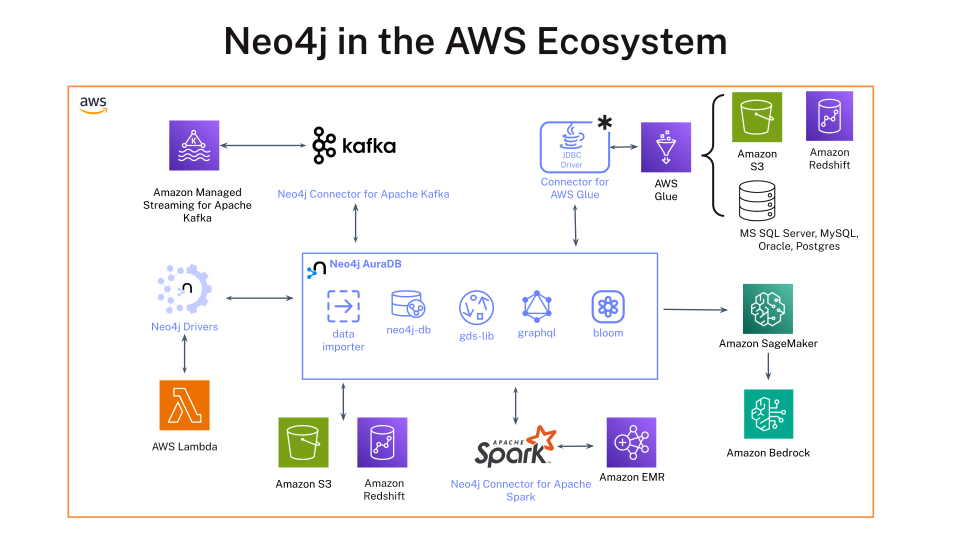

<!--
This diagram shows where Neo4j runs inside AWS.

- **Next slide:** It lists the deployment options, managed and self-managed.
-->

---

<style scoped>
small { font-size: 16px; }
</style>

## Neo4j Supports Managed and Self-Managed AWS Deployment

- **AuraDB on AWS:** Use Neo4j's managed graph database in an AWS region that fits the workload.
- **AWS Marketplace:** Purchase eligible Aura plans through AWS billing and marketplace terms.
- **Private connectivity:** Use AWS PrivateLink with supported Aura enterprise configurations.
- **Self-managed:** Deploy Neo4j on Amazon EKS or Amazon EC2 when the customer manages the runtime.

<small>Sources: [Aura through cloud marketplaces](https://neo4j.com/docs/aura/cloud-providers/), [Aura secure connections](https://neo4j.com/docs/aura/security/secure-connections/), and [AgentCore supported regions](https://docs.aws.amazon.com/bedrock-agentcore/latest/devguide/agentcore-regions.html)</small>

<!--
You can run Neo4j managed or self-managed on AWS.

- **AuraDB:** Neo4j's managed database, in an AWS region that fits the workload.
- **Marketplace:** Buy eligible Aura plans through AWS billing.
- **PrivateLink:** Private connectivity works with supported Aura enterprise configurations.
- **Self-managed:** Run Neo4j on EKS or EC2 when you manage the runtime.
-->

---

## A Combined Architecture: Graph Plus Lakehouse

- **Amazon S3 Tables, Amazon Athena, and AWS Glue Data Catalog** hold and query high-volume analytic data as open Iceberg tables. AWS Lake Formation can govern access.
- **Neo4j Aura** holds the connected domain, GraphRAG paths, rules, provenance, and agent memory.
- **Stable identifiers connect both sides**, through an ETL pipeline or application services.
- **Each store does the job it's good at:** Athena scans and totals rows. Neo4j follows relationships and returns focused context.

<!--
This pattern is for teams that already have a lakehouse. The graph sits next to it.

- **Lakehouse:** It keeps the high-volume tables and answers counting questions.
- **Graph:** It adds relationships, rules, and provenance, which tables model poorly.
- **Link:** Shared identifiers tie the two stores together.
-->

---

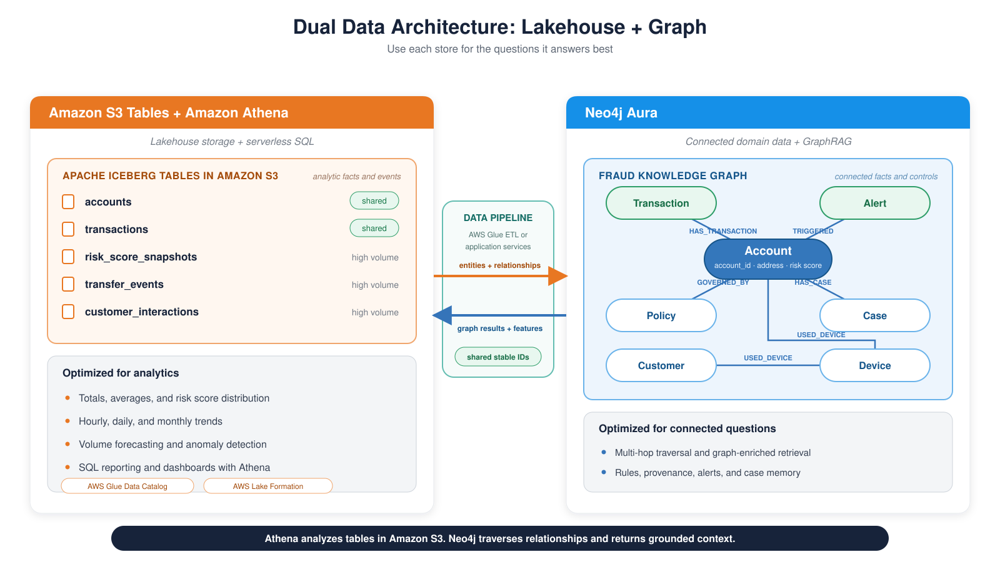

<!--
Two stores sit side by side. Each answers the questions it handles best.

- **Lakehouse:** S3 Tables and Athena hold high-volume Iceberg tables. They answer totals, trends, and forecasts. Glue Data Catalog and Lake Formation govern them.
- **Graph:** Neo4j Aura holds accounts, transactions, alerts, policies, cases, customers, and devices. It answers multi-hop questions.
- **Pipeline:** Glue ETL or application services move entities and relationships into the graph. Graph results and features flow back.
- **Link:** Shared stable IDs tie the two sides together.
-->

---

<style scoped>
table { font-size: 21px; }
ul, p { font-size: 24px; }
</style>

## Decision Table: SQL vs. Cypher

| Signal | Stay in SQL | Move to Cypher |
|--------|-------------|----------------|
| Number of hops | 1 to 2 fixed joins | 3+ or variable depth |
| Query shape | Known at design time | Depends on the data encountered |
| Result type | Aggregated numbers | Paths, subgraphs, connected components |
| Latency requirement | Batch is fine | Sub-second for interactive investigation |
| Data volume per query | Millions of rows scanned | Thousands of entities traversed |

- **Athena in SQL:** aggregates transaction activity, computes P95 thresholds, and ranks the accounts generating the most alerts.
- **Cypher in Neo4j:** follows funds across accounts and devices, finds circular transfers, and reaches everything downstream of a compromised account.

**The rule of thumb:** if you are counting things, stay in SQL. If you are following connections, move to the graph.

<!--
Use this table to decide where a question should run.

- **Hops:** One or two fixed joins stay in SQL. Three or more, or a variable depth, move to Cypher.
- **Query shape:** Known at design time fits SQL. Shape that depends on the data fits Cypher.
- **Result:** Numbers fit SQL. Paths and subgraphs fit Cypher.
- **Latency:** Batch fits SQL. Sub-second interactive work fits Cypher.
- **Volume:** Millions of rows scanned fit SQL. Thousands of entities traversed fit Cypher.
- **Rule:** Counting stays in SQL. Following connections moves to the graph.
-->

---

## Virtual Graph for AWS

Planned: query Amazon S3 Tables with Cypher through Athena.

<!--
Virtual Graph lets you query tables as a graph without copying them.

- **Status:** The AWS version is planned.
- **Next:** The product overview, then the planned AWS query path.
-->

---

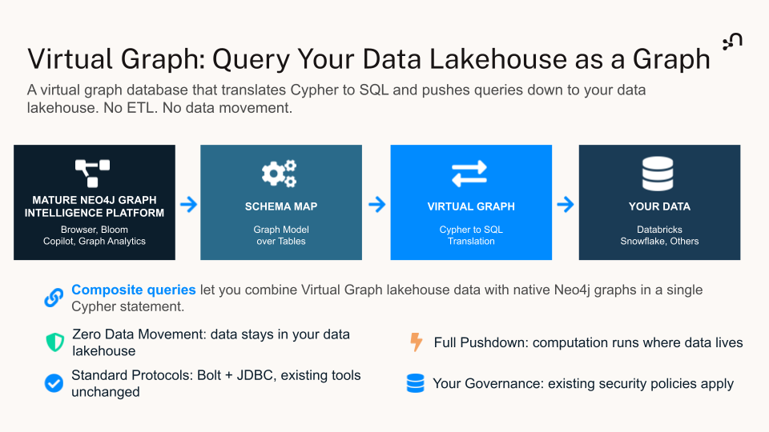

<!--
Virtual Graph translates Cypher to SQL and pushes the query down to your data lakehouse.

- **No ETL:** Data stays where it is.
- **Schema map:** It maps a graph model over your tables.
- **Composite queries:** One Cypher statement can combine lakehouse data with native Neo4j graphs.
- **Pushdown:** The computation runs where the data lives.
- **Protocols:** Bolt and JDBC work, so existing tools stay the same.
- **Governance:** Your existing security policies apply.
- **Sources today:** Databricks, Snowflake, and others.
-->

---

## Planned AWS Query Path: Cypher Through Athena to S3 Tables

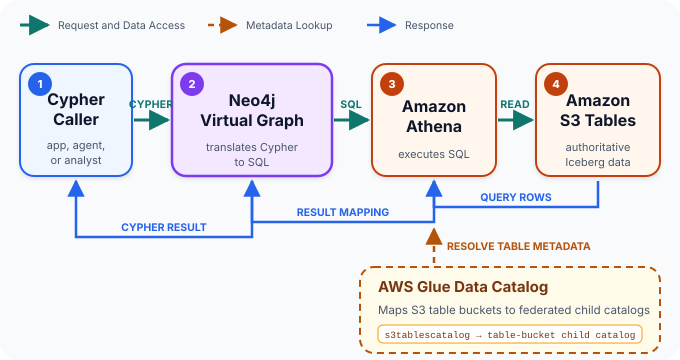

**Read in place:** Virtual Graph queries current S3 Tables data without materializing a second copy in Neo4j.

<!--
This is the planned AWS path for a Cypher query.

- **Steps:** Cypher goes to Virtual Graph, then Athena, then S3 Tables.
- **Benefit:** The query reads current data. Neo4j holds no second copy.
- **Next slide:** What each component does.
-->

---

<style scoped>
small { font-size: 16px; }
</style>

## What Each Component Does in the Virtual Graph Path

- **Translate:** Virtual Graph turns Cypher into SQL and maps the returned rows back to a Cypher result.
- **Execute:** Athena runs the SQL against the table bucket.
- **Resolve:** Glue exposes each table bucket as a child federated catalog under `s3tablescatalog`.
- **Govern:** IAM or Lake Formation permissions control access to catalog and table resources.
- **Store:** S3 Tables remains the authoritative source.

<small>**Public preview:** Snowflake, Databricks, and Google BigQuery. **Planned for AWS:** Athena, AWS Glue Data Catalog, and Amazon S3 Tables.</small>

<!--
Virtual Graph lets you query S3 Tables with Cypher. The data stays in S3.

- **Status:** The AWS path is planned. Public preview covers Snowflake, Databricks, and Google BigQuery today.
- **Flow:** Cypher becomes SQL, Athena runs it, and the rows come back as a Cypher result.

Sources: https://neo4j.com/blog/auradb/neo4j-virtual-graph-is-now-in-public-preview/,
https://docs.aws.amazon.com/athena/latest/ug/gdc-register-s3-table-bucket-cat.html,
and https://docs.aws.amazon.com/glue/latest/dg/enable-s3-tables-catalog-integration.html
-->

---

## Choose the Execution Path That Fits the Workload

| Workload | Recommended path | Execution |
| --- | --- | --- |
| **Query current S3 Tables data without copying it**<br>*Planned* | Cypher through Virtual Graph | Athena queries the table-bucket child catalog mounted in AWS Glue Data Catalog. |
| **Run frequent, low-latency traversals or graph algorithms** | Materialize selected data in Neo4j | Neo4j executes Cypher against the persisted graph. |

<!--
Pick the path that matches the workload.

- **Current data, no copy:** Use Virtual Graph. Athena runs the query. This path is planned.
- **Frequent, low-latency traversals or graph algorithms:** Load the selected data into Neo4j. Neo4j runs Cypher on the stored graph.
-->

---

## Connecting Amazon Quick and Neo4j with MCP

Graph context for the enterprise AI assistant.

<!--
This section connects Neo4j to Amazon Quick through MCP.

- **Order:** What MCP is, the Neo4j tools, how the server is hosted, then Quick itself.
-->

---

## Model Context Protocol (MCP)

**MCP** is an open standard that defines how AI agents discover and use external tools.

```
AI Assistant or Agent  ←→  MCP Server  ←→  Data Source
                           (Neo4j MCP)     (Neo4j Aura)
```

- **Client:** The assistant or agent asks the MCP server which tools it offers.
- **MCP server:** The server translates between the protocol and the native API.
- **Data source:** Neo4j, a REST API, or a file system holds the data.

Any MCP-compatible client connects to any MCP-compatible server.

<!--
MCP is an open standard. It gives agents one way to find and use tools.

- **Client:** The assistant or agent asks the server which tools it has.
- **MCP server:** It translates between the protocol and the native API.
- **Data source:** Neo4j, a REST API, or a file system.
- **Benefit:** Any MCP client works with any MCP server.
-->

---

## Neo4j MCP Server Tools

The Neo4j MCP Server exposes two tools in read-only mode:

| Tool | Description |
|------|-------------|
| **`get_neo4j_schema`** | Reads the graph schema: node labels, relationship types, and properties. The format is token-efficient for LLM use. |
| **`read_neo4j_cypher`** | Executes a read-only Cypher query. It runs `EXPLAIN` first to reject writes such as CREATE, MERGE, DELETE, and SET. |

The client discovers these tools automatically through MCP. Schema lookup shows it the Customer, Account, Phone, Address, and Merchant labels before it writes Cypher.

<!--
The server runs in read-only mode and offers two tools.

- **get_neo4j_schema:** Returns labels, relationship types, and properties in a format that uses few tokens.
- **read_neo4j_cypher:** Runs a read-only Cypher query. It runs EXPLAIN first and rejects writes such as CREATE, MERGE, DELETE, and SET.
- **Discovery:** The client finds both tools through MCP. It reads the schema before it writes Cypher.
-->

---

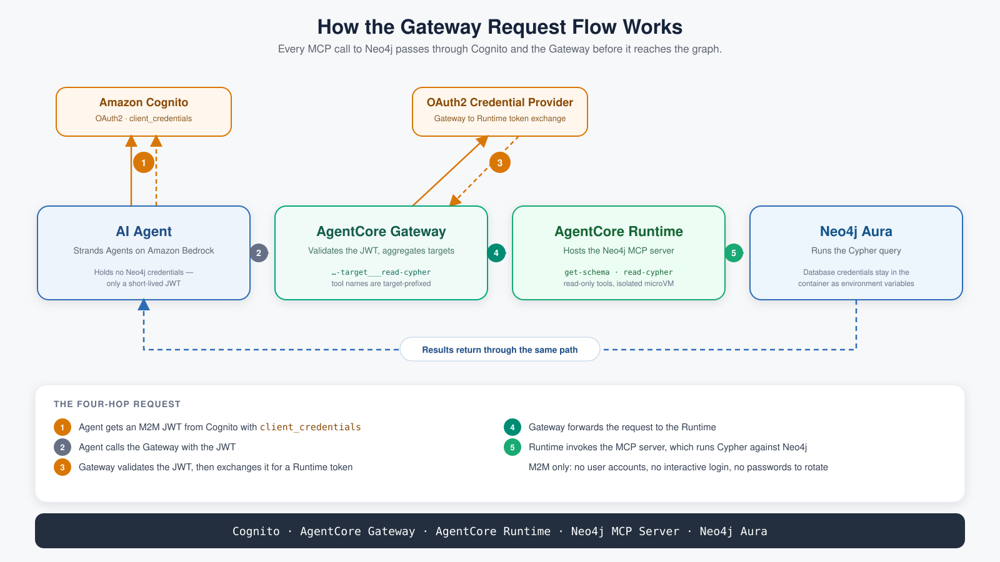

<!--
The client never holds Neo4j credentials. It only talks to the Gateway.

- **Cognito:** It trades a client ID and secret for a JWT.
- **Gateway:** It checks the JWT and sends each tool call to the runtime. It also gets its own OAuth token for the runtime, so callers see one endpoint.
- **Runtime:** It hosts the read-only Neo4j MCP Server over Streamable HTTP.
- **Secrets Manager:** It stores the Neo4j password. The runtime receives it at deploy time.
- **Deploy:** ./deploy.py builds the ARM64 image, pushes it to ECR, and deploys the CDK stack. The code is in neo4j-mcp-server/.
- **Credentials:** ./deploy.py credentials writes the Gateway URL, client ID, client secret, and token URL. The Quick connection slide uses them.
-->

---

<style scoped>
small { font-size: 16px; }
</style>

## What Amazon Quick Is

Amazon Quick is the AI assistant for work, on web and desktop. As an MCP client, it can call the Neo4j tools from the previous slides.

- **Chat and Spaces:** Answers are grounded in connected data such as S3, SharePoint, Slack, and Salesforce.
- **Quick Sight:** Dashboards and natural-language Q&A run over sources such as Athena and Redshift.
- **Flows and automation:** Quick handles repetitive tasks and multi-step processes across apps.
- **Actions:** Quick acts on connected systems through built-in connectors and MCP servers.

<small>Sources: [Amazon Quick](https://aws.amazon.com/quick/) and [Amazon Quick features](https://aws.amazon.com/quick/features/)</small>

<!--
Business users already ask their questions in Quick. That makes it the natural front door for graph context.

- **Naming:** Amazon Quick is the new name for Amazon Q Business. Quick Sight is the BI part of Quick.
- **Amazon Q Developer:** It is a separate product. This rename does not change it.
- **MCP:** It is the door that Neo4j comes through.
-->

---

<style scoped>
small { font-size: 16px; }
</style>

## Registering Neo4j MCP in Amazon Quick

- **Register the server:** An admin adds the Neo4j MCP endpoint as a Quick connector.
- **Tools become actions:** Quick discovers each Neo4j tool, such as schema lookup and read-only Cypher.
- **Authenticate as a service:** Quick's service-to-service option uses the same Cognito client credentials.
- **Reach it privately:** A Quick VPC connection reaches MCP servers that are not on the public internet.
- **Share the connector:** Analysts on the team use the same governed graph tools.

<small>Source: [MCP integration with Amazon Quick](https://docs.aws.amazon.com/quick/latest/userguide/mcp-integration.html)</small>

<!--
The Neo4j MCP server from the deployment slide works in Quick without changes.

- **Setup:** Point Quick at the AgentCore Gateway URL. Do this in the console. This repository does not script it.
- **Credentials:** The file from ./deploy.py credentials holds the client ID, client secret, and token URL that Quick asks for.

Limits to plan for:
- **Subscription:** MCP integration needs Quick Enterprise.
- **Servers:** Quick supports remote servers only. Use Streamable HTTP instead of SSE.
- **Timeout:** Each MCP operation stops after 60 seconds. Keep Cypher tools bounded.
- **Tool count:** Quick registers up to 100 tools per MCP server.
- **Headers:** Quick sends no custom HTTP headers. Authentication must use OAuth.
- **New tools:** Custom connectors do not pick up new tools by themselves. The owner chooses Sync after the server changes.
-->

---

## One Fraud Investigation in Amazon Quick

1. **Spot the anomaly:** A Quick Sight dashboard over the Athena Iceberg tables shows an alert spike.
2. **Ask in chat:** The analyst asks Quick who is connected to the flagged accounts.
3. **Traverse the graph:** Quick calls the Neo4j MCP tools and traces the ACC-1001 ⇄ ACC-2047 ring.
4. **Explain the finding:** Graph context links the ring to typologies, KYC documents, and prior cases.
5. **Share the result:** Quick turns the answer into a case summary for the team.

**One assistant, both data paths:** Quick Sight counts the activity. Neo4j explains how it connects.

<!--
This example ties back to the SQL versus Cypher slide.

- **Counting:** Athena and Quick Sight count the activity.
- **Connections:** The Neo4j MCP tools follow the links between accounts.
- **Analyst view:** The analyst stays in Quick. The Gateway and MCP server own database access, so the analyst needs no Neo4j credentials.

Source: demos/fraud-amazon-quick/README.md.
-->

---

## The Same Pattern Applies to Other Finance Use Cases

- **Counterparty exposure:** Graph traversal shows who owes whom, directly and indirectly.
- **Fraud rings:** Shared identifiers and circular transfers expose coordinated groups.
- **Contagion risk:** Following links shows how one failure spreads through the network.
- **KYC and AML:** Ownership chains and transaction paths show who really sits behind an account.

<!--
The fraud demo is one instance of a general pattern. The data is a set of entities and the links between them, and the hard question is about the links.

- **Counterparty exposure:** A table shows the direct counterparties of a firm. A graph follows obligations through several hops, so you can see exposure to a counterparty's counterparties. Aggregate the paths to find concentration, such as many positions that all depend on one institution.
- **Fraud rings:** Individual accounts look normal. The ring shows up when accounts share a phone, address, or device, or when money loops back to its origin. Community detection and shortest-path queries find these groups without knowing the shape in advance.
- **Contagion risk:** Model institutions, accounts, or assets as nodes and exposures as relationships. Start from a stressed node and traverse outward to see what it reaches and how fast. Graph algorithms such as centrality rank the nodes whose failure would spread furthest.
- **KYC and AML:** Beneficial ownership is a chain of companies and people, often several layers deep. Traversal resolves the ultimate owner behind an account, and screens that owner against sanctions lists and prior cases. Transaction paths support AML monitoring by tracing where funds came from and where they went.

The architecture stays the same for each. Athena and the lakehouse count the activity, Neo4j follows the connections, and the agent reaches the graph through MCP.
-->

---

## Building GraphRAG Agents on AWS

<!--
This section shows how to give an agent graph-based retrieval.

- **Problem:** Plain RAG adds noise to the context.
- **Fix:** GraphRAG patterns, built as agent tools.
- **After that:** Memory.
-->

---

## Context Rot: More Context, Worse Answers

Too much irrelevant context **degrades** LLM performance.

- RAG retrieves chunks that are *similar*, not *relevant*.
- The context window fills with tangential noise.
- The model gets distracted or misled.

"Context rot": retrieval of tangents that rots response quality. This is the problem GraphRAG's traversal step is built to avoid.

<!--
More context can make answers worse.

- **Similar is not relevant:** RAG retrieves chunks that look alike, and some of them do not help.
- **Noise:** Those chunks fill the context window with loosely related text.
- **Effect:** The model gets confused or misled, so the answer quality drops.
- **Next slide:** GraphRAG follows connections to related facts instead of adding more look-alike text.
-->

---

## The Shift to GraphRAG

- **One step past vector search:** a graph traversal follows the matched text to the facts connected to it.
- **Stored links:** the graph records how facts connect, such as which account a transaction belongs to.
- **Connected, verifiable facts:** the graph stores facts you can check, not just pattern-matched chunks of text.
- **Traceable:** every answer can walk back to the document behind it.
- **Fewer tokens:** the agent receives the facts an answer needs, not everything that looked similar.

The agent answers from evidence the graph can defend.

<!--
GraphRAG adds one step after vector search. It follows links to connected facts.

- **Traversal:** The graph walks from the matched text to related facts.
- **Stored links:** The graph records how facts connect, such as which account a transaction belongs to.
- **Verifiable:** The graph holds facts you can check.
- **Traceable:** Every answer walks back to its source document.
- **Fewer tokens:** The agent gets the facts it needs and nothing else.
-->

---

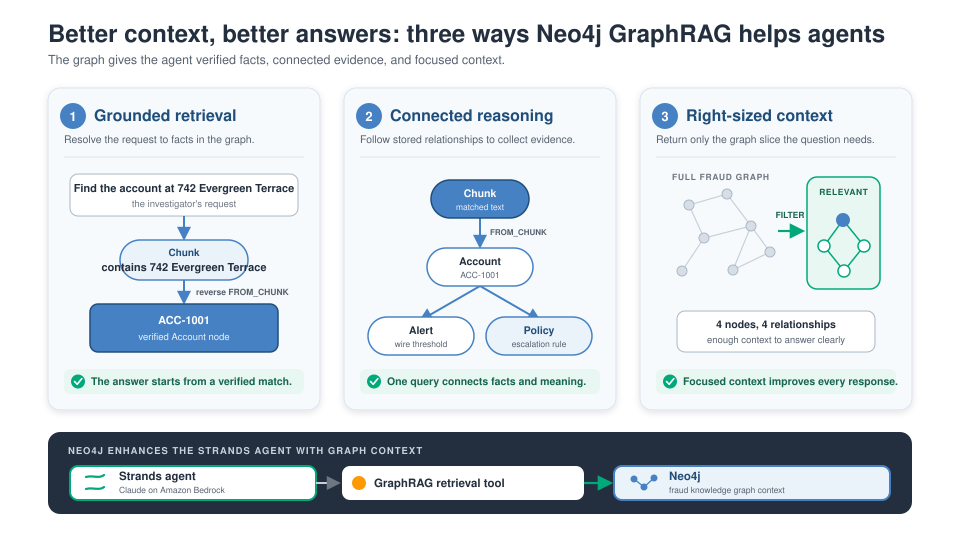

<!--
The graph helps an agent in three ways.

- **Grounded retrieval:** A request such as "find the account at 742 Evergreen Terrace" matches a chunk of text. The graph resolves it to the verified account node ACC-1001.
- **Connected reasoning:** One query follows stored relationships from the account to its alert and its escalation policy.
- **Right-sized context:** The graph returns only the slice the question needs. In this example that is 4 nodes and 4 relationships.
- **Agent:** A Strands agent on Claude in Bedrock calls a GraphRAG retrieval tool backed by Neo4j.
-->

---

## GraphRAG Patterns

Four patterns for building GraphRAG, all built around one graph.

- **Vector search:** the system finds the passages closest in meaning to the question, then narrows them with graph and metadata filters.
- **Hybrid search:** the system combines vector search with full-text keyword search.
- **Query generation:** the system writes Cypher queries dynamically, also called text-to-Cypher.
- **Graph enrichment:** the system adds community summaries, graph embeddings, and PageRank scores to improve results.

<!--
Four patterns cover most GraphRAG builds. All four use the same graph.

- **Vector search:** Find passages close in meaning to the question. Narrow them with graph and metadata filters.
- **Hybrid search:** Combine vector search with full-text keyword search.
- **Query generation:** The system writes Cypher on the fly. This is also called text-to-Cypher.
- **Graph enrichment:** Add community summaries, graph embeddings, and PageRank scores.
- **Next slide:** A walk through the vector plus Cypher flow.
-->

---

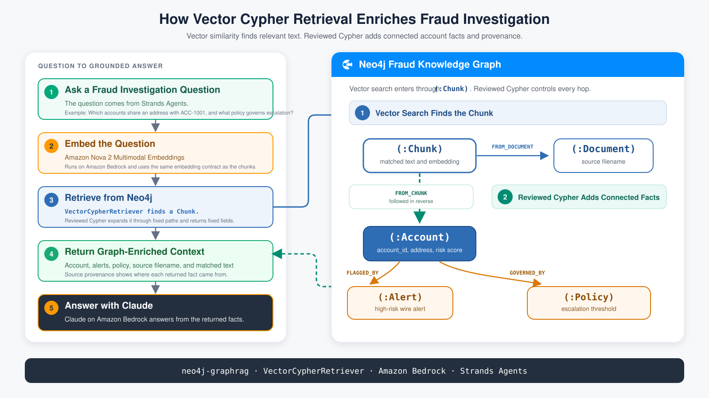

<!--
Vector similarity finds the text. Reviewed Cypher adds the connected facts.

1. **Ask:** A Strands agent sends a question, such as which accounts share an address with ACC-1001 and which policy governs escalation.
2. **Embed:** Amazon Nova 2 Multimodal Embeddings on Bedrock embeds the question. It uses the same embedding contract as the stored chunks.
3. **Retrieve:** VectorCypherRetriever finds a Chunk. Reviewed Cypher expands it through fixed paths and returns fixed fields.
4. **Enrich:** The result holds the account, alerts, policy, source filename, and matched text. Provenance shows where each fact came from.
5. **Answer:** Claude on Bedrock answers from the returned facts.
-->

---

## GraphRAG Becomes a Strands Agent Tool

- **GraphRAG patterns fit as tools:** Each GraphRAG pattern can be wrapped as a Strands tool. The agent calls it to pull connected context into the conversation.
- **Deploy to AgentCore:** A finished Strands agent deploys to AgentCore Runtime. AgentCore Gateway can expose Neo4j MCP tools to it.
- **The model picks, the tool governs:** The model decides when to call the tool. The tool's reviewed Cypher decides what data comes back.
- **Focused results:** The tool returns a small, bounded result, so the agent's context stays clean.

<!--
The audience already knows Strands. Each GraphRAG pattern becomes one tool.

- **Tool examples:** Vector search plus traversal, text-to-Cypher, or a GDS-backed query.
- **Focused results:** The tool returns a small result. This keeps the context clean and answers the context rot problem from the start of the section.
-->

---

## Agent Memory with Neo4j

Tools answer the current question. Memory carries context across turns and sessions.

<style scoped>
small { font-size: 16px; }
</style>

<small>[Library documentation](https://neo4j.com/labs/agent-memory/) · [GitHub project](https://github.com/neo4j-labs/agent-memory)</small>

<!--
Tools answer the current question. Memory keeps context across turns and sessions.

- **Next:** The context graph, what memory stores, and why a graph fits.
-->

---

## A Context Graph Is Persistent Connected Memory for Agents

One queryable graph links three kinds of memory.

- **Long-term knowledge:** Entities, relationships, business meaning, policies, and authoritative facts.
- **Short-term state:** Conversation, user intent, task, workflow state, and tool observations.
- **Reasoning memory:** Decisions linked to their situation, rationale, actions, outcomes, and precedents.

**Compounding context:** Each request retrieves relevant context and adds new state or traces. The graph persists across requests.

<!--
Most agents forget everything between sessions until you design memory on purpose.

- **Short-term state:** It lets the agent answer "what's the current balance?" after you already named an account.
- **Long-term knowledge:** It holds facts and preferences that outlive one conversation. It also records what changed and when.
- **Reasoning memory:** It keeps the tool calls, decisions, and outcomes. This is evidence for debugging and review.

Sources: https://neo4j.com/blog/agentic-ai/what-is-context-graph/,
https://neo4j.com/blog/agentic-ai/context-graph-ai-agent-memory/, and
https://neo4j.com/blog/agentic-ai/hands-on-with-context-graphs-and-neo4j/
-->

---

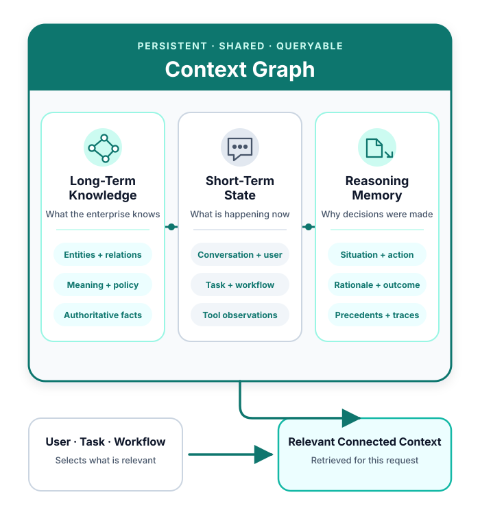

<!--
The context graph is persistent, shared, and queryable. It holds three kinds of memory.

- **Long-term knowledge:** What the enterprise knows. Entities, relations, meaning, policy, and authoritative facts.
- **Short-term state:** What is happening now. The conversation, the user, the task, the workflow, and tool observations.
- **Reasoning memory:** Why decisions were made. Situation, action, rationale, outcome, precedents, and traces.
- **Selection:** The user, task, and workflow decide which context is relevant for each request.
-->

---

## Agent Memory Preserves Facts, Context, and Reasoning

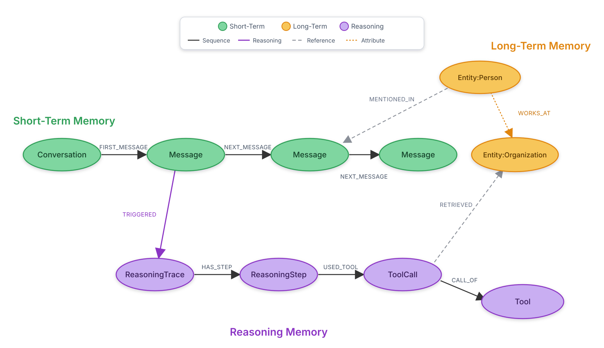

**Long-term model:** POLE+O represents Person, Object, Location, Event, and Organization. Temporal validity records when a fact was true.

<!--
The agent memory library stores facts, context, and reasoning in the graph.

- **POLE+O:** The long-term model. It covers Person, Object, Location, Event, and Organization.
- **Temporal validity:** The graph records when a fact was true.

Source: https://github.com/neo4j-labs/agent-memory
-->

---

<style scoped>
ul, p { font-size: 25px; }
</style>

## Why Graphs for Agent Memory

- **Relationships are first-class.** A conversation, a preference, and a transaction can all point to the same real-world record.
- **Multi-hop queries combine memory with domain facts** without joining separate data stores in application code.
- **Provenance stays traversable.** A stored memory can point back to the exact source that produced it.
- **Graph identity prevents copies.** One canonical record accumulates facts, conversations, preferences, and actions instead of scattering them.
- **Memory is scoped to individual users.** Each user's memory stays isolated across sessions.
- **History is retained.** Outdated memory is superseded without erasing its correction path.

**Store deliberately:** Entity extraction identifies what a turn is about. Policy or confirmation decides what becomes durable memory.

<!--
A graph suits agent memory because memory is full of links.

- **Relationships:** A conversation, a preference, and a transaction can point to the same real-world record.
- **Multi-hop:** One query combines memory with domain facts. The application does not join separate stores.
- **Provenance:** A memory points back to the source that produced it.
- **One record:** A single canonical record collects facts, conversations, preferences, and actions.
- **Per-user scope:** Each user's memory stays isolated across sessions.
- **History:** New memory supersedes old memory. The correction path stays.
- **Store deliberately:** Entity extraction finds what a turn is about. Policy or confirmation decides what becomes durable.
-->

---

## Example: The Fraud Memory Agent

The agent uses **NAMS**, the Neo4j Hosted Agent Memory Service.

- **Every turn is captured:** The agent records each user and assistant message in NAMS, tagged with the user and session.
- **Entities are extracted:** NAMS extracts entities from each message on the server side.
- **Tool calls become reasoning traces:** Each MCP tool call is saved as a step in a reasoning trace.
- **Graph and memory stay separate:** The Neo4j MCP server owns access to the fraud graph, and NAMS owns memory storage. The agent holds no Neo4j credentials.

<!--
This demo captures memory. It does not feed recalled memory back into prompts.

- **Why:** A shared NAMS workspace stays safe during synthetic multi-user load runs.
- **Recall:** The library supports recall. This demo does not show it.

Source: demos/fraud-amazon-quick/fraud-memory-agent/README.md and
server/runtime_app.py.
-->

---

## These Capabilities Meet Inside an AWS-Hosted Agent Workflow

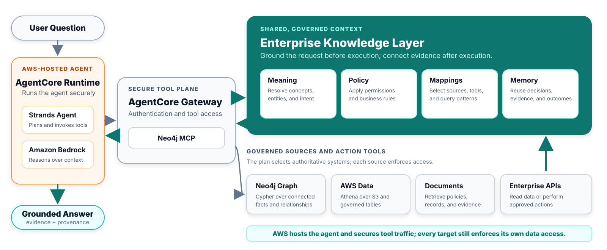

**Security boundary:** Gateway supports OAuth 2.0 for tool traffic. Targets enforce data access.

<!--
This slide puts the pieces together in one agent workflow.

- **Gateway:** It protects tool traffic with OAuth 2.0.
- **Targets:** They enforce data access.

Sources: https://docs.aws.amazon.com/bedrock-agentcore/latest/devguide/gateway.html
and https://docs.aws.amazon.com/bedrock-agentcore/latest/devguide/gateway-target-MCPservers.html
-->

---

## Together, Connected Knowledge Grounds the AWS Agent Stack


<!--
This is the full stack from the start of the talk, now with every piece explained.

- **AWS:** It stores, governs, and analyzes the data. It also hosts the models and agents.
- **Neo4j:** It adds MCP tools, connected facts, graph analytics, and agent memory.
- **Result:** Agents answer from connected, governed knowledge.
-->

---

## Takeaways

- **Neo4j connects what AWS stores:** AWS stores, governs, and analyzes the data. Neo4j follows the relationships in it.
- **GraphRAG counters context rot:** Vector search finds the starting point. A reviewed traversal returns only the connected facts.
- **GraphRAG is an agent tool:** Strands agents on Bedrock call it directly or through Neo4j MCP on AgentCore Gateway.
- **Graph memory persists:** Conversations, entities, and reasoning traces stay connected and inspectable across sessions.

<!--
Four points to remember.

- **Connect:** AWS stores, governs, and analyzes the data. Neo4j follows the relationships in it.
- **Context rot:** Vector search finds the starting point. A reviewed traversal returns only the connected facts.
- **Agent tool:** Strands agents on Bedrock call GraphRAG directly or through Neo4j MCP on AgentCore Gateway.
- **Memory:** Conversations, entities, and reasoning traces stay connected across sessions.
-->
