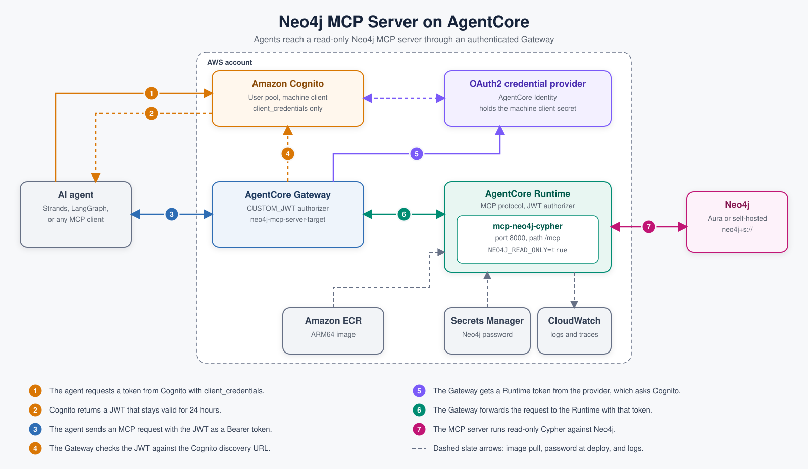
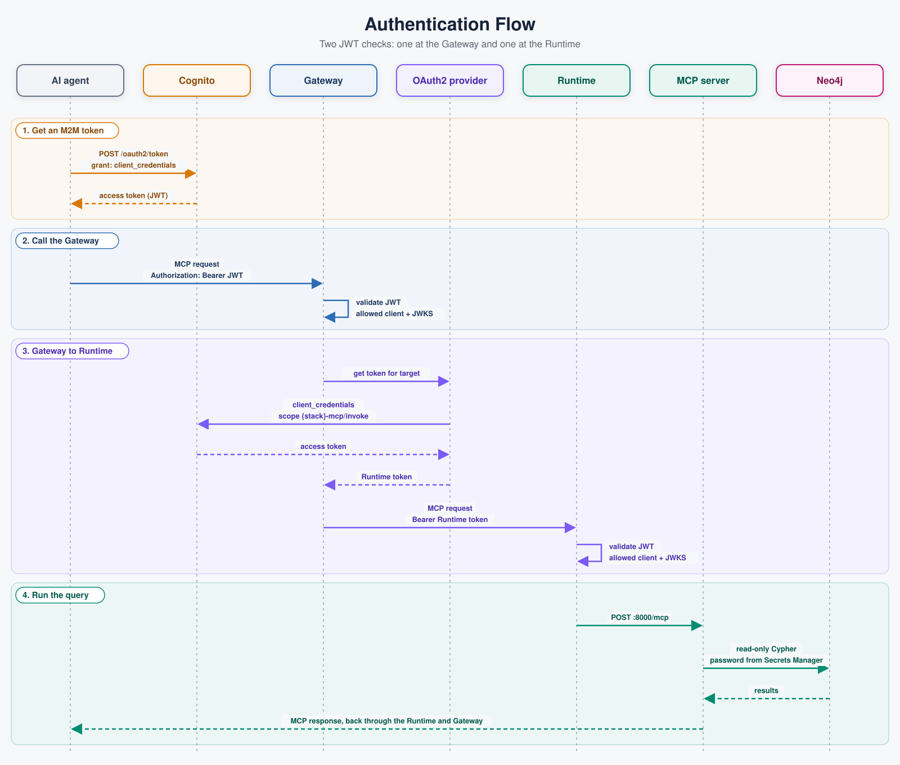
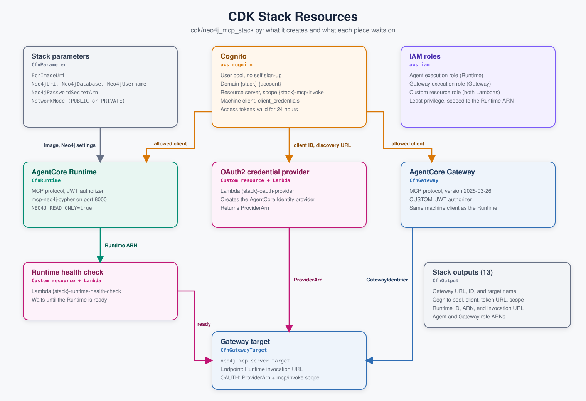

# Architecture

The Neo4j MCP server runs as a container on Amazon Bedrock AgentCore Runtime. Agents never call the Runtime directly in normal use. They get a machine token from Amazon Cognito and call an AgentCore Gateway, which forwards each request to the Runtime with a token of its own. The MCP server then runs read-only Cypher against Neo4j. One CDK stack, `cdk/neo4j_mcp_stack.py`, creates every AWS resource, and `deploy.py` builds the image and deploys the stack.

## Request path



- **Agent:** Any MCP client can act as the agent. The samples in this repository use Strands and LangGraph.
- **Cognito:** The user pool has one machine client and no users. The client uses the `client_credentials` grant, and its access tokens stay valid for 24 hours.
- **Gateway:** The Gateway checks each JWT with a `CUSTOM_JWT` authorizer. It accepts only the machine client and reads signing keys from the Cognito discovery URL.
- **Gateway target:** The target named `neo4j-mcp-server-target` points at the Runtime invocation URL. It gets its token from an OAuth2 credential provider in AgentCore Identity.
- **Runtime:** The Runtime runs the `mcp-neo4j-cypher` server with the MCP protocol on port 8000 at `/mcp`. It has its own JWT authorizer for the same machine client.
- **Neo4j:** The database can be Aura or self-hosted. The server sets `NEO4J_READ_ONLY=true`, so write tools are off.
- **Supporting services:** The Runtime pulls its ARM64 image from Amazon ECR and sends logs and traces to CloudWatch. CloudFormation reads the Neo4j password from Secrets Manager at deploy time.

## Authentication flow



| Phase | What happens |
|-------|--------------|
| 1. Get an M2M token | The agent posts to the Cognito `/oauth2/token` endpoint with its client ID and secret. Cognito returns a JWT. |
| 2. Call the Gateway | The agent sends the MCP request with `Authorization: Bearer <JWT>`. The Gateway validates the token. |
| 3. Gateway to Runtime | The Gateway asks the OAuth2 credential provider for a token with the `{stack}-mcp/invoke` scope. The provider gets it from Cognito with the machine client. The Runtime validates that token. |
| 4. Run the query | The Runtime passes the call to the MCP server on port 8000. The server queries Neo4j, and the response returns along the same path. |

- **Two checks:** The Gateway and the Runtime both validate a JWT. A token from another Cognito client fails at both.
- **Neo4j password:** `deploy.py` stores the password in Secrets Manager as `{stack}/neo4j-password`. The stack receives only the secret ARN. CloudFormation resolves it into the `NEO4J_PASSWORD` variable with a `{{resolve:secretsmanager:...}}` dynamic reference, so the password never appears as a parameter or on the `cdk` command line.

## CDK stack



The Gateway target is created last. It waits for the Gateway, for the OAuth2 credential provider, and for the health check custom resource to report that the Runtime is ready.

### Parameters

| Parameter | Description |
|-----------|-------------|
| `EcrImageUri` | The full ECR image URI that the Runtime runs |
| `Neo4jUri` | The Neo4j connection URI |
| `Neo4jDatabase` | The Neo4j database name |
| `Neo4jUsername` | The Neo4j user |
| `Neo4jPasswordSecretArn` | The ARN of the Secrets Manager secret that holds the password |
| `NetworkMode` | The Runtime network mode, `PUBLIC` or `PRIVATE`. The default is `PUBLIC`. |

Every resource name derives from the stack name. `cdk/naming.py` checks each derived name against its AWS length limit before the build starts.

### Cognito

- **User pool:** The pool `{stack}-user-pool` has self sign-up turned off. It holds no users.
- **Domain:** The domain prefix is `{stack}-{account}`. The domain hosts the OAuth2 token endpoint.
- **Resource server:** The resource server `{stack}-mcp` defines the `invoke` scope.
- **Machine client:** The client `{stack}-machine-client` has a generated secret and uses only the `client_credentials` grant.

### IAM

- **Agent execution role:** The Runtime runs as this role. Its inline policy covers ECR image pulls, CloudWatch Logs under `/aws/bedrock-agentcore/`, X-Ray, CloudWatch metrics in the AgentCore namespace, and workload access tokens. Its trust policy limits it to this account.
- **Gateway execution role:** The Gateway runs as this role. It can read OAuth2 tokens from the credential provider and token vault. It can invoke only this stack's Runtime. It also has Bedrock model access for semantic tool search.
- **Custom resource role:** Both Lambda functions run as this role. It can read the machine client secret from Cognito, manage the OAuth2 credential provider, and read the status of this stack's Runtime.

### Lambda functions and custom resources

- **OAuth provider:** The function `{stack}-oauth-provider` creates, updates, and deletes the OAuth2 credential provider. It reads the client secret from Cognito itself and returns the provider ARN to the stack.
- **Runtime health check:** The function `{stack}-runtime-health-check` polls the Runtime until it reports ready. The Gateway target depends on it, which keeps the target from pointing at a Runtime that cannot answer yet.

Both functions run Python 3.12. The OAuth provider times out after 5 minutes and the health check after 10.

### AgentCore

- **Runtime:** The `CfnRuntime` runs the container from `EcrImageUri` with the MCP protocol. It sets the Neo4j connection, HTTP transport on `0.0.0.0:8000/mcp`, and read-only mode through environment variables.
- **Gateway:** The `CfnGateway` is named `{stack}-gateway`. It speaks MCP version `2025-03-26` and uses the `CUSTOM_JWT` authorizer.
- **Gateway target:** The `CfnGatewayTarget` named `neo4j-mcp-server-target` connects the Gateway to the Runtime. It authenticates with the OAuth2 credential provider and the `{stack}-mcp/invoke` scope.

### Stack outputs

| Output | Description |
|--------|-------------|
| `GatewayUrl` | The MCP endpoint that agents call |
| `GatewayId` | The Gateway identifier |
| `GatewayTargetName` | The target name, which prefixes every tool name |
| `CognitoUserPoolId` | The user pool ID, used to read the client secret |
| `CognitoMachineClientId` | The machine client ID |
| `CognitoTokenUrl` | The OAuth2 token endpoint |
| `CognitoScope` | The OAuth2 scope, such as `neo4j-mcp-server-mcp/invoke` |
| `CognitoDiscoveryUrl` | The OpenID discovery URL for the user pool |
| `MCPServerRuntimeId` | The Runtime ID |
| `MCPServerRuntimeArn` | The Runtime ARN |
| `MCPServerInvocationURL` | The direct Runtime URL. The ARN in it must be URL-encoded. |
| `AgentExecutionRoleArn` | The Runtime role ARN |
| `GatewayExecutionRoleArn` | The Gateway role ARN |

`./deploy.py credentials` reads these outputs to write `.mcp-credentials.json`.

## Why agents use machine login through the Gateway

The design serves agents, not people.

- **No user management:** The pool has no users. Nobody has to create users or rotate their passwords.
- **Simple auth:** Agents use client credentials. They never go through an interactive login.
- **One entry point:** The Gateway is the single front door for agents. Its logs record every call.
- **Token handling:** The Gateway gets and refreshes the Runtime token itself. Agents hold only their Cognito token.
- **Tool discovery:** The Gateway supports semantic tool search across many MCP servers. This stack leaves search off, but the Gateway role already has the Bedrock access that search needs.
- **Direct access:** The Runtime also accepts the machine client's token directly. `./cloud-http.sh` uses that path for debugging, and agents should use the Gateway.

## Why AgentCore instead of Fargate or Lambda

AgentCore Runtime, Fargate, Lambda, and EC2 can all host an MCP server. AgentCore Runtime was built to run agents and their tools. Fargate and Lambda are general-purpose compute, so you must add agent features to them yourself.

- **Session isolation:** Each AgentCore session runs in its own microVM with separate CPU, memory, and filesystem. AgentCore ends the microVM and clears its memory when the session ends. This keeps one user's data from leaking to another. Shared MCP hosting has caused real security incidents of this kind. On Fargate you would have to build this isolation yourself.
- **Long sessions:** AgentCore sessions can run for up to 8 hours. Lambda stops after 15 minutes, which is often too short for agent workflows with many tool calls. Fargate runs longer, but you manage session state and lifecycle yourself.
- **Scaling:** AgentCore scales the server up and down with demand. You do not configure auto-scaling groups or health checks.
- **Tracing:** AgentCore records traces of each interaction, including reasoning steps, tool calls, and model calls. Each trace splits into spans with timing, inputs, and outputs.
- **OpenTelemetry:** AgentCore emits telemetry in the OpenTelemetry format. Your existing monitoring tools can read it.
- **Dashboards:** AgentCore ships CloudWatch dashboards for token usage, latency, session length, and error rates.
- **Gateway:** An MCP server on AgentCore can sit behind a Gateway. Agents authenticate once to the Gateway, and the Gateway handles credentials for each backend.

Fargate or Lambda can still be the better fit in these cases:

- **Proof of concept:** Lambda charges per call, which keeps low-volume testing cheap.
- **Custom infrastructure:** Fargate gives more control when you have networking, security, or compliance needs that AgentCore does not meet.
- **Simple stateless tools:** Lambda can be simpler and cheaper for a server that wraps one API and needs no session state or tracing.

## Gateway tool names

The Gateway adds the target name and three underscores to the front of each tool name. AWS documents this behavior.

| Server tool | Gateway tool |
|-------------|--------------|
| `get_neo4j_schema` | `neo4j-mcp-server-target___get_neo4j_schema` |
| `read_neo4j_cypher` | `neo4j-mcp-server-target___read_neo4j_cypher` |

Write tools do not appear because the server runs with `NEO4J_READ_ONLY=true`.

- **Name collisions:** The prefix keeps tool names unique when one Gateway fronts several MCP servers.
- **Routing:** The Gateway reads the prefix to choose the target for each call.
- **Policies:** Cedar policies use the prefixed name as the action.

The clients in this repository discover the real names at run time. They call `tools/list` and map each base name to its full name, as `client/mcp_operations.py` does:

```python
async def get_tool_map(session: ClientSession) -> dict[str, str]:
    """Build a map from base tool names to actual (possibly prefixed) names."""
    result = await session.list_tools()
    tool_map = {}
    for tool in result.tools:
        full_name = tool.name
        # Extract base name (after ___ prefix if present)
        if "___" in full_name:
            base_name = full_name.split("___", 1)[1]
        else:
            base_name = full_name
        tool_map[base_name] = full_name
    return tool_map
```

The same map works through the Gateway, where names carry the prefix, and against the Runtime directly, where they do not. It also respects the MCP rule that tool names match exactly.

The same pattern appears in other code:

| Code | File | Location |
|------|------|----------|
| `patterns/gateway-rbac-interceptor` in this repository | `client/demo.py` | Line 315 |
| AWS sample shopping-concierge-agent | `gateway_client.py` | Line 142 |
| AWS sample AWS-operations-agent | `mcp-tool-handler.py` | Lines 8-10 |

## Hyphens in tool names

The prefixed names contain hyphens, so the model must accept hyphens in tool names.

- **Claude:** Claude on Bedrock accepts names such as `neo4j-mcp-server-target___read_neo4j_cypher`.
- **Nova:** Nova rejects hyphens. It requires names that match `[a-zA-Z][a-zA-Z0-9_]*`.
- **MCP spec:** The MCP spec allows `[a-zA-Z0-9_.-]{1,128}`.

This project uses Claude, so it keeps the server's tool names as they are.

## Troubleshooting

**Deployment fails with "Parameters do not exist in template"**

This happens when you update a stack that had different parameters. Delete the stack and deploy again:

```bash
./deploy.py cleanup
./deploy.py
```

**Deployment ends in ROLLBACK_COMPLETE**

`deploy.py` handles this case once. It deletes the failed stack, waits 30 seconds, and deploys again. If the retry fails, check the CloudWatch logs for the Runtime and the custom resource Lambdas.

**Test fails with an authentication error or an expired token**

1. Regenerate the credentials with `./deploy.py credentials`.
2. Check the token expiry with `./cloud.sh token`.
3. Confirm the stack deployed with `./deploy.py status`.

**Neo4j connection fails**

`deploy.py` tests the Neo4j connection with `cypher-shell` before it builds anything. It skips the test with a warning when `cypher-shell` is not installed.

1. Check that `NEO4J_URI` is correct. Aura URIs start with `neo4j+s://`.
2. Check `NEO4J_USERNAME` and `NEO4J_PASSWORD` in `.env`. `deploy.py` copies the password into Secrets Manager on each full deploy.
3. Make sure the database is running and reachable.
4. Check the CloudWatch logs for the AgentCore Runtime.

**Build fails on Apple Silicon**

`deploy.py` builds with `docker buildx build --platform linux/arm64`. If buildx has no usable builder, create one:

```bash
docker buildx create --use
docker buildx inspect --bootstrap
```

**CDK is not bootstrapped**

`deploy.py` bootstraps CDK on its own when the `CDKToolkit` stack is missing. It uses the `PowerUserAccess` and `IAMFullAccess` managed policies instead of `AdministratorAccess`, because organization SCPs often deny `AdministratorAccess`. Set `CDK_BOOTSTRAP_EXECUTION_POLICIES` to use other policies.

## Resources

- [mcp-neo4j](https://github.com/neo4j-partners/mcp-neo4j) holds the `mcp-neo4j-cypher` server that this stack runs.
- [Amazon Bedrock AgentCore](https://docs.aws.amazon.com/bedrock-agentcore/)
- [AgentCore Gateway](https://docs.aws.amazon.com/bedrock-agentcore/latest/devguide/gateway.html)
- [AgentCore CDK samples](https://github.com/awslabs/amazon-bedrock-agentcore-samples/tree/main/04-infrastructure-as-code/cdk)
- [AWS CDK Python reference](https://docs.aws.amazon.com/cdk/api/v2/python/)
- [Model Context Protocol](https://modelcontextprotocol.io/)
